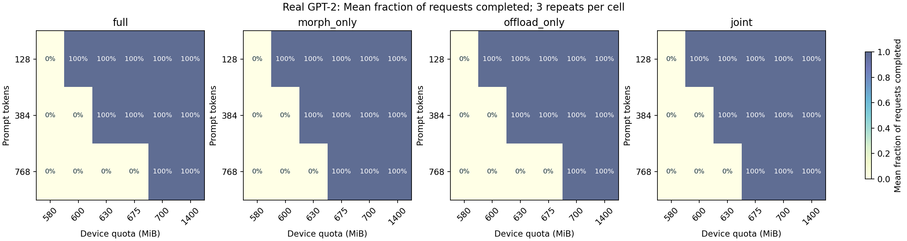
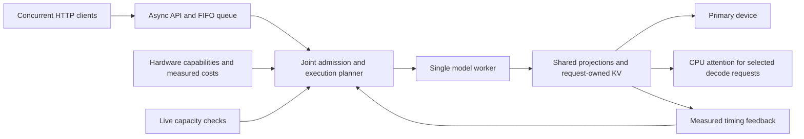

# PrismServe

**Hardware-profile-driven control of layer precision and CPU attention for language-model serving.**

**Quick overview:** read the [project summary](SUMMARY.md) for the research question, what we built, key experiments, results and deliverables.

PrismServe is a course research prototype for DA4022, Hardware Aware Deep Learning, IIT Guwahati. It independently implements ideas inspired by **MorphServe (MLSys 2026)** and **NEO (MLSys 2025)** and evaluates when combining them helps memory feasibility, latency and generation quality.

The project runs actual **124M-parameter GPT-2**, shares model computation across concurrent requests, and chooses quantized layers and CPU-attention placement through a common resource contract. It includes **116 passing tests**, archived experiment traces, a live demonstration, and detailed technical reports.

> Hardware-agnostic describes the controller interface. Actual portability was tested on CPU and CUDA on one laptop. The reference INT4 path unpacks weights for floating-point matmul, and CPU attention is synchronous. This is not an optimized production server or a reproduction of either paper's complete system.

## What is implemented

- **Reversible packed INT4:** selected transformer-block projections use real packed weights and retained FP32 recovery copies.
- **Persistent CPU attention:** eligible decode requests keep their KV history and execute attention on the host while dense projections stay on the primary device.
- **Continuous batching:** independent request caches share dense transformer projections; chunked prefill and cached decode progress through one model worker.
- **Measured joint control:** device-specific calibration, live memory checks, future KV reservations, transition accounting, feedback, decision reuse and a conservative FP32 fallback.
- **Concurrent HTTP serving:** asynchronous completion handlers share a bounded queue and the model worker.
- **Reproducible evaluation:** source snapshots, pinned model provenance, dataset attribution, complete/rejected request accounting and separate teacher-forced quality audits.

## Main result: capacity improves at a measurable quality cost

The final study performs **216 actual serving runs** across six memory quotas, three prompt lengths, four policies and three repeats. Each run submits four requests with 16 output tokens.

Lowest **tested** quota completing every request in every repeat:

| Prompt tokens | FP32 | Quantization only | CPU attention only | Joint |
|---:|---:|---:|---:|---:|
| 128 | 600 MiB | 600 MiB | 600 MiB | 600 MiB |
| 384 | 630 MiB | 630 MiB | 630 MiB | 630 MiB |
| 768 | 700 MiB | **675 MiB** | 700 MiB | **675 MiB** |

At 768 prompt tokens and 675 MiB, FP32 and offload-only reject all four requests; quantization-only and joint control complete all four in all three paired repeats. The corresponding joint quality audit raises perplexity by **2.752% on 96 held-out targets**. Joint control does not improve this sampled capacity boundary over quantization alone.



These are warm-start admission/reservation quotas, not the GPU's physical VRAM size or a cold checkpoint-loading limit. The grid records **552 completed requests and 312 explicit rejections**; rejected work counts as SLO failure and has no first-token latency observation. See the [complete results](results/capacity_frontier/report.md) and [protocol](docs/capacity_frontier.md).

Other findings are retained, including negative results:

- Optimized FP32 has the highest mean throughput in all three final M10 scenarios.
- Optimized joint control stays below 5% control overhead in 15/15 final M10 repetitions; the worst is 4.97%.
- Fresh calibration reduces static prediction MAE from 71.88 to 10.31 ms on identical executed batches. Simple feedback reaches 4.55 ms and outperforms phase-specific feedback at 5.54 ms.
- CPU/CUDA FP32 greedy outputs match at 96/96 compared positions in the smaller portability workload.
- Early-prefill quantization can affect later FP32 outputs through retained KV history: the controlled 2048-target audit increases perplexity by 0.881% after restoration.

## Architecture



One GPT-2 iteration performs **48 dense projection calls across 12 blocks**, independent of the number of requests sharing that iteration. Attention remains ragged and request-specific. Weight precision is global to an iteration; cache placement is selected per request. Resource feasibility is checked even when a scheduling decision is reused.

## Quick start

Python **3.10+**. Clone and run commands from the repository root:

```powershell
git clone https://github.com/Vamaxi/PrismServe.git
cd PrismServe
python -m venv .venv
.\.venv\Scripts\Activate.ps1
python -m pip install -e ".[all]"
python -m prismserve doctor
```

On Linux/macOS, activate the environment with `source .venv/bin/activate`. For GPU execution, install a PyTorch build appropriate to your driver using the [official installer](https://pytorch.org/get-started/locally/) before installing the project. The archived measurements used Python 3.10.11, PyTorch 2.5.1+cu121 and an RTX 4050 Laptop GPU; [environment metadata](results/environment.json) records the other versions.

### Inspect results without model weights

This command reads saved, validated evidence and needs only Python:

```powershell
python scripts/demo_project.py --evidence-only
```

### Prepare the pretrained model

Large model/tokenizer assets are excluded from Git. Preparation uses an existing local cache when available, otherwise the explicit download flag fetches the pinned public checkpoint:

```powershell
python -m prismserve pretrained-prepare --download
python -m prismserve pretrained-generate --device cpu --prompt "Artificial intelligence can help scientists understand"
```

No API key or gated model is required. The checkpoint revision is `607a30d783dfa663caf39e06633721c8d4cfcd7e`; the [model manifest](models/gpt2/prismserve_source.json) records hashes. The small WikiText-2 validation/test prefixes and their [attribution](data/wikitext2/ATTRIBUTION.md) are already included, so dataset downloading is unnecessary for the saved protocols.

### Serve concurrent requests on your hardware

Calibrate on the execution device rather than assuming that the archived laptop timings transfer to another machine:

```powershell
python -m prismserve live-calibrate --device cuda --output results/local_live/calibration.json
python -m prismserve live-serve --device cuda --calibration results/local_live/calibration.json --policy joint
```

Use `--device cpu` for both commands to run the same serving path on CPU. In another terminal:

```powershell
python scripts/demo_concurrent.py
```

The server exposes `/health`, `/v1/models`, `/v1/completions`, `/metrics` and FastAPI's `/docs`. Its model ID is `prismserve-gpt2-batched`. Completions are **non-streaming**; recorded engine TTFT is internal token readiness, not client streaming latency.

### Run the recorded capacity demonstration

On the prepared CUDA environment used for the project:

```powershell
python scripts/demo_project.py
```

The demo distinguishes saved evidence from fresh execution. It replays FP32 and joint control at the selected tight quota, prints actual completion/rejection and precision-placement activity, then starts a temporary API server and verifies that four concurrent HTTP requests share a batch. The temporary server stops automatically. Later demo sessions write timestamped folders. This uses the archived laptop calibration and is a functional reproduction of that setup; calibrate and rerun the experiment for claims about different hardware.

## Tests and experiment verification

```powershell
# Does not overwrite the archived validation record
python -m unittest discover -s tests -v

# Verify archived traces, numerical accounting and source snapshots
python scripts/check_capacity_frontier.py --check-current
python scripts/check_validation_study.py
python scripts/check_controller_results.py
python scripts/check_live_results.py
```

The saved submission has **116 passing tests**. CUDA-dependent cases skip when CUDA is unavailable; CPU-only test runs are not GPU performance measurements. Run GPU correctness tests and timing experiments sequentially.

For a new AC-powered CUDA measurement session, write into a new folder to preserve the published evidence:

```powershell
python scripts/run_capacity_frontier.py --output results/frontier_reproduction
python scripts/check_capacity_frontier.py --output results/frontier_reproduction --check-current
```

The frontier harness calibrates freshly, checks AC power at recorded samples, uses matched workloads, and saves worker failures rather than silently accepting partial benchmarks. The [M10 protocol](docs/validation_study.md) documents repeated GPU and CPU/CUDA studies. The simulator remains available with `python -m prismserve simulate --config configs/experiment.json --output results/simulation_reproduction`; its 8B-shaped timings are analytical.

## Reports and guides

| Document | Contents |
|---|---|
| [Detailed technical report — PDF](deliverables/PrismServe_Detailed_Report.pdf) | 78 pages, 47 figures, 74 tables, equations and all 454 main-suite run records |
| [Editable detailed report — Word](deliverables/PrismServe_Detailed_Report.docx) | Editable text, diagrams and numerical tables |
| [Graph and diagram atlas](deliverables/PrismServe_Graph_and_Diagram_Atlas.pdf) | 47 figures, one enlarged figure per page |
| [Detailed report source](reports/detailed/PrismServe_Detailed_Report.md) | Markdown, PNG/SVG assets, CSV exports and generator scripts |
| [Concise final report](docs/final_report.md) / [PDF](deliverables/PrismServe_Final_Report.pdf) | Research methods, results and limitations |
| [Presentation](deliverables/PrismServe_Presentation.pptx) / [PDF](deliverables/PrismServe_Presentation.pdf) | 22 slides; [speaker-note source](docs/presentation.md) |
| [Demo and viva guide](docs/demo_and_viva.md) | Architecture walkthrough, demonstration and viva questions |
| [Research review](docs/research_review.md) | Paper mechanisms and differences from the implementation |
| [System design](docs/design.md) | Hardware contract, resource equations, decisions and metrics |
| [Repository contents and provenance](docs/repository_layout.md) | Included files, exclusions and frozen-submission verification scope |

The detailed report includes **every archived result chart**, with analytical and diagnostic evidence labeled separately. The source code and original frozen experiment snapshots are unchanged by GitHub publication; the public README and repository housekeeping are publication additions.

## Repository layout

```text
prismserve/       Model executor, quantization, controller, batching and API
configs/         Experiment grids, policies and smaller protocol pilots
tests/           Numerical, resource, scheduler, API and protocol tests
scripts/         Demos, experiments, checks, report export and packaging
docs/            Design, methods, research review, reports and viva guide
data/wikitext2/  Small attributed prefixes, original responses and hashes
models/gpt2/     Provenance manifest; pretrained assets prepared separately
results/         Accepted runs, labeled diagnostics, figures and source snapshots
reports/detailed/ Detailed companion source, vector diagrams and complete CSV tables
deliverables/    Readable reports, editable presentation and release metadata
```

Model weights, caches, debug renders, personal input PDFs and duplicate submission ZIPs are not tracked. A small independently trained decoder checkpoint is retained with its test evidence. Source snapshots and historical wheels under `results/` are intentional experiment-provenance artifacts.

## Research scope and credits

PrismServe demonstrates a common controller and real pretrained serving with explicit capacity/quality tradeoffs. Larger models, optimized INT4 kernels, asynchronous CPU/GPU overlap, downstream-task accuracy and physical multi-machine/vendor validation remain future work. Quantization-only and offload-only are this project's reduced-mechanism baselines, not the full MorphServe and NEO engines.

Project team: **Siddharth Khatod, Akash Iyer, Vamaxi Maheshwari, Kanika Bansal and Yashvardhan Kant**.

Research inspiration: *MorphServe: Efficient and Workload-Aware LLM Serving via Runtime Quantized Layer Swapping and KV Cache Resizing* (MLSys 2026) and *NEO: Saving GPU Memory Crisis with CPU Offloading for Online LLM Inference* (MLSys 2025). See [references.bib](references.bib). Model and dataset attribution are retained with their manifests. No separate license for the original project code has been declared in this repository.
