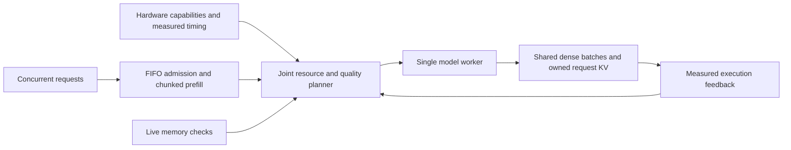

# Final demonstration and viva guide

## One-command demonstration

From the project folder, on the prepared CUDA laptop:

```powershell
python scripts/demo_project.py
```

The command first prints **saved, validated** capacity and quality evidence. It then loads the local GPT-2 checkpoint and actually replays a measured frontier trace under FP32 and an adaptive policy, printing admitted/completed/rejected counts and quantized/CPU-attention iteration counts. Finally it releases that model, starts a hidden temporary API server, sends four concurrent HTTP requests, verifies shared execution, and stops the server. Raw live demonstration outputs go to `results/final_demo/`. Demonstration timings are not controlled benchmark results.

After the version is frozen, later demonstration runs write timestamped `results/demo_sessions/` folders so the submission's recorded demo evidence remains intact.

For a machine without the prepared GPU/model dependencies:

```powershell
python scripts/demo_project.py --evidence-only
```

This mode reads saved evidence only and clearly labels it. `--skip-http` runs the live capacity demonstration without its final API check. A fresh machine needs the pinned public checkpoint prepared with `python -m prismserve pretrained-prepare --download --dataset`. The ZIP omits large weights and retains their source/hashes.

## Five-minute presentation flow

1. State the question: can one resource-based controller coordinate runtime precision and CPU attention across execution backends?
2. Explain the paper inspiration: MorphServe frees device weight memory through reversible layer precision; NEO places selected decode attention and KV on CPU. Combining them shares host, link, device and transition resources.
3. Walk through the architecture below, then run the demonstration. Point to actual batch size and 48 shared projection calls, not just active request count.
4. Show the M11 completion map. Explain lowest **tested** quota, explicit rejections, queued versus concurrent capacity, and transition staging. Read the measured quality cost alongside capacity evidence.
5. Close with the limits: reference unpacking/host attention are synchronous; GPT-2 is small and not instruction-tuned; CPU/CUDA portability is one laptop; no universal speedup or task-accuracy guarantee.



## Architecture walkthrough

`types.py` defines capability, model, work, plan and estimate contracts. `measured_policy.py` supplies calibrated action families and conservative resource reservations. `efficient_policy.py` compiles accounting, caches shapes, separates phase feedback and gates changes against feasible full precision. `live_engine.py` owns requests, performs admission, applies global layer precision and per-request placement, and checks resources before every tick. `batching.py` shares each transformer projection over all current request tokens while retaining separate KV and ragged causal attention. `pretrained.py` adapts real GPT-2 weights and reversible INT4 storage. `batch_service.py` asynchronously awaits worker Futures so concurrent HTTP submissions overlap. Experiment modules preserve measured traces and source provenance separately from the analytical simulator.

## Likely viva questions

**What is hardware-agnostic here?** Policy decisions use resource/capability profiles and measured action costs. The same controller executes with CPU and CUDA calibration. Kernels, model adapters and performance remain hardware-dependent; this is not proof of GPU-vendor or physical multi-machine portability.

**Why combine the two mechanisms?** Both can free device capacity, but they consume host memory, transfer bandwidth, workspace and switching time. A common planner checks those coupled costs instead of assuming that stacking independently useful techniques helps.

**What does CPU offload actually execute?** Eligible decode requests keep KV on CPU and execute attention there; dense model projections remain on the primary device. Prompt attention is not offloaded. Transfers and migrations are synchronous and measured.

**Is INT4 a fused fast kernel?** No. Packed storage is real, but reference computation unpacks floating-point weights before matmul. Memory savings can therefore come with slower execution.

**Can the quantized model fit while its transition cannot?** Yes. The old FP32 weights, staging and workspace can coexist temporarily. Admission checks the transition peak, not only the final packed size. Model loading and warmup occur before the measured serving quota.

**Why did FP32 win in M10?** Its measured execution and sufficient capacity made adaptation unnecessary in that session. M11 deliberately studies smaller quotas and longer contexts. Report capacity and speed separately; joint control need not beat either mechanism alone.

**Why are rejected requests not latency zero?** They never produce a token. Their TTFT is unavailable and they count as SLO failures. Throughput rankings include only cells that complete the full workload.

**What is the quality guarantee?** There is no downstream-task guarantee. Layer selection uses validation-logit KL as an additive proxy. Held-out teacher-forced audits report PPL, target counts, actual precision history and CPU placement. M10 shows historical quantized KV can affect FP32 outputs after restoration.

**Did phase feedback improve prediction?** It isolated phases correctly, but the matched M10 probes favored simpler feedback over phase feedback. Fresh calibration produced the larger improvement. Different serving trajectories cannot by themselves establish which predictor is more accurate.

**What failures were retained?** The original workspace-growth diagnostic, mixed battery/AC measurements and an incomplete pressure-associated attempt remain separate. The latter's precise cause is unproven. Current failures retain active work, sampled limits and reservation estimates; unsafe work is not executed merely to finish a benchmark.

**What is the defensible conclusion?** A common joint-control interface and real pretrained serving implementation are demonstrated, with measured capacity/quality tradeoffs and explicit negative regimes. Broader LLM-scale, optimized-kernel and heterogeneous-machine claims remain future research.

## Rebuild and freeze

```powershell
python scripts/check_capacity_frontier.py --check-current
python scripts/update_frontier_report.py
python scripts/build_submission.py
python scripts/check_submission.py
python scripts/freeze_release.py
python scripts/package_project.py
python scripts/check_submission.py --package
```

`deliverables/release.json` records version 1.0.0, the accepted experiment and source hashes. Freeze means a reviewable content snapshot; later changes should receive a new version and new experiment output folder. The report PDF, editable presentation, wheel, raw evidence and reproducible scripts are included in the ZIP.
