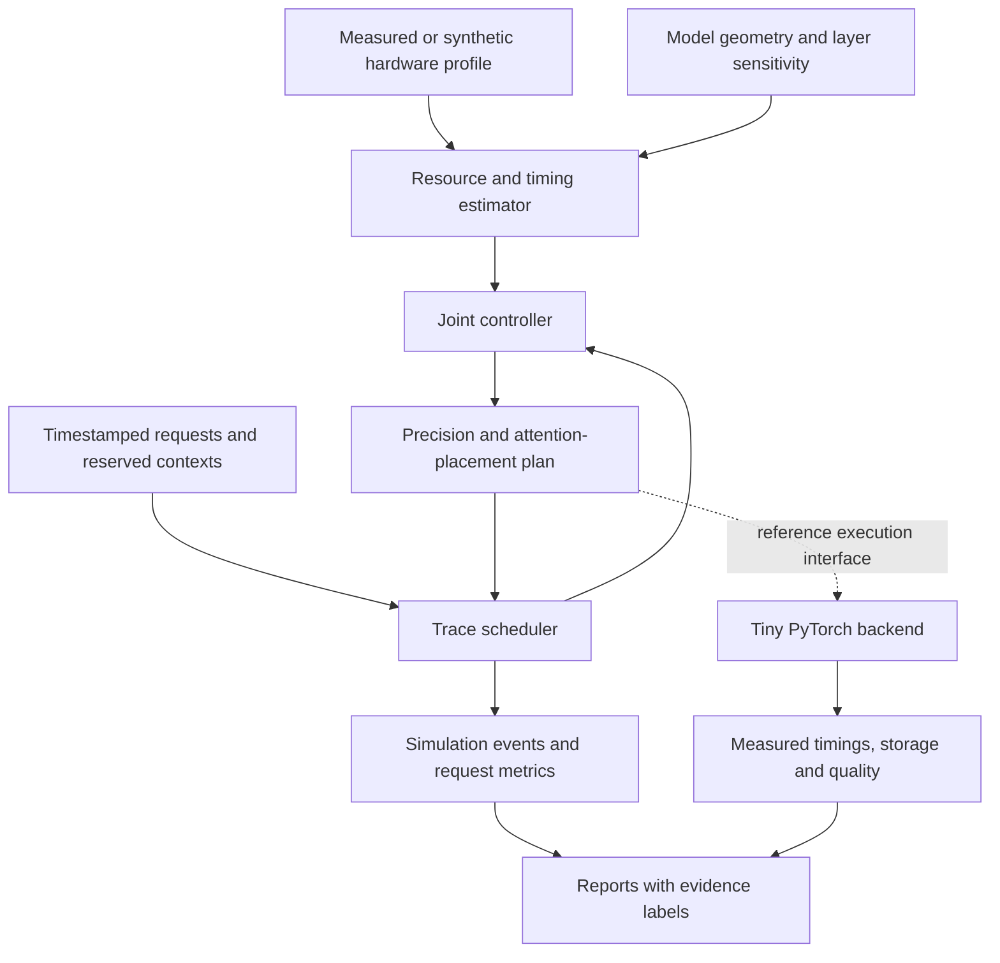

# PrismServe technical design

PrismServe separates policy, resource estimation, simulation, and real tensor execution. A resource profile describes capabilities numerically. The policy does not branch on hardware product names.

The simulator and real backend are separate execution paths. Simulation has synthetic requests and analytical service times. Real execution has actual tensors and wall-clock timing. Sharing a plan representation does not make simulated timings real measurements.

## Control problem

At a decision boundary, a plan contains a set of quantized transformer layers `Q` and a set of requests whose decoding attention and KV reside on the CPU, `C`. The scheduler chooses a candidate batch; the controller chooses its plan. Search candidates include prefixes of a layer order from least to most sensitive, combined with a finite grid of offload fractions. Candidate CPU assignments prefer shorter contexts, limiting host scan cost. This restricted search is tractable and deterministic, but it is not a global optimum over all layer subsets or request placements.

Conceptually, the policy minimizes an estimated service-cost objective with quality and transition penalties:

\[
\min_{Q,C}\ \frac{\widehat T_{iter}(Q,C)+\lambda_t\widehat T_{change}(Q,C)/H}{T_{SLO}}
  + \lambda_q\frac{\widehat R(Q)}{R_{budget}},
\]

subject to usable device and host capacities and a configurable additive quality-risk budget. The default transition horizon `H=16` amortizes one-time plan changes over 16 estimated iterations in the objective. The simulator still charges the entire transition once when it executes. Exact score normalization, SLO handling, and tie-breaking live in `prismserve/policy.py`. A configured TBT objective is a planning signal, not a guarantee on the queue's P95 TTFT. If no plan fits a candidate batch, the scheduler must reduce admission or declare the request infeasible rather than invent capacity.

A cooldown prevents needless changes when the current plan remains feasible. Capacity constraints override cooldown. Restoring full precision must pass the same capacity and transition checks as reducing precision. Hysteresis controls oscillation; it cannot make a physically infeasible plan safe.

## Memory accounting

For a model with `L` layers, `Hkv` KV heads, head dimension `d`, and KV element width `bkv` bits, one cached token requires

\[
m_{KV}=2L H_{kv}d\,b_{kv}/8\quad\text{bytes}.
\]

The factor two counts keys and values. Grouped-query attention uses KV heads, rather than query heads. Weight memory at `bw` bits is approximately `parameters × bw / 8`; packed INT4 additionally requires scale metadata and padding. `ModelSpec.layer_parameters` can specify the exact morphable matrix count per layer, leaving embeddings, normalization and other parameters unquantized. If omitted, the estimator uses an explicitly approximate uniform all-parameter split. The supplied 8B experiment sets 218,103,808 morphable parameters per layer and leaves 1,050,939,392 other parameters outside precision control. `reference_dequantization=True` additionally accounts for the real reference backend's floating-point unpack scratch and associated cost. Real backend tensor accounting remains the authoritative measurement for its own tiny model.

Device capacity includes resident weights, device KV reservations, workspace, and transition peaks. Host capacity includes full-precision recovery copies, quantized metadata/variants where retained, and host KV. The backend's CPU master weights consume host memory even if device weights are compressed. An allocation is not free merely because it moves to the host.

The simulator reserves each admitted request's prompt plus requested maximum output. This avoids future KV growth overrunning capacity and avoids oracle knowledge of early EOS; it is conservative compared with a dynamic paged allocator. It is a capacity policy, not an implementation of MorphServe's CUDA block remapping. Live KV is neither evicted nor quantized.

Transition accounting must distinguish initial allocation, layer conversion/restoration, and migration of an existing cache. A layer switch needs a temporary representation; moving a request may briefly require source and destination KV. Final-state feasibility alone is insufficient. The estimator records transition costs separately so that small steady-state gains do not hide expensive repeated movement.

## Analytical time model

The estimator uses bandwidth and compute bounds for dense operations, GPU attention, CPU attention, and link transfer. A roofline-style component is of the form

\[
\widehat T=\max(\text{bytes}/\text{bandwidth},\text{FLOPs}/\text{compute rate}).
\]

For persistent CPU attention, steady-state link traffic contains current Q/K/V/output tensors, while the host scans historical KV locally. Migration copies are charged separately. Prefill remains on the device in this model; CPU offloading is a decode decision.

Simulated overlap is an analytical assumption about useful concurrency, not an observed NEO pipeline. Actual achievable overlap depends on kernel launch overhead, CPU scheduling, pinning, transfer direction, NUMA locality, device streams, and batch shape. Synthetic effective bandwidths and compute rates are inputs to a thought experiment. A local copy microbenchmark alone does not calibrate every inference component.

## Trace scheduler and metrics

The simulator replays request arrival timestamps, forms continuous batches, and chunks prefill. The final prefill chunk emits the first output token; subsequent decode steps emit one token each. Requests arriving during a running iteration wait until the next scheduling boundary. Output timestamps, rather than a throughput-derived latency shortcut, determine request metrics.

For arrival `a`, first output timestamp `t1`, and subsequent outputs `t2...tn`:

\[
TTFT=t_1-a,\qquad TBT_i=t_i-t_{i-1},\qquad
TPOT=(t_n-t_1)/(n-1).
\]

TPOT and TBT are undefined for a request with only one output token. Percentiles must exclude undefined observations and identify the aggregation unit. P95 over pooled token gaps weights long requests more strongly than P95 over per-request mean TPOT. End-to-end latency is `tn-a` and includes queueing.

The denominator for output throughput is the full reported observation interval, including the queue drain. SLO goodput counts completed requests satisfying both the TTFT limit and every available inter-token-gap limit. Rejections count as SLO failures in the violation fraction; excluding them could make an infeasible policy appear fast. The simulator drains work before returning and raises an error if its iteration limit is reached, rather than silently publishing unfinished work as a success.

## Real tensor path

The reference backend is a small causal transformer with a byte tokenizer. It supports cached incremental decoding, reversible grouped INT4 weight storage, and moving attention/KV to the CPU while projections remain on the selected compute device. Full-prefix and cached generation parity are correctness checks. Existing KV survives precision changes; later values naturally reflect the weights used to generate them.

Packed INT4 storage and INT4 arithmetic are different properties. This backend unpacks weights for a floating-point matmul, so scratch memory and unpacking time matter. Its attention transfers are synchronized reference operations, not a CUDA-stream implementation of NEO's asymmetric two-batch schedule. CPU-only execution cannot demonstrate CPU–GPU overlap.

The HTTP interface is a bounded local demonstration of the tiny model. Serialized execution protects mutable precision state. It is not the simulator's continuous-batching engine, a full OpenAI API implementation, or a production LLM server. A locally trained tiny checkpoint remains a small educational language model; its generated text does not establish LLM task performance.

For CUDA measurements, distinguish bytes occupied by live tensors from the allocator's reserved pool. Releasing a layer tensor need not immediately lower reserved memory. Time asynchronous device work with synchronization or CUDA events, as described in [PyTorch CUDA semantics](https://docs.pytorch.org/docs/stable/notes/cuda.html). Save tensor state dictionaries and primitive configuration; load the project's checkpoint with explicit `weights_only=True`, following [PyTorch serialization semantics](https://docs.pytorch.org/docs/stable/notes/serialization.html). Dependency versions in actual run metadata determine the execution environment; the live documentation may describe a later release.

## Real pretrained execution and further extension

Version 0.2 implements the model-specific access and forward/cache adapter for actual GPT-2 weights and its original BPE tokenizer. `pretrained.py` preserves pretrained embeddings, norms, activations and tied output weights, wraps each block's four Conv1D projections for reversible packed INT4, and executes attention against persistent CPU KV when selected. It verifies parity with the original Hugging Face eager forward path. `pretrained_experiments.py` measures validation-only layer sensitivity, held-out WikiText-2 subset likelihood, real generation timing and common-controller execution. `pretrained_service.py` exposes a serialized completion API. See [pretrained execution](pretrained.md).

Further adapters for larger model families need verified grouped-query/rotary attention behavior, paged cache storage, optimized low-bit kernels, pinned host storage, asynchronous stream/event ownership, chunked batching, cancellation, and memory-safe transitions. Independent component calibration and broader task-quality evaluation remain necessary. Keep backend capabilities explicit, and compare against actual serving engines on identical hardware and workloads.

## Continuous batching and measured control, version 0.3

`ContinuousEngine` owns one background execution thread and per-request KV histories. HTTP handlers submit Futures and asynchronously await them. Requests enter at iteration boundaries; existing decode requests progress every tick. Admission considers possible batch additions and minimizes predicted time per serviced request, with a TBT penalty. Prompt chunks share a bounded token budget. Model precision is global to an iteration, while attention/KV placement is chosen per request.

`execute_batch` concatenates all current tokens into one activation matrix. Each transformer block applies its four dense projections once across that matrix. Attention operates on each request's own history, with correct absolute positions and causal masking. Final vocabulary logits are calculated only for the last current token of each request. This selective batching reduces repeated projection launches while retaining straightforward ragged attention, distinct from a fused paged-attention kernel.

The measured controller uses 75 calibrated shapes covering batch sizes 1, 4 and 8, current contexts, prompt/decode mixtures, CPU placements and three precision sets. It selects a compatible nearest timing sample and scales conservatively outside observed shapes. An EWMA ratio corrects the selected family's predicted execution time. Transition costs come from measured layer conversions and explicit KV movement. Analytical duration is used only by the named uncalibrated comparison; all reported request times remain measured wall time.

Latency prediction uses current context. Capacity reserves future context and temporary concatenation buffers. The workspace bound fits nonnegative fixed/per-request scratch terms from calibrated peaks, then adds a second reserved copy of device KV with safety headroom. Host accounting includes temporary CPU KV copies. The bound is monotone with admitted request count and reserved context. An earlier current-length workspace lookup could admit a request that failed later as its cache grew; a regression test covers this failure. `results/live_initial/` retains the incomplete diagnostic attempt and its source snapshot, separate from final live results.

Logical memory quotas are enforced by admission estimates, without intentionally exhausting physical VRAM. Telemetry bounds the quota, model buffers and backend headroom are reserved, and actual allocator peaks are reported independently. Sampling availability cannot guarantee isolation from unrelated processes. Executed source snapshots and input traces accompany measured runs.

## Controller efficiency, version 0.4

The default live controller compiles these conservative resource equations and timing families, caches bounded shape/reservation lookups, and reuses stable decisions for up to three intervening iterations. Capacity is sampled and feasibility recomputed every tick. Phase-specific feedback separates prefill, mixed and decode observations. Adaptive choices must clear a heuristic uncertainty/gain gate against feasible full precision, including a smaller reference batch. Full-precision FIFO prefixes are checked exhaustively; adaptive search uses a bounded prefix set. These choices trade search cost against potentially missed admission plans. See `controller_efficiency.md` for the exact policy, limits and ablations; `results/controller/` retains fresh comparisons with legacy scheduling.

## Reliability and backend validation, version 0.5

M10 retains this serving policy and adds an independent instrumented study. Five rounds with fresh calibration and balanced policy positions record read-only GPU/host telemetry. Matched prediction probes forecast identical execution durations, separating prediction accuracy from different chosen actions. CPU and CUDA use separately timed shapes and the same hardware contract; CPU-primary execution excludes offload. Expanded quality audits track quantization during prefill and output emission, including retained historical KV. A source snapshot is frozen before execution. See `validation_study.md` for procedures and evidence limits; observations do not lock GPU clocks or establish physical multi-machine portability.
