# PrismServe: Resource-Calibrated Joint Precision and CPU-Attention Control

DA4022 · Hardware Aware Deep Learning · IIT Guwahati  
Siddharth Khatod · Akash Iyer · Vamaxi Maheshwari · Kanika Bansal · Yashvardhan Kant  
Project implementation and evaluation, 18 November 2026

## Abstract

PrismServe implements resource-calibrated control of reversible weight quantization and CPU attention placement, inspired by MorphServe and NEO. It includes real pretrained GPT-2 execution, a small correctness decoder, a trace simulator, and local completion APIs. On an RTX 4050 Laptop GPU, the 124.4M-parameter GPT-2 executor matches the original Hugging Face forward logits exactly in the recorded test. Quantizing three validation-selected blocks reduces resident storage from 486.70 to 417.09 MiB, while WikiText-2 subset perplexity rises 3.48% and reference decode latency increases. All-block packing saves more memory but worsens perplexity 25.85%. The common controller moves real GPT-2 KV to the CPU for 12 decode steps under an explicit capacity quota, then restores device placement. Separately, a 63-run 8B-shaped analytical study improves TTFT against naive stacking in a slow-host regime but does not beat full precision there. These results support a working pretrained-model serving prototype and identify limits; they do not establish universal speedups, 8B deployment, or the proposal's SLO and quality targets.

The continuous-batching experiment adds 42 real traffic runs, 75 measured calibration shapes and separate policy-quality audits. A 36-run controller-efficiency study is followed by a final AC-conditioned 60-run GPU comparison, 12 CPU/CUDA serving runs, 54 matched prediction shapes and eight 2048-target quality arms. All 15 final optimized joint runs remain below 5% controller overhead (worst 4.97%), and CPU/CUDA FP32 outputs agree at 96/96 compared token positions. Fresh calibration substantially improves timing estimates; phase feedback does not beat simpler feedback in matched probes. Optimized full precision remains faster on average in all three final scenarios. Early-prefill quantization increases audit perplexity 0.881% even after FP32 restoration. Diagnostic failures and mixed-power measurements remain separately archived. See Section 6 for the staged evidence.

The final M11 capacity study adds 216 warm-start quota/context replays with four mechanism controls. For 768-token prompts, reversible quantization and joint control complete requests at 675 MiB across three repeats, while FP32 and offload-only reject all requests there and need a lowest tested successful quota of 700 MiB. The paired 96-target joint audit increases perplexity 2.752%. The final version 1.0.0 includes 116 passing tests, a live capacity/API demonstration and an inspectable source freeze. These observations demonstrate a sampled capacity/quality tradeoff, not universal speedup or an exact hardware minimum.

## 1. Motivation and research question

Serving a decoder requires capacity for both weights and a KV cache that grows with request context. A device may have substantial compute capacity while memory limits the number of concurrent requests. Increasing concurrency can reduce queueing, yet host offload, precision changes, and migrations introduce their own costs. The question is therefore not whether every request should be offloaded or every layer quantized, but when each control is worth using.

MorphServe changes selected layer precision at runtime and uses reclaimed device memory to expand KV capacity. Its host memory holds weight variants, while its runtime manages non-contiguous cache blocks and asynchronous transitions. Its KVResizer does not compress, quantize, or evict the live attention history. NEO keeps selected requests' KV on the host and executes their decoding attention on the CPU, with dense computation on the GPU. Its asymmetric sub-batches overlap complementary work. NEO already adapts schedules to runtime queues; offline profiling supplies its timing estimates [1,2].

Our revised question is: **Can a common policy choose useful combinations of precision and attention placement from resource measurements, without product-specific decision rules?** Hardware agnosticism here describes the policy interface. It does not imply identical optimized kernels on all devices, guaranteed SLOs under arbitrary traffic, or freedom from calibration.

The original proposal requested Llama-scale reproduction, particular speedups, and downstream-accuracy bounds. The available machine has an RTX 4050 Laptop GPU with approximately 6 GB VRAM and 16 GB host RAM, with much less host memory free during execution. We implement real pretrained GPT-2, retain a tiny decoder for fast correctness tests, and use a separate simulator for 8B-shaped scenarios. Original paper speedups and proposed numerical targets are not reported as our results.

## 2. System and controller

The controller receives a hardware profile, model geometry, request contexts, and the current plan. Profiles contain device/host capacities, effective bandwidths, link rate, compute rates, and a fixed-overhead term. They carry provenance distinguishing measured local microbenchmarks from synthetic settings. Device product names are metadata, not policy branches.

A plan consists of quantized-layer indices and CPU-attention request IDs. The search combines prefixes of a sensitivity-ranked layer order with a grid of offload fractions. CPU candidates prefer shorter contexts to limit host scan work. This bounded family is practical and deterministic, though it cannot find every possible layer/request assignment. The objective normalizes estimated iteration time plus transition cost amortized over 16 iterations by the TBT target, and adds a budget-normalized quality penalty. Actual transition execution is charged in full once. Quality is an additive surrogate; it is neither task accuracy nor a formal approximation bound.

Feasibility checks usable device and host capacity. The estimator counts weights, INT4 scales, CPU recovery/packed variants, workspace, KV reservations, and transition peaks. KV bytes per token are `2 × layers × KV heads × head dimension × element bytes`; using KV heads handles grouped-query geometry. Each admitted request reserves prompt plus its declared maximum output. This conservative admission rule avoids later cache growth overrunning the initial reservation, at the cost of potentially lower utilization than an on-demand paged allocator.

Transitions distinguish initial allocation from moving existing KV. A steady host-attention step exchanges current query, new key/value, and attention output; it does not repeatedly transfer all past KV. Migration does transfer the historical cache and must preserve source state until the move completes. Layer restoration also needs staging capacity. Cooldown limits oscillation while capacity constraints override it. The static INT4 comparison deliberately reports its quality proxy without imposing the adaptive policy's quality budget.

The analytical estimator uses bandwidth/compute bounds and optimistic partial CPU/device overlap. Transition costs are charged separately. The trace scheduler forms continuous batches, chunks prefill, and emits the first output at the last prefill chunk. It advances virtual time using analytical service times. Policy-search wall time is measured separately and is not silently added to, or confused with, virtual execution time.

Both real executors use actual four-bit nibbles with FP32 group scales and CPU master weights for restoration. The initial two-layer byte decoder supplies quick numerical checks. The pretrained executor loads GPT-2's original safetensors, tokenizer and modules while implementing its own forward/cache path. Four projection matrices per selected block are packed; tied embeddings/output weights, norms and biases remain floating point. Both executors unpack matrices for floating-point matmul. CPU KV attention is real but synchronous, rather than NEO's asynchronous pipeline. The earlier completion APIs serialize requests; version 0.3 adds a concurrent API with one shared model worker.

## 3. Evaluation method

The real benchmark checkpoint in `results/demo/` was trained from scratch for 80 steps with seed 7 on authored text. It contains 149,248 parameters and uses FP32 weights and KV before quantization. The recorded training run took 1.918 seconds on CUDA; sampled training NLL fell from 5.6829 at step 1 to 2.5619 at step 80. These values establish that training executes, not that the model has general language competence.

Quality evaluation uses a distinct authored held-out passage with 480 next-byte targets. We compare FP32, one quantized transformer layer, and both quantized layers using identical targets. Metrics are mean negative log likelihood, perplexity, and mean logit KL divergence from FP32. A restoration evaluation uses fresh inference after restoring original weights. Cache/full-prefix parity, packing edge cases, causal masking, migration, and controller feasibility are tested separately in the repository test suite.

The real timing microbenchmark measures CPU and CUDA execution for FP32, INT4, CPU attention, and their combination. CUDA timing synchronizes device work. Results use a small number of short generations and do not include production request queues. CPU placement on an already-CPU model is explicitly a no-op. Storage measurements separate resident tensors, retained CPU masters, and the largest per-matrix dequantization scratch; allocator-reserved bytes are a different quantity [3].

The adaptive diagnostic in `results/adaptive/adaptive_runtime.json` runs the shared controller before real decode steps using the same 80-step `results/demo/tiny_checkpoint.pt`. It changes a declared device-capacity quota instead of filling physical VRAM. It reserves 255 context tokens and generates 32 outputs from a 59-byte prompt, with actual cache migration if the controller changes placement. Every decision records live host-available memory, process resident memory, and CUDA free/allocated/reserved bytes. This telemetry distinguishes physical conditions from the imposed diagnostic quota.

For the LLM-scale experiment, `configs/experiment.json` defines a Llama-3.1-8B-shaped analytical model: 32 layers, hidden size 4096, eight KV heads, head dimension 128, and 8,030,261,248 parameters. Its explicit per-layer matrix count is 218,103,808, leaving 1,050,939,392 parameters outside precision control. Three synthetic hardware profiles vary capacity and effective rates: 20 GiB balanced, 20 GiB slow host/link, and 48 GiB server. Seven policies run on identical 96-request burst traces for seeds 7, 19, and 41, yielding 63 paired runs. Prompt lengths range 256–1536 and outputs 24–64; prefill chunks are 128 tokens. SLOs are 2000 ms TTFT and 100 ms for each inter-token gap. Bootstrap intervals use workload seeds, with only three seeds and consequently exploratory uncertainty.

## 4. Measured tiny-model results

| Variant | NLL | Perplexity | Resident bytes | CPU master bytes | Maximum unpack scratch bytes |
|---|---:|---:|---:|---:|---:|
| FP32 | 2.626656 | 13.827457 | 596,992 | 0 | 0 |
| Layer 0 INT4 | 2.626067 | 13.819310 | 428,032 | 196,608 | 65,536 |
| Both layers INT4 | 2.626034 | 13.818851 | 259,072 | 393,216 | 65,536 |

One quantized layer reduces resident model storage by 28.3%; both reduce it by 56.6%. Embeddings, output projection, and other unquantized tensors limit whole-model compression. The two-layer packed representation plus CPU masters totals 652,288 bytes, more than the initial 596,992 resident bytes. Quantization therefore relocates and compresses device storage while retaining an explicit host recovery cost; it does not reduce every memory category.

Relative perplexity changes are −0.0589% for one layer and −0.0622% for both. Their mean logit KL values are 0.0001345 and 0.0001565. The tiny negative perplexity changes are small corpus-specific perturbations, not evidence that quantization improves general accuracy. After restoring original weights, maximum absolute logit error is 0.0 and NLL returns to 2.626656. This fresh-inference restoration check does not erase approximation already stored in a cache produced under quantized weights.

| Device and variant | Mean TTFT (ms) | Mean TBT (ms) |
|---|---:|---:|
| CPU FP32 | 4.461 | 2.889 |
| CPU INT4, layer 0 | 5.989 | 4.256 |
| CUDA FP32 | 4.191 | 4.174 |
| CUDA INT4, layer 0 | 6.161 | 6.624 |
| CUDA CPU attention | 4.653 | 4.103 |
| CUDA hybrid | 6.621 | 6.160 |

The unpack-and-matmul implementation is slower after quantization. CUDA INT4 TBT is approximately 58.7% above CUDA FP32 in this short benchmark. This negative result matters: memory savings alone do not imply faster service. CPU FP32 is also faster than CUDA for this tiny shape, where device launch overhead is substantial. The small CPU-attention timing difference should not be presented as a reliable acceleration without repeated, controlled measurements. All variants in this microbenchmark emit the same recorded 16 output IDs, but that single-generation agreement does not replace held-out logit evaluation.

In the adaptive execution diagnostic, the controller initially keeps KV on CUDA under an 8 MiB declared quota. At decode index 8, the quota becomes 1,809,920 bytes and CPU attention is selected. It remains on the CPU for 12 output steps, then returns to CUDA at index 20 when the quota recovers. Measured application/migration time is approximately 0.608 ms at the CPU transition and 0.478 ms at restoration. No quantized layers are chosen: conservative scratch accounting and reference unpacking costs make host placement preferable for this diagnostic. Separate static mechanism runs exercise real INT4 storage.

The adaptive generation records 6.065 ms TTFT and 222.783 ms elapsed generation time. Mean planner search is 406 microseconds across 31 decisions. These are wall-clock observations; the estimator's roughly 0.1 ms component predictions are not measurements of this Python-heavy tiny executor. The mismatch shows why resource profiling must be extended with shape-dependent kernel and launch calibration before using the model as a latency predictor.

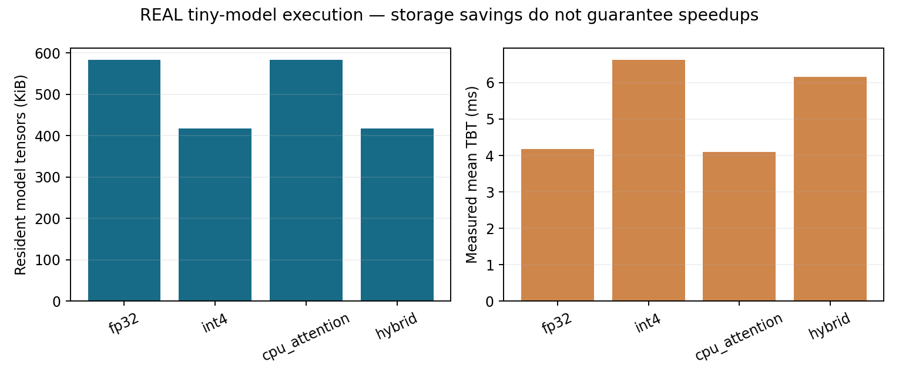

## 5. Real pretrained GPT-2 results

The pretrained milestone uses 124,439,808 parameters from the pinned GPT-2 revision recorded in `models/gpt2/prismserve_source.json`. It has 12 blocks, width 768, 12 heads and a 1024-position context; no pretrained-model training was performed. The official model is an English base completion model, not an instruction-tuned chatbot [4]. The executor uses FP32 and 64-weight quantization groups. Original-forward maximum logit error is 0.0, cached-versus-full-prefix error is 9.16×10⁻⁵, and CPU-attention placement error is 4.58×10⁻⁵. All pass the declared 0.002 absolute tolerance. Fresh restored inference also has 0.0 error against the original forward path.

Layer calibration quantizes one block at a time on the first 128 GPT-2 tokens from the WikiText-2 validation prefix, ranking logit KL. The three selected blocks are 1,7 and 9. Test quality uses the first 4096 BPE tokens from a separate test prefix: windows 256, stride 128, every next-token target counted once, for 4095 scored targets. Both prefixes derive from the first 100 rows of their respective `wikitext-2-raw-v1` splits, joined with two newlines; original responses and hashes are retained. This is a subset diagnostic, not the canonical full-test perplexity [5]. Test data never selects layers.

| Variant | Resident MiB | Test-subset PPL | PPL change (%) | CUDA mean TBT (ms) | Output tokens/s |
|---|---:|---:|---:|---:|---:|
| FP32 |486.70|36.550|0.000|21.095|47.40|
| INT4 blocks 1, 7, 9 |417.09|37.822|3.480|25.953|38.53|
| CPU attention, FP32 |486.70|36.550|0.000|22.688|43.90|
| Three-block hybrid |417.09|37.822|3.480|27.267|36.54|
| All 12 blocks INT4 |208.26|45.997|25.845|37.440|26.66|

Measured timings cover three authored prompts, three repeats each and 32 outputs per run, with EOS stopping disabled so work lengths match. Warmup and precision setup are excluded from generation timing and recorded separately. GPU FP32 mean TTFT is 20.363 ms; CPU FP32 reaches 20.00 output tokens/s with 49.374 ms mean TBT. These are serialized local generations, not concurrent-load SLO measurements.

Three-block packing saves 14.30% resident model storage; all-block packing saves 57.21%. However, the run retains 324 MiB of CPU masters touched during validation calibration, even for restored FP32 variants, plus up to 9 MiB of floating-point unpack scratch for quantized matrices. Allocator-reserved bytes and KV are separately reported. Quantization is slower here: the three-block mean TBT increases 23.03%. Its 3.48% perplexity rise is also not within a 1.5% tolerance, and perplexity change is not task accuracy. All-block quantization deteriorates much more. The reference uniform quantizer is not AWQ; these are implementation-specific outcomes.

CPU-placement quality rows evaluate fresh primary-device prefill, so their equal perplexity does not independently measure a whole sequence of CPU decode. CPU KV decoding correctness is established separately by placement parity and actual generated token traces. This distinction avoids assigning a misleading full-CPU interpretation to the NLL table.

The common controller also executes real GPT-2 generation in `adaptive.json`, using validation-derived sensitivity and per-decision physical-memory telemetry. During declared quota indices 8–19, it selects CPU attention for 12 outputs, restoring CUDA KV at index 20. Application/migration takes 3.864 ms at offload and 1.502 ms at restoration. Recorded TTFT is 22.575 ms and elapsed generation 769.094 ms; mean planner search is 1.079 ms. No quantization is selected in this diagnostic because the conservative reference-kernel costs favour placement. Physical VRAM is not artificially filled. Thus real adaptive placement is demonstrated, while a runtime quantization benefit is not claimed.

The live HTTP check also succeeds with actual GPT-2, block 0 INT4 and host KV, returning eight outputs with queue/setup metadata. Setup takes 71.93 ms and cold service TTFT is 1017.91 ms; this functional cold check is not comparable to the warm 20 ms model TTFT. The full response and health/metrics are preserved in `results/pretrained_api_smoke.json`.

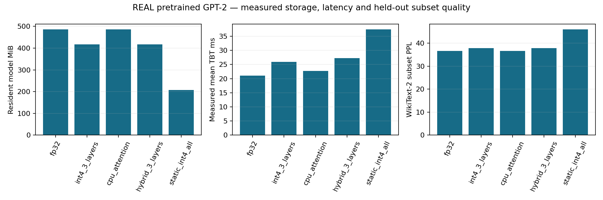

<!-- LIVE_RESULTS_BEGIN -->
## 6. Real continuous-batching traffic experiments

Version 0.3 adds a shared background worker with independent per-request KV histories. Current prefill/decode tokens are flattened for each layer's four dense projections; ragged attention is evaluated per request. A real GPT-2 comparison of unequal contexts and mixed CPU/GPU placement has maximum logit error 3.05e-4 against independent inference, within the declared 0.002 tolerance. One iteration uses 48 dense projection calls across 12 blocks, regardless of request count; it does not invoke a complete model separately for each request.

The controller starts from 75 synchronized measured batch shapes, with three repeats plus warmup, covering batches 1/4/8, contexts, mixed prefill/decode, precision sets and host placement. An EWMA corrects execution estimates. It evaluates admission alternatives using predicted time per serviced request and a TBT penalty. Layer changes and migrations execute at token boundaries. All request timings include actual controller/admission overhead, execution and transitions; analytical durations never advance the live clock.

The final comparison has 42 greedy-serving runs: seven policies, two replay identifiers and three scenarios. Burst timestamps depend on seed; the steady trace is identical between repetitions, with policy order changed. Each receives identical 12-request traces with 384-token prompts, 24 outputs, two-second arrival windows and disabled EOS stopping. A maximum of eight requests is active, with 64-token prefill chunks and 128 total prefill tokens per tick. Roomy/constrained budgets are 1400/700 MiB enforced reservation quotas, not physical-VRAM exhaustion. The serial baseline uses the same last-token-head batch primitive at batch size one. Actual batch kernels are warmed before each timed run. TTFT measures engine token readiness; the HTTP endpoint returns a complete non-streaming response, whose elapsed time is a separate metric.

| Scenario | Policy | Mean run P95 TTFT ms | Mean run P95 TBT ms | Output token/s | SLO failure % | Max active |
|---|---|---:|---:|---:|---:|---:|
| steady_roomy | serial_full | 7271.55 | 36.54 | 36.61 | 58.33 | 1 |
| steady_roomy | full | 3195.09 | 108.10 | 62.53 | 50.00 | 8 |
| steady_roomy | joint | 3297.51 | 137.42 | 53.02 | 83.33 | 8 |
| bursty_roomy | serial_full | 4877.73 | 21.57 | 46.32 | 62.50 | 1 |
| bursty_roomy | full | 1923.06 | 47.76 | 89.98 | 8.33 | 8 |
| bursty_roomy | joint | 2369.54 | 70.03 | 75.21 | 50.00 | 8 |
| bursty_constrained | serial_full | 4215.61 | 16.66 | 52.23 | 54.17 | 1 |
| bursty_constrained | full | 2680.21 | 21.36 | 72.83 | 29.17 | 2 |
| bursty_constrained | joint | 3285.92 | 51.17 | 62.83 | 37.50 | 4 |

Across the three scenarios, batched full-precision throughput relative to the same-primitive serial baseline is 1.71x, 1.94x, 1.39x. These are measured observations on one laptop across two seeds, not universal speedups. The final runs complete 504 requests and reject 0; all rejections remain SLO failures. Percentile columns average per-run percentiles across seeds rather than pooling tokens.

Under the 700 MiB quota, joint control reaches 4 active requests versus 2 for full precision. Its mean throughput is 62.83 versus 72.83 output tokens/s. Increased concurrency is therefore reported separately from latency and throughput. Quantized-output exposure is 4.69% and CPU-offloaded exposure is 34.20% for the joint arm. The largest observed CUDA tensor-allocation peak in that scenario is 638.33 MiB, below the 700 MiB budget; this describes observed Torch allocations, not total machine VRAM use or a formal isolation guarantee.

| Scenario | Joint search/admission wall fraction % | Joint prediction MAE ms | Uncalibrated prediction MAE ms |
|---|---:|---:|---:|
| steady_roomy | 7.43 | 14.44 | 63.87 |
| bursty_roomy | 7.21 | 9.71 | 30.30 |
| bursty_constrained | 16.01 | 5.98 | 34.11 |

The identical steady trace has substantial timing variation: full-precision throughput ranges from 28.67 to 96.38 tokens/s. Two repetitions do not establish a stable steady-load speedup; device clocks, thermal state and background activity were not independently controlled. Preserve the individual runs rather than interpreting the mean as a guarantee.

No general superiority is inferred from calibration or online feedback. The uncalibrated arm executes the same real engine with analytical decision-time predictions, including the earlier model's optimistic overlap and weight-streaming assumptions. It is a comparison between prediction designs, not an isolation of calibration, context features and overlap assumptions individually. Search/admission overhead is a measured part of request latency, not excluded as in the analytical simulator. Full policy tables, individual seeds, per-token timestamps and plans are retained in `results/live/`.

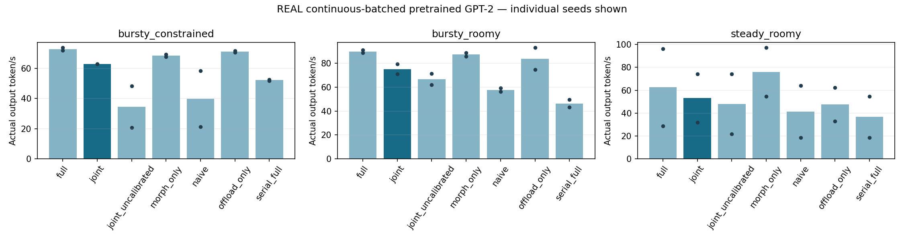

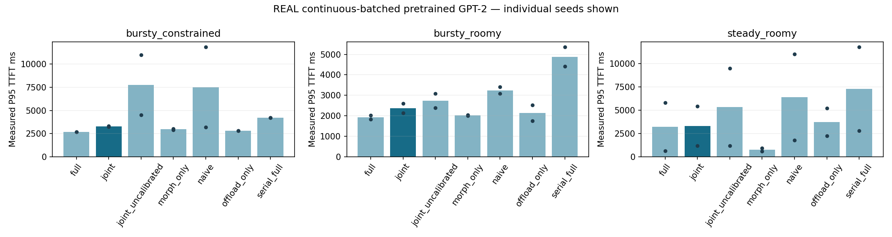

### Live policy quality and failure handling

A separate teacher-forced audit evaluates the same four held-out WikiText-2 prompts and 16-token reference continuations for each policy. It scores actual token likelihoods under each audit's selected precision and historical KV, rather than assigning static-quality numbers to a dynamic run. The audit trajectory is separate from the greedy serving trajectory.

| Policy | Scored targets | Audit PPL | Relative PPL change % | Quantized output % |
|---|---:|---:|---:|---:|
| serial_full | 64 | 68.284 | -0.000 | 0.00 |
| full | 64 | 68.284 | 0.000 | 0.00 |
| morph_only | 64 | 68.785 | 0.733 | 25.00 |
| offload_only | 64 | 68.284 | 0.000 | 0.00 |
| naive | 64 | 68.284 | -0.000 | 0.00 |
| joint | 64 | 68.816 | 0.779 | 21.88 |
| joint_uncalibrated | 64 | 68.284 | -0.000 | 0.00 |

A 64-target audit per policy is a narrow diagnostic. Precision exposure must accompany perplexity: a policy that does not quantize in its audit supplies no quality evidence for a different trajectory that does quantize. The additive validation-KL budget still does not prove a task-accuracy bound.

The actual HTTP check completes four concurrent clients in a shared execution batch of 4. The full suite has 97 passing tests. A constrained-memory diagnostic exposed a bug in current-length workspace reservation; the fix reserves a monotone calibrated scratch bound plus temporary copies of fully reserved device/host KV. Regression tests cover future growth and request removal. The corrected targeted workload completes before the full suite is run. The initial incomplete attempt and its source snapshot remain in `results/live_initial/`; those measurements are excluded from the final table.

The engine remains a synchronous reference: attention loops per request, CPU/GPU work is not pipelined, calibration extrapolation is approximate, and only one physical machine is measured. The source snapshot and calibration hashes in the live manifest describe this new experiment independently of the earlier simulation and serialized benchmarks.
<!-- LIVE_RESULTS_END -->

<!-- CONTROLLER_RESULTS_BEGIN -->
### Controller efficiency follow-up (v0.4)

The new controller compiles resource accounting and calibration lookup, reuses stable plans for up to three intervening iterations with fresh resource checks, separates feedback by phase, and gates adaptive choices against a feasible full-precision reference with heuristic uncertainty margins. Adaptive admission searches a bounded prefix set. The comparison retains the same model, calibration and workload as M8 and adds fresh old-controller comparators and gate/reuse ablations.

36 actual serving runs complete 432 requests with 0 rejections, plus 6 independent teacher-forced audits (384 targets total). 1246 reused iterations retain fresh resource checks. 106 tests and four-client real HTTP verification pass. Actual CUDA peaks exceed the declared device quota in 0 runs.

| Scenario | Old joint control % | New joint control % | Old joint token/s | New joint token/s | Change % | New full token/s |
|---|---:|---:|---:|---:|---:|---:|
| steady_roomy | 8.12 | 2.26 | 67.04 | 41.11 | -38.68 | 53.03 |
| bursty_roomy | 6.50 | 2.07 | 32.41 | 37.02 | +14.24 | 37.06 |
| bursty_constrained | 16.88 | 2.42 | 24.34 | 26.88 | +10.45 | 32.76 |

All six optimized joint runs meet the exploratory <5% control-overhead target (worst 2.82%).

Lower overhead does not establish a general throughput or prediction-accuracy improvement. The optimized joint controller improves mean throughput over its old counterpart in 2 of 3 scenarios. The steady scenario's old joint repeats range from 37.0 to 97.0 token/s. Optimized full precision is faster than optimized joint control under the tight quota. Joint prediction MAE increases in 3 of 3 scenarios; phase isolation passes its correctness test but does not demonstrate better overall prediction in these different executed trajectories. Disabling reuse increases control cost, yet its throughput result varies by scenario. The evidence supports reducing scheduling cost, not a universal performance win.

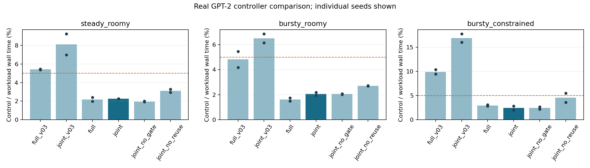

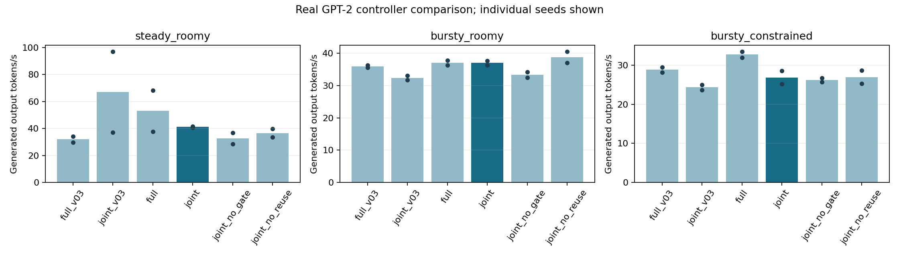

| Policy | Audit targets | Perplexity | Relative PPL % | INT4 output % | INT4 iterations |
|---|---:|---:|---:|---:|---:|
| full_v03 | 64 | 68.284 | +0.000 | 0.00 | 0 |
| joint_v03 | 64 | 68.403 | +0.174 | 21.88 | 9 |
| full | 64 | 68.284 | +0.000 | 0.00 | 0 |
| joint | 64 | 67.770 | -0.753 | 0.00 | 5 |
| joint_no_gate | 64 | 68.344 | +0.088 | 9.38 | 7 |
| joint_no_reuse | 64 | 67.730 | -0.811 | 0.00 | 3 |

The joint audit uses INT4 during 5 iterations containing prefill and emits 0.00% of outputs under INT4. Historical KV can remain affected after FP32 restoration. A small perplexity decrease is not evidence of improved model quality. Greedy serving can use different precision histories; this short audit does not certify all quantized serving outputs.

Means summarize two seeds per scenario; individual points are retained. Policy order is shuffled, but laptop thermal state, OS activity and limited repeats remain confounders. Throughput includes the entire scheduled trace and drain. Control overhead includes live telemetry, planning and admission. TTFT is engine token readiness from scheduled arrival, not streaming HTTP delivery. Quotas are enforced reservation budgets, not physical VRAM exhaustion. The small quality audit and heuristic uncertainty margins do not prove a task-quality bound or statistical confidence. Fresh v0.3 comparators run in the new study; historical results/live measurements remain separately archived.

All arms, latency tails, reuse fractions and prediction errors appear in `results/controller/comparison.md`; raw events and exact source hashes accompany each run. `docs/controller_efficiency.md` documents the algorithm and reproduction commands.

<!-- CONTROLLER_RESULTS_END -->

<!-- VALIDATION_STUDY_RESULTS_BEGIN -->
### Reliability and backend portability follow-up (v0.5)

60 instrumented GPU runs complete 720 requests, plus 12 matched CPU/CUDA runs (48 requests). There are zero rejections. 54 prediction shapes supply 270 matched executions. Eight quality arms score 2048 held-out targets each. All 112 tests pass.

M10 retains the serving policy while adding fresh calibration, three warmup passes, five GPU rounds, balanced policy positions, shuffled scenario order and read-only hardware instrumentation. It separately tests predictor accuracy on identical executed batches, uses device-specific calibration for CPU/CUDA serving, and expands independent quality audits.

The first complete study changed power source during measurement and is retained separately in `results/validation_study/`. It is diagnostic, not the primary controlled comparison. The new study requires AC power before execution and at every recorded 500 ms host sample, including calibration; a failed condition refuses the affected measurement. Observed clock settings still vary.

| Original steady joint subgroup | Runs | Mean token/s | Mean observed SM MHz |
|---|---:|---:|---:|
| AC | 2 | 121.17 | 2006 |
| battery | 3 | 72.48 | 1244 |

This subgroup split is observational and also differs in round/order. It exposes a power/clock confound; it does not isolate a causal effect. Primary throughput comparisons below use the separate AC-conditioned session.

An intermediate AC attempt stopped when a constrained joint worker reported no feasible plan for admitted work. It remains incomplete in `results/validation_study_ac/` and is excluded from successful-run aggregates. Available host RAM was about 0.8–1.0 GiB during that attempt; the same trace later completed with more than 2 GiB available. Its exact original cause remains unproven. The final source adds failure-only state/reservation snapshots and saves failed replay records; it does not bypass the safety check. Completion and zero-rejection statements below refer to the final accepted series, not every diagnostic attempt.

| Scenario | Old joint token/s | New joint token/s | Paired change % | Exploratory 95% interval | Old/new control % |
|---|---:|---:|---:|---|---|
| steady_roomy | 121.19 | 123.73 | +2.1 | [+1.3, +2.7] | 12.78 / 4.62 |
| bursty_roomy | 134.51 | 138.74 | +3.2 | [+1.8, +5.2] | 7.49 / 2.77 |
| bursty_constrained | 93.11 | 113.37 | +21.9 | [+18.8, +24.8] | 17.92 / 4.48 |

Optimized joint control stays below 5% of workload wall time in 15/15 runs; its worst observed fraction is 4.97%. This is a new session, not a re-labeling of M9's six-run overhead result. The fraction depends on execution speed as well as absolute controller cost. All request latency includes telemetry, planning, transitions and drain.

Optimized full precision has higher mean throughput than optimized joint control in 3/3 scenarios. Improvements over the older joint controller do not establish an advantage over optimized full precision. Decision reuse also trades admission responsiveness for lower control cost: compare TTFT as well as throughput. Raw action histories distinguish control-overhead savings from gains due to actual quantization/offload. Optimized joint control selects FP32 and device attention for every emitted token in this final session; its measured gains therefore concern control cost/admission, not active quantization or CPU offload.

Observed SM clocks span 1185–2565 MHz; GPU temperatures span 59–64 °C. AC-state observations are ['True']. Driver power/thermal reason flags are retained per sample. These observations do not prove that a particular performance change was caused by throttling; clock settings and external OS activity were not controlled.

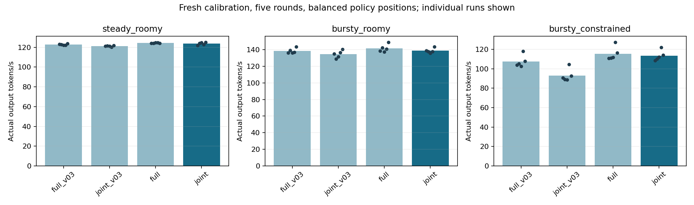

On identical executed batches, overall MAE is 71.88 ms with the old static table, 10.31 ms with the fresh static table, 4.55 ms with legacy feedback and 5.54 ms with phase feedback. These forecasts share actual execution durations and are made before observing each result. They therefore diagnose calibration/feedback without conflating different serving trajectories. Feedback remains dependent on probe order, action-family granularity and unobserved shapes; the best predictor here need not produce the best admission policy.

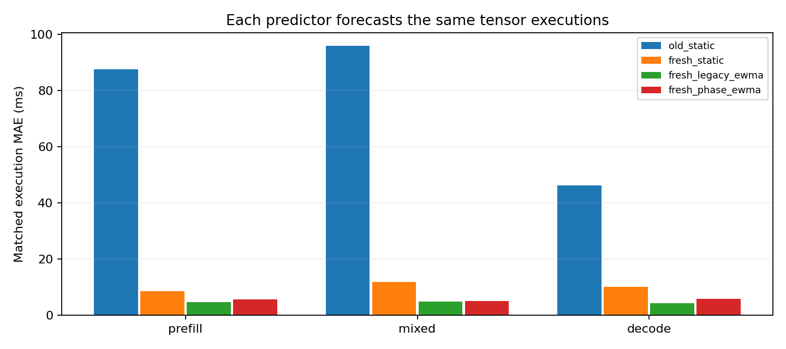

| Backend | Policy | Mean token/s | P95 TTFT ms | P95 TBT ms | Control % | Max batch | INT4 output % |
|---|---|---:|---:|---:|---:|---:|---:|
| cpu | full | 31.71 | 472.6 | 61.4 | 1.17 | 3 | 0.00 |
| cpu | joint | 31.97 | 468.0 | 60.0 | 1.35 | 3 | 0.00 |
| cuda | full | 71.23 | 51.8 | 16.4 | 1.98 | 4 | 0.00 |
| cuda | joint | 69.85 | 53.2 | 19.2 | 2.55 | 4 | 0.00 |

All 12 matched backend runs complete. CPU/CUDA full-precision greedy outputs match in 96/96 token positions. CPU-primary execution selects no CPU-offload requests, as required by its capability contract. Both use the same controller/batching source and separate calibration. This establishes execution portability across two backends on one laptop, not physical multi-machine or GPU-vendor portability. CPU's combined host quota and CUDA's separate memory pools are not equivalent resources.

| Audit arm | Targets | Perplexity | Relative PPL % | INT4 output % | Quantized prefill iterations |
|---|---:|---:|---:|---:|---:|
| dynamic_full | 2048 | 36.451 | +0.000 | 0.00 | 0 |
| dynamic_joint | 2048 | 36.451 | +0.000 | 0.00 | 0 |
| dynamic_joint_no_gate | 2048 | 36.451 | +0.000 | 0.00 | 0 |
| fixed_fp32 | 2048 | 36.451 | +0.000 | 0.00 | 0 |
| fixed_static_int4 | 2048 | 37.648 | +3.284 | 100.00 | 8 |
| fixed_early_prefill_int4_restore | 2048 | 36.772 | +0.881 | 0.00 | 4 |
| fixed_decode_int4 | 2048 | 36.976 | +1.440 | 99.22 | 0 |
| fixed_cpu_attention | 2048 | 36.451 | +0.000 | 0.00 | 0 |

Each arm scores the same 2048 distinct held-out positions in 16 disjoint prompt/continuation windows; eight arms repeat those targets. Early-prefill quantization restores FP32 before output emission but retains affected KV. Controlled schedules isolate this history effect and bypass admission; their times are not serving benchmarks. Dynamic teacher forcing has its own policy trajectory. These subset perplexities are not downstream-task accuracy or proof of a quality bound. FP32 dynamic/fixed token NLL and CPU-attention comparisons pass the 0.002 tolerance; the maximum observed token-NLL discrepancy across both checks is 4.58e-05. All three dynamic audits remain unquantized in this session. Their equal perplexities do not certify adaptive quantized outputs; the controlled schedules supply the separate precision-history evidence.

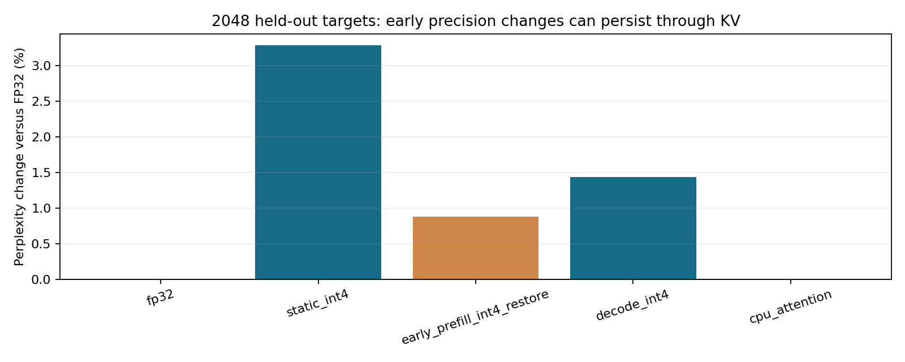

Five rounds and a single laptop remain a limited sample. Paired-change intervals bootstrap paired percent changes, not independent machines; they are exploratory, not population confidence guarantees. Steady traces repeat unchanged; burst arrivals vary by seed. Fresh calibration and standardized warmup change conditions relative to M9, so cross-session absolute rates are not controlled speedup evidence. TTFT measures engine token readiness in a non-streaming service. Reference INT4 still unpacks to floating point, and CPU attention remains synchronous. Broader hardware/model/task validation remains open.

Complete policy tails, paired intervals, observed clock plots and error breakdowns are in `results/validation_study_final/report.md`; `docs/validation_study.md` specifies the protocol.

<!-- VALIDATION_STUDY_RESULTS_END -->

<!-- FRONTIER_RESULTS_BEGIN -->
### Capacity frontier and submission release (M11, v1.0)

216 actual serving runs request 864 completions: 552 complete and 312 are explicitly rejected. There are 138 all-complete runs, 78 all-rejected runs and 0 partial runs. No worker failure is accepted. All 116 tests pass.

| Prompt tokens | FP32 | Quantization only | Offload only | Joint |
|---:|---:|---:|---:|---:|
| 128 | 600 | 600 | 600 | 600 |
| 384 | 630 | 630 | 630 | 630 |
| 768 | 700 | 675 | 700 | 675 |

There are 6 paired policy/seed observations where an adaptive policy completes every request while FP32 rejects every request under the same quota and inputs. Quantization and offload are evaluated independently as well as jointly. Joint control need not beat the single mechanisms. The measured frontier includes full-context KV reservation, calibration-derived workspace, headroom and FP32-to-INT4 transition staging. It is conditional on this warm-start implementation, not a physical-memory optimum or a cold-load feasibility result. Joint and quantization-only control share the same sampled minimum quotas here; a capacity advantage of joint control over quantization alone is not demonstrated.

| Prompt | Quota MiB | Policy completing all requests | Paired repeats with FP32 rejecting all |
|---:|---:|---|---:|
| 768 | 675 | joint | 3/3 |
| 768 | 675 | morph_only | 3/3 |

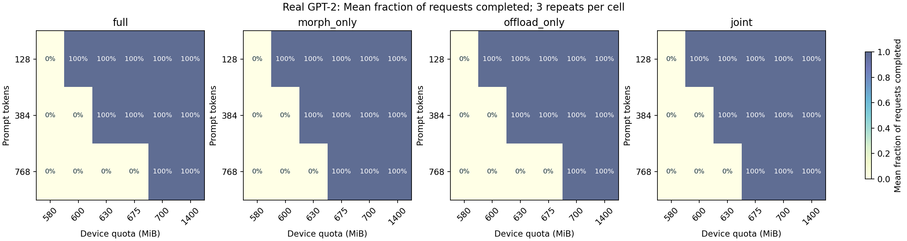

| Prompt | Quota MiB | Policy | Audit targets | FP32 PPL | Actual PPL | PPL change % | INT4 output % |
|---:|---:|---|---:|---:|---:|---:|---:|
| 128 | 630 | joint | 192 | 65.666 | 65.838 | +0.262 | 84.90 |
| 128 | 630 | morph_only | 192 | 65.666 | 67.281 | +2.459 | 99.48 |
| 384 | 675 | joint | 192 | 34.126 | 35.192 | +3.125 | 98.44 |
| 384 | 675 | morph_only | 192 | 34.126 | 34.126 | +0.000 | 0.00 |
| 768 | 675 | joint | 96 | 45.587 | 46.841 | +2.752 | 100.00 |
| 768 | 675 | morph_only | 96 | 45.587 | 47.274 | +3.702 | 100.00 |

Quality audits keep each selected cell's exact prompt/output lengths and quota. For each prompt and precision-capable policy, the lowest all-repeat-complete quota with observed quantization is selected without consulting test NLL. Disjoint held-out windows are compared with the same targets under FP32 at a roomy quota. Target counts are limited by the stored prefix and long prompts. Audit trajectories remain separate from greedy trajectories; this supplements M10's larger controlled audits and does not prove a task-accuracy bound. Actual quantization occurs in 5/6 selected adaptive audits; an audit that remains FP32 cannot certify the quantized trajectory observed during its separate greedy replay.

The first pilot missed a narrow transition-feasible region. Before the full sweep, validation-calibration reservation bounds motivated the final grid (580/600/630/675/700/1400 MiB); both pilots and the diagnostic preflight are retained. Cold model loading/calibration/warmup precede timed enforcement. Reference INT4 has unpacking costs, CPU attention is synchronous, and prefill CPU offload is unsupported. Rejections count as SLO failures, and missing latency is N/A. Finite grid spacing and three seeds on one GPU limit generalization. Resource limits are sampled and cannot isolate the worker from competing processes. Actual CUDA peaks above quota are separately reported: 0 runs.

Full cell-level completion, throughput, tail latency, SLO failures, actual memory peaks and precision/offload exposure are in `results/capacity_frontier/report.md`. The final demonstration and viva guide are in `docs/demo_and_viva.md`.

<!-- FRONTIER_RESULTS_END -->

## 7. Analytical simulation results

The following are means across three workload seeds, computed from the final 63-run `results/simulation/summary.csv`. TTFT is the mean of each run's P95, not a P95 over pooled requests. All runs complete all 96 requests with zero rejections.

| Synthetic profile | Policy | P95 TTFT (ms) | P95 TBT (ms) | SLO failure (%) | Output tokens/s |
|---|---|---:|---:|---:|---:|
|20 GiB balanced|Full|18,180.02|307.53|94.79|120.03|
|20 GiB balanced|Naive|18,488.02|365.80|94.79|118.46|
|20 GiB balanced|Joint|18,581.81|365.40|94.79|117.77|
|20 GiB slow host/link|Full|18,180.02|307.53|94.79|120.03|
|20 GiB slow host/link|Naive|33,397.11|426.85|95.83|74.14|
|20 GiB slow host/link|Joint|19,917.59|376.89|94.79|112.64|
|48 GiB server|Full|3,690.17|107.47|76.04|212.99|
|48 GiB server|Naive|4,030.83|110.96|77.08|212.97|
|48 GiB server|Joint|3,690.17|107.47|76.04|212.99|

Joint control avoids much of naive stacking's slow-host penalty: mean P95 TTFT falls 40.36% and output throughput rises 51.94%. The paired baseline-minus-joint TTFT difference is 13.48 s, with exploratory seed-bootstrap bounds 11.52–14.57 s. However, joint control is 9.56% slower than full precision in that same regime, and 2.21% slower on the balanced 20 GiB profile. The joint hypothesis is therefore supported against naive stacking in one regime, but a benefit over full precision or either mechanism alone is not established by this study.

The controller reacts to profile balance. Its mean CPU-attention request count per iteration falls from 9.44 in the balanced 20 GiB profile to 3.32 with the slow host/link, while mean quantized layers rise from 0.005 to 1.08. On the 48 GiB profile, joint control chooses full precision and no CPU offload, matching the full baseline. Disabling hysteresis produces identical simulated outcomes in this workload, so this experiment supplies no evidence of a hysteresis benefit.

These are overloaded regimes: joint request-SLO failure is 94.79% for the 20 GiB profiles and 76.04% for the 48 GiB profile. The proposal's universal latency claim and numerical SLO-improvement targets are not achieved. Static INT4 modestly improves TTFT and throughput but exceeds the adaptive quality-risk budget; it cannot be ranked as quality-equivalent. Unoptimized joint search has a mean seed-level measured P95 of roughly 33–36 ms per call. That wall time is excluded from analytical service time and cannot substantiate the proposed <2% production overhead target. Full policy tables, individual seeds, transition traces, and bootstrap intervals are retained with the results.

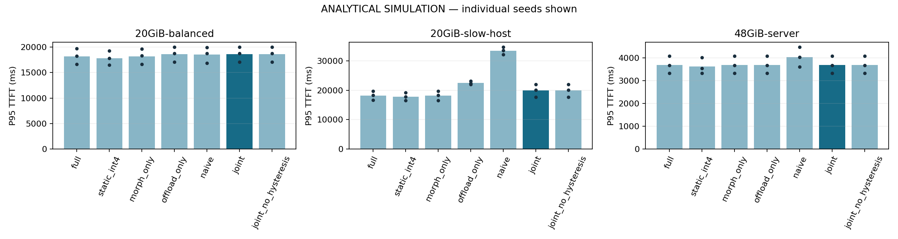

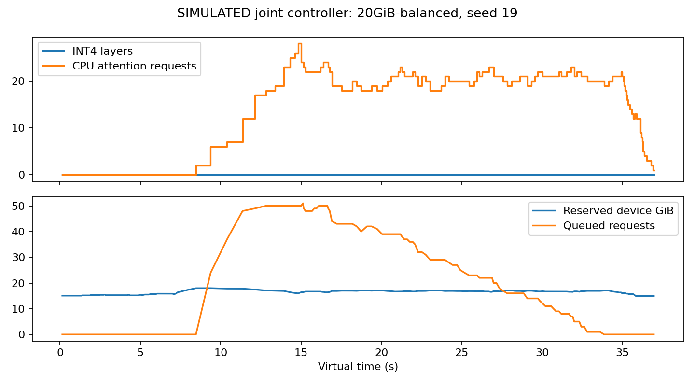

### Offered-load sensitivity

A separate 25-run exploratory sweep keeps the same 48 requests and token lengths while scaling every arrival timestamp by the inverse load factor. Five policies run at 0.6, 1.2, 2.4, 4.8 and 9.6 offered requests/s on the balanced 20 GiB profile, with one seed. Joint P95 TTFT is respectively 1.291, 5.204, 7.938, 10.054 and 11.120 seconds. Full precision gives 1.291, 4.520, 8.219, 9.574 and 11.117 seconds. The crossover is workload dependent; joint control does not show consistent superiority.

At 0.6 requests/s, P95 TTFT meets the 2-second objective, but worst inter-token-gap violations still cause a 50% request-SLO failure rate. Failure rises to 100% at the largest load; every run completes all 48 requests with zero rejections. This exposes prefill/decode contention and the limits of an iteration-cost objective without deadline-aware chunk scheduling. The single-seed curves are diagnostic, not confidence intervals. Raw outputs and assumptions are retained in `results/load_sweep/`.

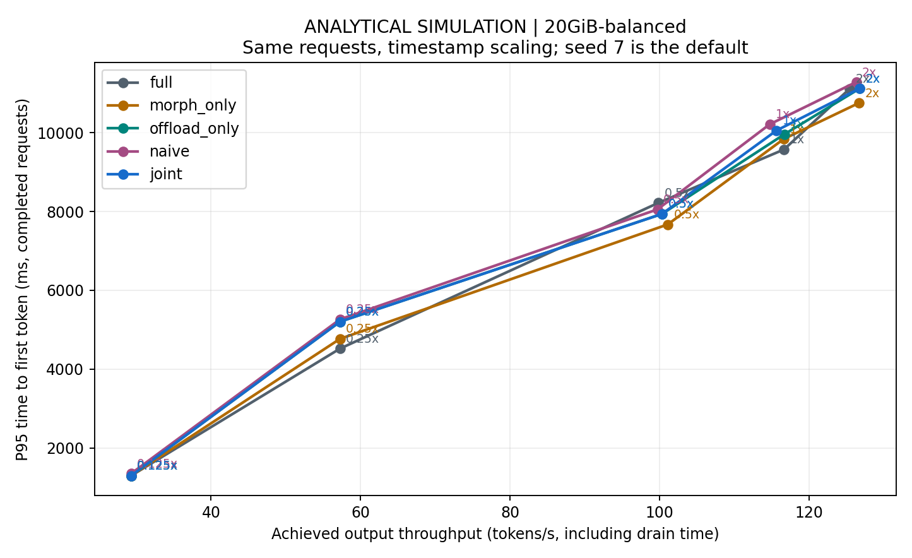

## 8. Interpretation and threats to validity

The real experiments establish executable quantization, reversible stored weights, cached decoding and CPU/GPU placement for actual pretrained GPT-2. They do not establish downstream-task accuracy, optimized INT4 acceleration or asynchronous overlap. GPT-2 quality evidence uses a small WikiText-2 prefix; the tiny decoder's corpus is authored. Checkpoint, token protocol, environment and source hashes accompany the logs. All 116 current tests pass without skips, covering numerical paths, accounting, scheduling and API behavior; live-service evidence is recorded separately.

The simulator can expose resource tradeoffs, but its favorable predictions are conditional on the cost model. Uniform or approximated layer layouts, conservative full-context scans, optimistic overlap, and synthetic effective rates can change both timing and policy rankings. Host/link sensitivity is useful evidence about the modeled system, not proof of hardware-vendor portability. Three workload seeds support inspection of variability, not a strong statistical generalization.

Metric definitions also matter. TTFT includes queueing until the first generated output; TBT uses actual successive virtual output timestamps. A single-token request has no TBT. Reported output throughput includes the queue drain. Rejected requests count as SLO failures, preventing a policy from improving its apparent compliance by dropping difficult work. Mean end-to-end latency divided by output length, used in NEO Figure 6, is a different metric and is not substituted for TTFT here.

The bounded deterministic search makes controller choices inspectable, but it remains heuristic. A fixed order misses layer interactions, and shorter-context CPU assignments may sacrifice a better global placement. Cooldown can prevent wasteful changes but can delay recovery; an ablation is necessary. The quality surrogate cannot ensure a ≤1.5% task-accuracy loss. The proposal's performance and accuracy targets require calibrated pretrained-model experiments on physical heterogeneous machines.

## 9. Conclusion and continuation

PrismServe answers the engineering part of the question affirmatively: a common resource interface drives a joint policy and actual pretrained GPT-2 placement changes, with packed storage and independently checked model outputs. Its evidence supports a working serving research prototype, rather than universal SLO-preserving LLM performance. Reference quantization slows generation and increases held-out perplexity; these negative outcomes constrain the design rather than being hidden.

The next extension beyond GPT-2 requires larger-model adapters, optimized low-bit kernels, paged KV storage, pinned host buffers and explicit CUDA stream/event ownership. Component measurements should calibrate the estimator before comparing an asynchronous executor with original serving engines on matched hardware, models, traces and quality tasks. The independent reference implementation supplies a reproducible base without depending on MorphServe's unreleased code.

## References and artifact provenance

[1] Zhaoyuan Su et al. *MorphServe: Efficient and Workload-Aware LLM Serving via Runtime Quantized Layer Swapping and KV Cache Resizing.* MLSys 2026. User-supplied PDF, particularly Sections 4–6 and Appendices A, C, D. The [official repository](https://github.com/ds2-lab/MorphServe) still announced preparation of a full code release when checked on 18 November 2026.

[2] Xuanlin Jiang et al. *NEO: Saving GPU Memory Crisis with CPU Offloading for Online LLM Inference.* MLSys 2025. User-supplied PDF, particularly Sections 3–6 and Appendix A. The original implementation is linked by the authors at the [NEO repository](https://github.com/NEO-MLSys25/NEO).

[3] PyTorch contributors. [CUDA semantics](https://docs.pytorch.org/docs/stable/notes/cuda.html), synchronized timing and allocated versus reserved memory; [serialization semantics](https://docs.pytorch.org/docs/stable/notes/serialization.html), tensor state dictionaries and explicit `weights_only` loading. Accessed 18 November 2026.

[4] OpenAI community. [GPT-2 model card](https://huggingface.co/openai-community/gpt2) and [GPT-2 Transformers documentation](https://huggingface.co/docs/transformers/model_doc/gpt2). Pinned checkpoint revision `607a30d783dfa663caf39e06633721c8d4cfcd7e`; model manifest records the safetensors hash. Accessed 18 November 2026.

[5] Stephen Merity et al. [WikiText dataset card](https://huggingface.co/datasets/Salesforce/wikitext), `wikitext-2-raw-v1` validation/test subsets. Wikipedia-derived text; CC BY-SA 3.0/GFDL attribution, retained responses and text hashes are stored under `data/wikitext2/`.

Pretrained measured results: `results/pretrained/{benchmark.json,quality.json,calibration.json,parity.json,adaptive.json,manifest.json}`. Tiny-model results remain in `results/demo/` and `results/adaptive/`. Synthetic study: `results/simulation/` and `results/load_sweep/`. The original simulation's configuration/source hashes describe that earlier run; adding pretrained modules does not imply rerunning or re-versioning those measurements. The exact original simulator source is recoverable from `results/dist/prismserve-0.1.0-py3-none-any.whl`; the pretrained benchmark module snapshot is `results/pretrained/source_snapshot.zip`, verified against its manifest. Each experiment retains its own provenance. See `pretrained.md`, `research_review.md`, `design.md`, and `experiments.md` for reproduction and evidence boundaries.
