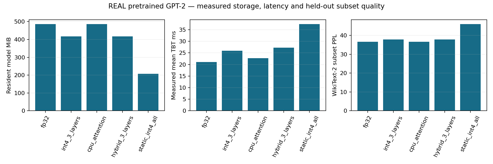

# Real pretrained GPT-2 execution

The pretrained milestone adds actual execution of the small GPT-2 checkpoint to PrismServe. It complements the tiny decoder's numerical checks and the 8B-shaped analytical experiments. GPT-2 is an English causal text-completion model with approximately 124M parameters; it is not an instruction-tuned chat model. The [official model card](https://huggingface.co/openai-community/gpt2) describes its intended completion use and MIT model license.

## Checkpoint and provenance

The default model directory is `models/gpt2`. The recorded local preparation copied existing Hugging Face cache files, without network access, at revision:

```text
607a30d783dfa663caf39e06633721c8d4cfcd7e
```

`models/gpt2/prismserve_source.json` records the canonical model ID, source, revision, byte sizes and SHA-256 values for configuration, tokenizer, and safetensors files. For the recorded checkpoint, `model.safetensors` is 548,105,171 bytes and has SHA-256:

```text
248dfc3911869ec493c76e65bf2fcf7f615828b0254c12b473182f0f81d3a707
```

The pinned configuration has 12 transformer blocks, hidden width 768, 12 attention heads, 50,257 vocabulary entries and a 1024-position context limit. The executor uses the pretrained tokenizer and original weight tensors with a project-owned forward/cache path, so precision changes and attention placement remain inspectable. The default reference dtype is FP32. Four projection matrices per selected block are packed: attention QKV and output projections, plus both MLP projections. Embeddings, tied output weights, biases and layer norms remain floating point. Group size defaults to 64.

An original Hugging Face forward pass supplies a separate numerical reference. Architecture and tokenizer conventions follow the checkpoint and the [official GPT-2 documentation](https://huggingface.co/docs/transformers/model_doc/gpt2). Merely returning text from `transformers.generate` would not validate the project's precision/placement executor.

## Run sequence

Run the commands below from the repository root. The CLI `--help` output is authoritative for optional flags and limits.

```powershell
# Prepare the pinned checkpoint from an existing cache or the supported download path.
python -m prismserve pretrained-prepare

# If the checkpoint is absent locally, opt in to the pinned public download.
python -m prismserve pretrained-prepare --download

# Continue an English prompt using the real pretrained executor.
python -m prismserve pretrained-generate --prompt "The purpose of a language model is"

# Measure parity, quality, packed storage, and reference execution latency.
python -m prismserve pretrained-prepare --dataset
python -m prismserve pretrained-benchmark --output results/pretrained

# Apply the common controller to real GPT-2 decoding under diagnostic quotas.
python -m prismserve pretrained-adapt --output results/pretrained/adaptive.json

# Start the pretrained completion API, using models/gpt2 by default.
python -m prismserve pretrained-serve
```

Preparation and an optional benchmark-data fetch are the only steps that may require network access when their assets are not cached. A successful local preparation does not require retraining GPT-2. Keep the source manifest with the checkpoint and preserve original model/dataset attribution.

The server is a local, bounded completion demonstration. Request-level controls exercise quantized layers and CPU attention. Serialized execution protects mutable global model state and cache placement. It is separate from the analytical continuous-batching simulator; concurrent HTTP requests are not evidence of an optimized multi-request execution engine.

For example, with the default local port:

```powershell
Invoke-RestMethod -Uri http://127.0.0.1:8000/health
Invoke-RestMethod -Uri http://127.0.0.1:8000/v1/completions -Method Post -ContentType 'application/json' -Body '{"model":"prismserve-gpt2","prompt":"The purpose of a language model is","max_tokens":32,"quantized_layers":[1, 7, 9],"cpu_attention":true}'
```

`/v1/models` identifies the actual local model and `/metrics` reports accumulated execution counters and memory. The completion schema supports greedy base-model continuation and explicit precision/placement controls; it does not implement chat messages, streaming, or arbitrary OpenAI API parameters. Prompt plus maximum output must fit the 1024-token context. Queue wait, precision/setup cost, backend generation and total service time are distinct measurements. Compare like-for-like timing fields rather than treating warm model TTFT as end-to-end HTTP latency.

## What the results establish

The pretrained benchmark artifacts are stored under `results/pretrained/`:

| Artifact | Evidence |
|---|---|
| `parity.json` | Original Hugging Face versus project forward logits, and cached-decoding parity |
| `quality.json` | NLL/perplexity and logit differences for the exact recorded corpus and token subset |
| `benchmark.json` | Actual pretrained generation timing and tensor-storage measurements |
| `adaptive.json` | Common-controller decisions, real cache placement and diagnostic quota transitions |
| `manifest.json` | Environment, checkpoint/data provenance, and benchmark configuration |
| `report.md`, `figures/` | Derived summaries and figures with actual execution labels |

The saved run uses WikiText-2 raw v1, not an authored fallback. It retains the first 100 dataset-viewer rows of validation and test separately, joined with two newlines; response payloads and text hashes are in `data/wikitext2/`. Calibration uses 128 validation tokens. Quality uses 4096 test BPE tokens, windows 256 and stride 128, counting 4095 next-token targets exactly once. The [WikiText dataset card](https://huggingface.co/datasets/Salesforce/wikitext) lists CC BY-SA 3.0 and GFDL licenses. This subset is a diagnostic, not a full benchmark result. A different corpus supplied in a later run must be identified by its own provenance rather than borrowing this run's WikiText label.

Original-model logit agreement checks the implementation before quantization. INT4 quality changes must then be measured against the same unquantized checkpoint, corpus and evaluation protocol. Restoring weights should reproduce fresh full-precision inference, but cannot retroactively remove error from KV produced while quantized layers were active. CPU-attention parity must distinguish mathematical output agreement from measured performance.

## Recorded pretrained results

The final FP32 executor contains 124,439,808 pretrained parameters. Validation selects blocks 1,7 and 9. No model training uses validation or test text.

| CUDA variant | Resident MiB | Mean TTFT (ms) | Mean TBT (ms) | Output tokens/s | Test-subset PPL |
|---|---:|---:|---:|---:|---:|
| FP32 |486.70|20.36|21.09|47.40|36.550|
| INT4 blocks 1, 7, 9 |417.09|25.16|25.95|38.53|37.822|
| CPU attention, FP32 |486.70|24.73|22.69|43.90|36.550|
| Three-block hybrid |417.09|29.70|27.27|36.54|37.822|
| All 12 blocks INT4 |208.26|38.73|37.44|26.66|45.997|

Timing uses three prompts with three repeats and 32 outputs each, EOS stopping disabled. Precision setup and warmup are separately recorded and excluded from these steady-generation means. The CPU FP32 baseline reaches 20.00 tokens/s. Calibration has already touched and retained 324 MiB of host master weights for all variants; maximum quantized-matrix unpack scratch is 9 MiB. Those costs accompany the resident savings.

Three-block quantization raises subset perplexity 3.480%; all-block quantization raises it25.845%. Neither is evidence for the original≤1.5% accuracy target. The selected-block implementation also has higher reference decode latency. This result demonstrates the memory/quality/time tradeoff rather than an acceleration claim.

The original Hugging Face forward comparison has maximum logit error 0.0, cached decoding 9.16×10⁻⁵ and CPU attention 4.58×10⁻⁵, within the declared 0.002 absolute tolerances. The adaptive run chooses CPU KV for 12 steps at indices 8–19 and restores CUDA at 20. Offload/restoration application times are 3.864/1.502 ms. It records 22.575 ms TTFT and 769.094 ms total generation with the controller included; no quantization is selected in this quota diagnostic.

The recorded live HTTP smoke succeeds with the actual pretrained model, block 0 INT4 and CPU KV, returning eight generated tokens. Its setup is 71.93 ms and cold service TTFT 1017.91 ms, including a cold backend call. This serves as functional evidence and is not comparable to the warm benchmark's 20 ms mean model TTFT. See `results/pretrained_api_smoke.json`. All 58 recorded repository tests pass without skips.



## Limits that still apply

This executor uses actual packed four-bit storage with floating-point dequantization and matrix multiplication. Packed storage savings do not imply fused low-bit arithmetic or a throughput gain. CPU attention uses actual host KV, but synchronized transfers do not reproduce NEO's asynchronous two-batch schedule. Live cache concatenation and unpacking scratch must remain visible in memory accounting.

The adaptive run changes a declared capacity quota to make decisions reproducible; it does not fill physical VRAM or claim that an OOM occurred. It executes real model tokens and migrations. The planner's analytical estimates and measured elapsed times remain separate fields.

GPT-2 completion makes the project a real pretrained-model serving prototype, while the scope remains small-model, single-machine reference execution. It does not establish Llama-8B deployment, multi-vendor performance, MMLU/GSM8K accuracy, original-paper reproduction, or the proposal's latency and quality guarantees. The existing synthetic-profile study retains its original configuration and source-hash manifest; the pretrained extension is a separate milestone with its own artifacts.
