## Figure index

- [Figure 1. Lowest tested complete serving quotas across prompt lengths. Lines connect sampled points only; they do not identify an exact continuous physical frontier.](#figure-1)
- [Figure 2. End-to-end architecture: concurrent request handling, common control interface, one worker, owned request state and measured feedback.](#figure-2)
- [Figure 3. Request states and explicit unsuccessful outcomes. A rejection is different from worker failure, and neither is silently treated as a completed request.](#figure-3)
- [Figure 4. Selective batching: dense work is shared while causal positions, histories and output ownership remain separate. Illustrative token counts are not measured data.](#figure-4)
- [Figure 5. Precision transition and restoration lifecycle, including host masters, staging and temporary unpack scratch.](#figure-5)
- [Figure 6. Placement and link traffic in the reference CPU-attention path. Migration differs from steady-state offloaded decode.](#figure-6)
- [Figure 7. Separate memory pools and temporary lifetimes. The diagram is schematic and not to scale.](#figure-7)
- [Figure 8. Validation-only one-block logit-KL sensitivity. Blocks 1, 7 and 9 form the selected three-block set.](#figure-8)
- [Figure 9. A control tick with plan reuse, fresh feasibility, search, execution and explicit failure paths.](#figure-9)
- [Figure 10. Separation of calibration, greedy serving, quality auditing and preserved experiment provenance.](#figure-10)
- [Figure 11. Sampled training NLL for the actual 80-step tiny-decoder run. This demonstrates executable training, not general language capability.](#figure-11)
- [Figure 12. Actual tiny-decoder resident storage and mean reference latency. Packed storage does not imply accelerated arithmetic.](#figure-12)
- [Figure 13. Real pretrained GPT-2: measured storage, reference latency and WikiText-2 subset quality](#figure-13)
- [Figure 14. Real GPT-2 placement transitions under declared capacity changes. Measured application/migration cost is displayed separately from execution.](#figure-14)
- [Figure 15. Analytical simulation: mean P95 TTFT and individual workload seeds](#figure-15)
- [Figure 16. Analytical simulation: joint precision, placement and device reservation timeline](#figure-16)
- [Figure 17. Analytical simulation: throughput versus tail latency across offered loads](#figure-17)
- [Figure 18. Analytical request-SLO violation rates across synthetic profiles and policies. These are virtual-service outcomes.](#figure-18)
- [Figure 19. Analytical offered-load sensitivity of request-SLO failure. One load-sweep seed limits uncertainty claims.](#figure-19)
- [Figure 20. Actual output token/s](#figure-20)
- [Figure 21. Measured P95 TTFT ms](#figure-21)
- [Figure 22. Separate M8 teacher-forced policy-quality changes. Exposure and 64-target counts must accompany the small PPL differences.](#figure-22)
- [Figure 23. Actual control overhead](#figure-23)
- [Figure 24. Actual throughput](#figure-24)
- [Figure 25. M9 automatic throughput view, retained alongside the focused comparison figure for complete chart coverage. Individual repeats are visible.](#figure-25)
- [Figure 26. M9 automatic P95 TTFT view. Lower planning cost does not by itself imply improved tail latency.](#figure-26)
- [Figure 27. Repeated real throughput](#figure-27)
- [Figure 28. Observed GPU clocks](#figure-28)
- [Figure 29. Matched prediction error](#figure-29)
- [Figure 30. Controlled precision-history audit](#figure-30)
- [Figure 31. Measured backend throughput and P95 engine TTFT for the matched smaller CPU/CUDA workload. These are means of three repeats.](#figure-31)
- [Figure 32. Controlled precision history explains why FP32 restoration can leave later quality effects through retained KV. The 0.881% observation belongs to the M10 controlled audit.](#figure-32)
- [Figure 33. Actual completion frontier](#figure-33)
- [Figure 34. Observed concurrency](#figure-34)
- [Figure 35. Frontier quality tradeoff](#figure-35)
- [Figure 36. Throughput among fully completed cells](#figure-36)
- [Figure 37. Complete requested-work accounting across all frontier cells. Rejections remain in the denominator and count as SLO failures.](#figure-37)
- [Figure 38. Mixed-power diagnostic session: repeated throughput; excluded from the primary AC comparison.](#figure-38)
- [Figure 39. Mixed-power diagnostic clock/throughput association; correlation does not establish causality.](#figure-39)
- [Figure 40. Matched prediction errors in the earlier mixed-power diagnostic session; use the final AC probe table for primary conclusions.](#figure-40)
- [Figure 41. Functional actual-serving smoke chart; small-protocol diagnostic only.](#figure-41)
- [Figure 42. Functional actual-serving smoke TTFT chart; not a production performance result.](#figure-42)
- [Figure 43. Serving regression chart retained for pipeline verification.](#figure-43)
- [Figure 44. Serving regression TTFT chart retained for pipeline verification.](#figure-44)
- [Figure 45. Analytical smoke-test TTFT chart; neither the main simulation nor physical serving.](#figure-45)
- [Figure 46. Analytical smoke-test SLO chart; diagnostic only.](#figure-46)
- [Figure 47. Analytical smoke-test control timeline; diagnostic only.](#figure-47)

## Table index

- [Table 1. Evidence map and headline counts](#table-1)
- [Table 2. Research mechanisms and this implementation](#table-2)
- [Table 3. Implementation map](#table-3)
- [Table 4. Derived GPT-2 reservation geometry](#table-4)
- [Table 5. Metric definitions and common interpretation errors](#table-5)
- [Table 6. Recorded software and model environment (rows 1-18)](#table-6)
- [Table 7. Recorded software and model environment (rows 19-19)](#table-7)
- [Table 8. Tiny-model quality and storage — published results](#table-8)
- [Table 9. Tiny-model quality and storage — published results](#table-9)
- [Table 10. Pretrained GPT-2 measured variants — published results](#table-10)
- [Table 11. Independent numerical and batching checks](#table-11)
- [Table 12. Analytical synthetic-profile comparison — published results](#table-12)
- [Table 13. report — published results (field panel 1) (rows 1-18)](#table-13)
- [Table 14. report — published results (field panel 1) (rows 19-21)](#table-14)
- [Table 15. report — published results (field panel 2) (rows 1-18)](#table-15)
- [Table 16. report — published results (field panel 2) (rows 19-21)](#table-16)
- [Table 17. Quality audit — published results](#table-17)
- [Table 18. comparison — published results](#table-18)
- [Table 19. Complete policy results — published results](#table-19)
- [Table 20. Separate policy quality audits — published results](#table-20)
- [Table 21. report — published results](#table-21)
- [Table 22. Repeated GPU comparison — published results](#table-22)
- [Table 23. Repeated GPU comparison — published results (field panel 1)](#table-23)
- [Table 24. Repeated GPU comparison — published results (field panel 2)](#table-24)
- [Table 25. Repeated GPU comparison — published results](#table-25)
- [Table 26. Prediction on identical actual executions — published results](#table-26)
- [Table 27. CPU/CUDA execution portability — published results](#table-27)
- [Table 28. Expanded history-aware quality audit — published results](#table-28)
- [Table 29. Lowest tested quota completing every request in every repeat — published results](#table-29)
- [Table 30. Lowest tested quota completing every request in every repeat — published results](#table-30)
- [Table 31. Quality where the policy actually quantizes — published results](#table-31)
- [Table 32. Complete cell results — published results (field panel 1) (rows 1-18)](#table-32)
- [Table 33. Complete cell results — published results (field panel 1) (rows 19-36)](#table-33)
- [Table 34. Complete cell results — published results (field panel 1) (rows 37-54)](#table-34)
- [Table 35. Complete cell results — published results (field panel 1) (rows 55-72)](#table-35)
- [Table 36. Complete cell results — published results (field panel 2) (rows 1-18)](#table-36)
- [Table 37. Complete cell results — published results (field panel 2) (rows 19-36)](#table-37)
- [Table 38. Complete cell results — published results (field panel 2) (rows 37-54)](#table-38)
- [Table 39. Complete cell results — published results (field panel 2) (rows 55-72)](#table-39)
- [Table 40. Research conclusions and their evidence bounds](#table-40)
- [Table 41. Recorded live capacity demonstration](#table-41)
- [Table 42. A.1 Analytical main study — every recorded run (rows 1-18)](#table-42)
- [Table 43. A.1 Analytical main study — every recorded run (rows 19-36)](#table-43)
- [Table 44. A.1 Analytical main study — every recorded run (rows 37-54)](#table-44)
- [Table 45. A.1 Analytical main study — every recorded run (rows 55-63)](#table-45)
- [Table 46. A.2 Analytical offered-load study — every recorded run (rows 1-18)](#table-46)
- [Table 47. A.2 Analytical offered-load study — every recorded run (rows 19-25)](#table-47)
- [Table 48. A.3 M8 actual serving — every recorded run (rows 1-18)](#table-48)
- [Table 49. A.3 M8 actual serving — every recorded run (rows 19-36)](#table-49)
- [Table 50. A.3 M8 actual serving — every recorded run (rows 37-42)](#table-50)
- [Table 51. A.4 M9 actual serving — every recorded run (rows 1-18)](#table-51)
- [Table 52. A.4 M9 actual serving — every recorded run (rows 19-36)](#table-52)
- [Table 53. A.5 M10 final GPU repeats — every recorded run (rows 1-18)](#table-53)
- [Table 54. A.5 M10 final GPU repeats — every recorded run (rows 19-36)](#table-54)
- [Table 55. A.5 M10 final GPU repeats — every recorded run (rows 37-54)](#table-55)
- [Table 56. A.5 M10 final GPU repeats — every recorded run (rows 55-60)](#table-56)
- [Table 57. A.6 M10 backend portability — every recorded run](#table-57)
- [Table 58. M11 all 216 repeats; C/R means completed/rejected (rows 1-18)](#table-58)
- [Table 59. M11 all 216 repeats; C/R means completed/rejected (rows 19-36)](#table-59)
- [Table 60. M11 all 216 repeats; C/R means completed/rejected (rows 37-54)](#table-60)
- [Table 61. M11 all 216 repeats; C/R means completed/rejected (rows 55-72)](#table-61)
- [Table 62. M11 all 216 repeats; C/R means completed/rejected (rows 73-90)](#table-62)
- [Table 63. M11 all 216 repeats; C/R means completed/rejected (rows 91-108)](#table-63)
- [Table 64. M11 all 216 repeats; C/R means completed/rejected (rows 109-126)](#table-64)
- [Table 65. M11 all 216 repeats; C/R means completed/rejected (rows 127-144)](#table-65)
- [Table 66. M11 all 216 repeats; C/R means completed/rejected (rows 145-162)](#table-66)
- [Table 67. M11 all 216 repeats; C/R means completed/rejected (rows 163-180)](#table-67)
- [Table 68. M11 all 216 repeats; C/R means completed/rejected (rows 181-198)](#table-68)
- [Table 69. M11 all 216 repeats; C/R means completed/rejected (rows 199-216)](#table-69)
- [Table 70. Final unit suite](#table-70)
- [Table 71. M10 final validation (rows 1-18)](#table-71)
- [Table 72. M10 final validation (rows 19-20)](#table-72)
- [Table 73. M11 final validation (rows 1-18)](#table-73)
- [Table 74. M11 final validation (rows 19-21)](#table-74)

## 1. Executive summary and principal findings

PrismServe is an independently implemented, hardware-profile-driven research prototype for coordinating reversible layer quantization and CPU attention placement during language-model serving. It takes its two mechanisms from the research directions represented by MorphServe and NEO [1,2], but uses its own model adapter, request scheduler, cost model and experiment harness. The main actual model is pretrained GPT-2 with 124,439,808 parameters. A small trained decoder supports fast correctness checks; separate analytical experiments explore an 8B-shaped model.

The central question is whether a common resource contract can make useful precision/placement decisions without hard-coded product-name rules. The implementation demonstrates this engineering interface on CPU and CUDA on one laptop. The results support conditional capacity and quality tradeoffs, rather than universal speedups, guaranteed task accuracy, optimized low-bit arithmetic, or physical multi-vendor portability.

The strongest capacity observation occurs in the final warm-start grid. With four requests, 768 prompt tokens, 16 output tokens and a 675 MiB serving quota, FP32 and offload-only reject all requests. Quantization-only and joint control complete all requests across three paired repeats. Their lowest tested complete quota is 675 MiB, against 700 MiB for the other two policies. Joint control does not improve that sampled frontier over quantization alone. The corresponding joint audit increases perplexity by 2.752% over the paired FP32 reference on 96 held-out targets; this small audit is a measured cost, not a quality guarantee.

In the final reliability study, optimized full precision has higher mean throughput than optimized joint control in all three scenarios. Nevertheless, efficient joint scheduling improves over the earlier joint controller by about 2.1%, 3.2% and 21.9% in paired mean percent changes. All 15 optimized-joint repetitions remain below 5% control overhead (worst 4.97%). On identical prediction probes, fresh calibration reduces static MAE from 71.88 to 10.31 ms. Legacy feedback reaches 4.55 ms, outperforming phase feedback at 5.54 ms. The additional phase structure is therefore not presented as an accuracy improvement.

This companion preserves the frozen submission v1.0.0. It adds original architecture/flow diagrams, every archived result chart, complete run-level tables and editable document output. No new model training, serving benchmark or quality measurement is performed while producing it. Tables and added plots are regenerated from archived records; schematics are labeled explicitly.

<p class="caption" id="table-1"><strong>Table 1.</strong> Evidence map and headline counts</p>

| Evidence stream | Model / execution | Size | Interpretation |
| --- | --- | --- | --- |
| Correctness and tiny training | 149,248-parameter decoder | 80 training steps; 480 held-out targets | Functional mechanisms, not general language competence |
| Pretrained model evaluation | Real GPT-2, CPU/CUDA | 4095 subset-quality targets per variant | Actual model outputs, storage and timing |
| Analytical studies | Synthetic 8B-shaped model | 63 main + 25 load runs | Modeled sensitivity, not physical 8B execution |
| M8 measured continuous serving | Real GPT-2 | 42 serving runs; 7 quality audits | Shared dense batches and queue-aware wall time |
| M9 controller efficiency | Real GPT-2 | 36 serving runs; 6 quality audits | Old/new comparison and two ablations |
| M10 final AC study | Real GPT-2 | 60 GPU + 12 CPU/CUDA runs; 54 matched shapes | Reliability, feedback diagnosis and backend portability |
| M11 capacity frontier | Real GPT-2 | 216 runs: 552 completed / 312 rejected | Sampled quota/context capacity and quality cost |
| Frozen submission validation | Version 1.0.0 | 116 tests pass | Source snapshot, raw evidence and verified live demo |

<p class="small">Source: Archived manifests and validation files; stage counts are not independent-machine replications.</p>

<div class="figure" id="figure-1">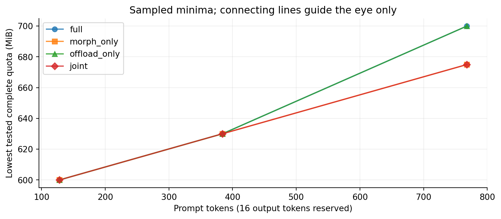<p class="caption"><strong>Figure 1.</strong> Lowest tested complete serving quotas across prompt lengths. Lines connect sampled points only; they do not identify an exact continuous physical frontier. <em>[Measured experiment]</em><br />Source: Derived from results/capacity_frontier/analysis.json</p></div>

## 2. Research motivation, paper inspiration and scope

LLM serving competes for device capacity between model weights and growing attention history. Larger batches can amortize dense computation, but a device can run out of useful capacity before exhausting its arithmetic throughput. Quantization can reclaim weight memory; CPU attention can reclaim device KV memory. Both introduce coupled costs: host recovery storage, CPU bandwidth, device-link traffic, temporary copies and switching latency. A controller must evaluate those costs together.

MorphServe uses workload-aware runtime quantized layer swapping and KV-capacity resizing. The resizing repurposes freed device memory; it should not be described as quantizing or deleting the live KV history. NEO offloads selected requests' attention computation and KV state to the CPU, using load-aware scheduling and asymmetric CPU/GPU pipelining. Its CPU placement is more than parking KV bytes and repeatedly fetching the entire history back to the device. PrismServe adopts these mechanism ideas while implementing synchronous reference execution [1,2].

<p class="caption" id="table-2"><strong>Table 2.</strong> Research mechanisms and this implementation</p>

| Aspect | MorphServe inspiration | NEO inspiration | PrismServe evidence |
| --- | --- | --- | --- |
| Main control | Runtime layer precision | Request attention / KV placement | Joint plan Q (layers), C (request IDs) |
| Capacity benefit | Freed device weight storage | Freed device KV capacity | Measured admitted workload region |
| Host resource | Recovery / packed variants | Persistent host KV and attention | Host backups, copies and KV reserved jointly |
| Execution engineering | Asynchronous state-preserving swaps | Asymmetric pipeline and load-aware scheduling | Synchronous reference transitions and attention |
| Portability scope | Paper-specific evaluated engines | Paper-specific evaluated engines | Common profile contract; actual CPU/CUDA laptop |
| What is not reproduced | Original optimized full system | Original optimized full system | No paper-speedup, vLLM-equivalence or vendor-portability claim |

<p class="small">Source: User-supplied MorphServe and NEO papers; docs/research_review.md</p>

The supplied proposal and midterm slides are planning context. The delivered scope was revised to fit the available hardware and independently available code: real GPT-2 serving plus an explicitly separate simulator. The proposal's larger-model, downstream-accuracy and universal-latency targets are not converted into measured accomplishments. A working GPT-2 implementation is not a physical Llama-8B deployment, and a resource-profile interface is not a universal optimized kernel.

The hypotheses are deliberately falsifiable. A common controller should respond to capacity/rate changes through its inputs; exact cached and restored paths should preserve the intended numerical invariants; adaptation should help in at least some constrained regimes; and adding complexity should justify its overhead. The studies retain counterexamples: FP32 often wins, reference quantization is slower, phase feedback does not beat simpler feedback in matched probes, and joint control does not expand the final frontier beyond quantization alone.

<div class="figure" id="figure-2">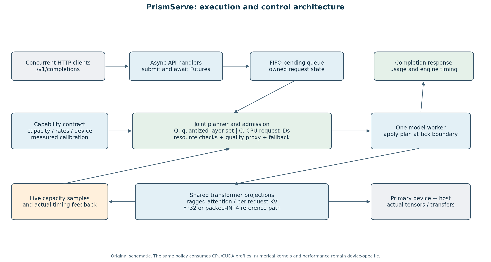<p class="caption"><strong>Figure 2.</strong> End-to-end architecture: concurrent request handling, common control interface, one worker, owned request state and measured feedback. <em>[Original architecture schematic]</em><br />Source: prismserve/{types,efficient_policy,live_engine,batching,batch_service}.py</p></div>

## 3. System architecture, request lifecycle and true batching

HTTP handlers submit requests and asynchronously await concurrent Futures. One background worker owns mutable global precision and per-request KV placement. This ownership prevents two clients from independently changing the same layer weights. Request IDs, prompt tokens, current prompt cursor, generated outputs, cache, timing history and completion Future remain request-specific.

At an iteration boundary, the engine observes live capacities, snapshots active/pending work, allocates a bounded prefill token budget, and evaluates admission prefixes and allowed execution plans. Existing active work advances rather than being silently evicted. New requests enter in FIFO prefix order. The worker applies any precision or placement changes, executes one shared batch, records output times and updates learned timing corrections. Finished requests release their owned KV.

The batch primitive flattens all current token chunks into one activation matrix. Each of GPT-2's 12 blocks performs its four dense projections once, giving 48 projection calls per iteration. Attention then operates over each request's own causal history and placement. The vocabulary head uses only the last current token of each request. This establishes shared dense execution, while retaining a Python-level ragged attention loop. It is not a fused paged-attention kernel.

<div class="figure" id="figure-3">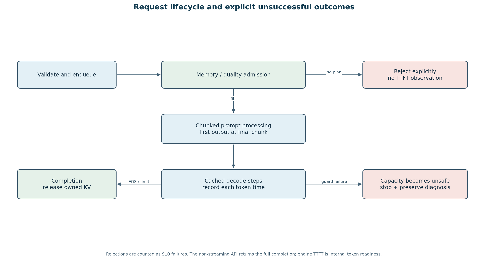<p class="caption"><strong>Figure 3.</strong> Request states and explicit unsuccessful outcomes. A rejection is different from worker failure, and neither is silently treated as a completed request. <em>[Original flowchart]</em><br />Source: prismserve/live_engine.py</p></div>

<div class="figure" id="figure-4">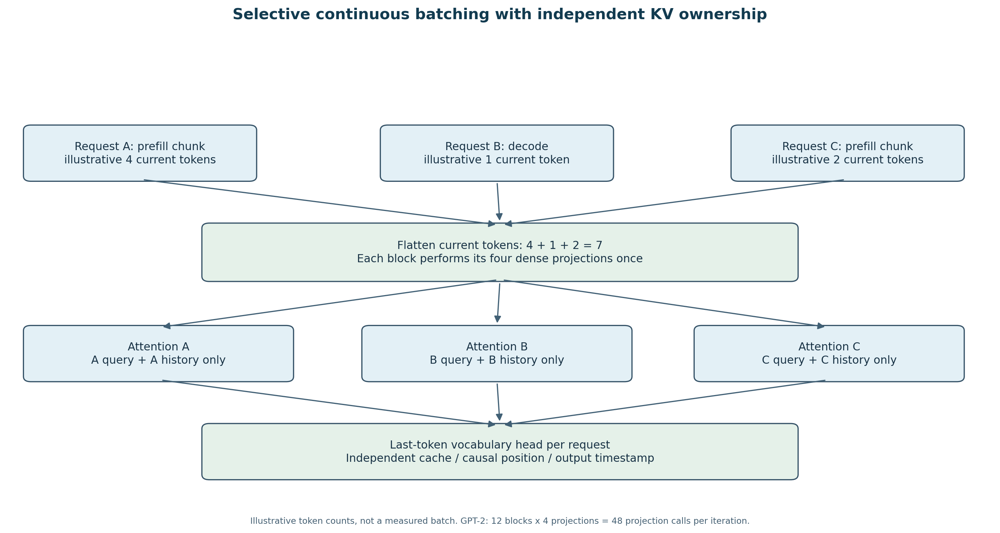<p class="caption"><strong>Figure 4.</strong> Selective batching: dense work is shared while causal positions, histories and output ownership remain separate. Illustrative token counts are not measured data. <em>[Original architecture schematic]</em><br />Source: prismserve/batching.py</p></div>

<p class="caption" id="table-3"><strong>Table 3.</strong> Implementation map</p>

| Component | Principal module | Responsibility |
| --- | --- | --- |
| Capability and plan contracts | types.py | HardwareProfile, ModelSpec, WorkItem, Plan, Estimate, Decision |
| Reference analytical path | estimator.py / policy.py / simulator.py | 8B-shaped modeled times and restricted plan search |
| Measured control | measured_policy.py / efficient_policy.py | Timing families, resource bounds, feedback and conservative gate |
| Pretrained adapter | pretrained.py / quantization.py | Real GPT-2, packed INT4, exact masters, cached forward |
| Actual shared batches | batching.py | Flattened dense tokens, ragged independent attention, last-token head |
| Continuous worker | live_engine.py | Admission, chunking, transitions, request timestamps and failure diagnosis |
| Concurrent API | batch_service.py | Async handlers, bounded queues, health and metrics |
| Experiment and provenance | live_experiments.py / validation_study.py / frontier.py | Actual replay, audit targets, archived source and all outcomes |

The API is non-streaming: clients receive a full response after generation completes. Engine TTFT measures internal first-token readiness from scheduled arrival, not the time at which the client receives its first streamed byte. Concurrent HTTP success and true shared batching are validated separately from a large active-request count.

## 4. Precision, placement and memory accounting

### 4.1 Grouped INT4 storage and exact weight restoration

The portable quantizer uses symmetric per-group values in [-7, 7], with a group size of 64 and FP32 scales. For an all-zero group the scale is replaced by one to avoid division by zero. Two encoded values are stored in each byte; padding handles incomplete groups and odd packed lengths. Embeddings, normalization parameters, biases and tied vocabulary weights remain floating point. GPT-2's four projection matrices in a selected block are morphable.

A CPU FP32 master supports exact restoration of the original stored matrix. During INT4 execution, the reference implementation temporarily unpacks one matrix and performs floating-point matmul. Packed storage is genuine; accelerated native INT4 arithmetic is not claimed. Quantization can reduce resident model storage while increasing total host-plus-device accounting and runtime.

<div class="figure"><p class="caption"><strong>Equation 1.</strong> Per-group reference quantization; reconstruction uses the stored scale and integer value.</p></div>

<div class="figure" id="figure-5">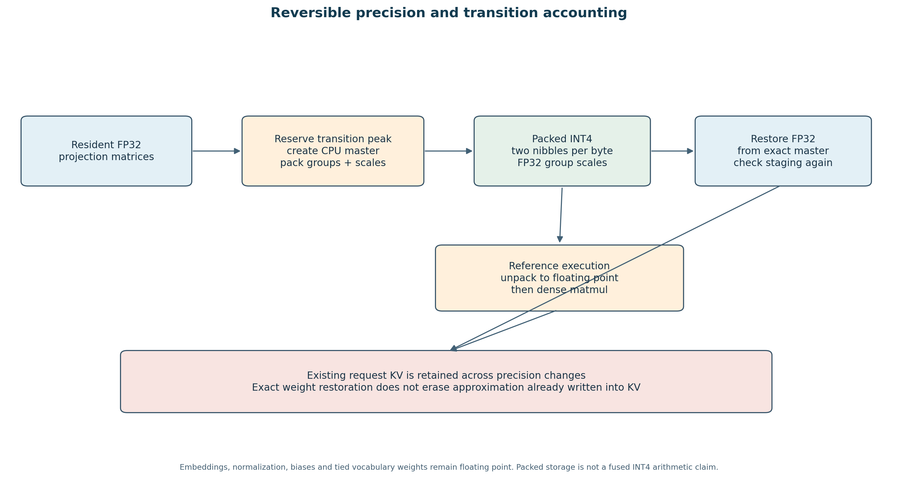<p class="caption"><strong>Figure 5.</strong> Precision transition and restoration lifecycle, including host masters, staging and temporary unpack scratch. <em>[Original mechanism diagram]</em><br />Source: prismserve/quantization.py and prismserve/pretrained.py</p></div>

### 4.2 Persistent CPU attention and cache movement

Offloaded decode requests keep their accumulated KV on CPU and execute attention there. Current query and newly projected K/V travel from the primary device, and attention output returns for subsequent dense operations. The full historical KV does not make a round trip every steady-state token. An actual placement change copies the existing history and must reserve overlapping source/destination lifetimes. Prefill stays on the primary device. CPU-primary execution disallows the nonsensical action of offloading attention to itself.

<div class="figure" id="figure-6">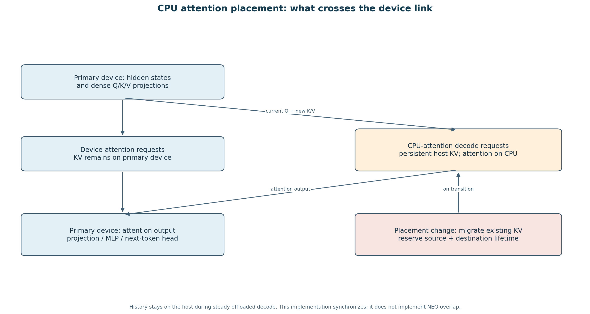<p class="caption"><strong>Figure 6.</strong> Placement and link traffic in the reference CPU-attention path. Migration differs from steady-state offloaded decode. <em>[Original data-flow diagram]</em><br />Source: prismserve/batching.py and prismserve/pretrained.py</p></div>

### 4.3 Future KV and transition-safe admission

<div class="figure"><p class="caption"><strong>Equation 2.</strong> KV bytes per cached token; the factor two counts keys and values, and KV heads support grouped-query model geometry.</p></div>

<p class="caption" id="table-4"><strong>Table 4.</strong> Derived GPT-2 reservation geometry</p>

| Quantity | Value | Interpretation |
| --- | --- | --- |
| Layers / KV heads / head dimension | 12 / 12 / 64 | FP32 KV, 4 bytes per element |
| KV bytes per token | 73,728 bytes = 72 KiB | Derived geometry, not an allocator-peak observation |
| 128 prompt + 16 reserved outputs | 10.125 MiB KV per request | Maximum declared context 144 |
| 384 prompt + 16 reserved outputs | 28.125 MiB KV per request | Maximum declared context 400 |
| 768 prompt + 16 reserved outputs | 55.125 MiB KV per request | Maximum declared context 784 |
| Four requests at maximum context 784 | 220.5 MiB future KV | Before weights, temporary copies, workspace and margins |
| One morphable FP32 block matrix set | 27 MiB | 7,077,888 projection weights |
| Its packed INT4 plus scales | 3.796875 MiB | 64-weight groups and FP32 scales |
| Three-block ideal projection-weight saving | 69.609375 MiB | Consistent with measured 486.70 to 417.09 MiB resident storage |

Admission reserves prompt length plus configured maximum output length, rather than assuming oracle knowledge of early EOS. It checks both host and device pools and the maximum of steady and transition states. The measured workspace bound is monotone in admitted request count and reserved context, with fixed/per-request scratch fitted from calibration, reserved KV copies and safety headroom. Static buffers and a 64 MiB backend margin further reduce usable primary-device capacity. CPU-primary mode checks the combined host footprint.

Reservations intentionally differ from reported physical allocation. CUDA allocated bytes, allocator-reserved bytes, owned KV, retained masters and sampled free memory are different measurements. A logical quota is not a physical VRAM exhaustion event. Sampling does not provide isolation from unrelated processes: if capacity becomes unsafe, the engine stops and preserves diagnosis rather than forcing work to finish.

<div class="figure" id="figure-7">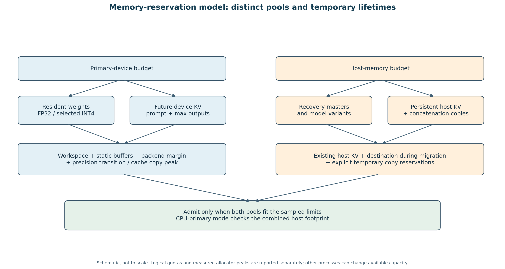<p class="caption"><strong>Figure 7.</strong> Separate memory pools and temporary lifetimes. The diagram is schematic and not to scale. <em>[Original memory-accounting diagram]</em><br />Source: prismserve/estimator.py, measured_policy.py and efficient_policy.py</p></div>

## 5. Planning algorithm, calibrated predictions and safety

A plan specifies a global quantized-layer set Q and per-request CPU-attention set C. Candidate precision sets follow a validation-derived sensitivity order; CPU assignments use a bounded set of eligible decode prefixes, preferring shorter contexts. The planner evaluates memory, additive quality risk and a compatible measured timing family before comparing cost. Unknown timing families are infeasible in the measured path. This is a bounded heuristic search, not a global solution over every layer/request subset.

The engine and plan selector have distinct objectives. Within a candidate admitted batch, the measured selector combines predicted iteration time, transition cost amortized over a horizon of 16, and an additive quality penalty. Across admission prefixes, the worker ranks predicted time per serviced request with a TBT penalty. Meeting an iteration-time proxy does not guarantee a request's queue-inclusive TTFT or every inter-token gap.

<div class="figure"><p class="caption"><strong>Equation 3.</strong> Conceptual execution-plan objective; the engine separately compares admission sizes and charges actual changes in full.</p></div>

<div class="figure"><p class="caption"><strong>Equation 4.</strong> Additive validation-logit KL surrogate. This is not a downstream-task or perplexity guarantee.</p></div>

<div class="figure" id="figure-8">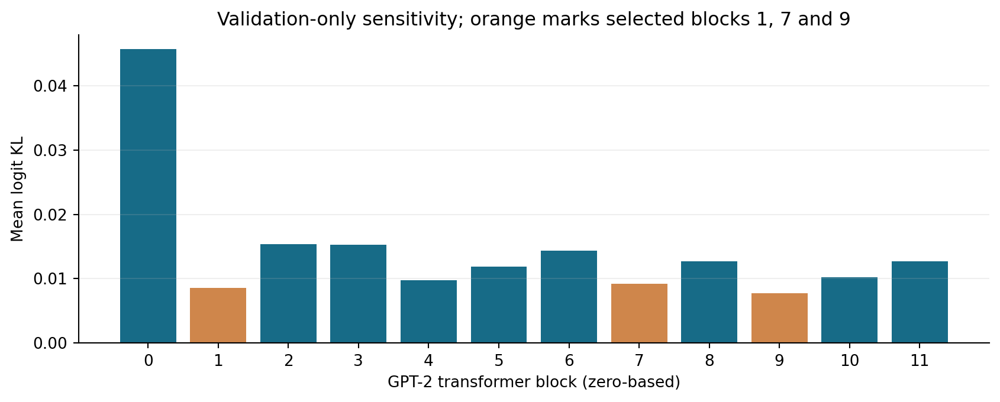<p class="caption"><strong>Figure 8.</strong> Validation-only one-block logit-KL sensitivity. Blocks 1, 7 and 9 form the selected three-block set. <em>[Derived from measured validation data]</em><br />Source: results/pretrained/calibration.json; 128 validation input tokens</p></div>

### 5.1 Measured lookup and feedback

Calibration covers actual batch sizes, current contexts, prompt/decode mixtures, precision and CPU-attention placement. The controller finds a compatible nearest shape in log feature space and conservatively scales upward for greater work. Features include batch count, total prefill tokens, maximum current context and CPU request count. Current lengths drive timing; future reservations drive memory. An EWMA ratio updates only the executed family after its duration is observed. New phase-specific keys separate prefill, mixed and decode; observations do not reveal the true counterfactual runtime of unchosen plans.

The efficient path compiles resource terms and timing families, bounds lookup/reservation caches, avoids repeated model-tensor scans, and skips no-op placement/precision applications. It can reuse a stable plan during three intervening iterations of a four-iteration refresh interval. New request IDs, a changed active set/phase or a failed resource check trigger search. Every reused plan still receives current capacity checks. This reduces search cost but can postpone reconsidering an already-seen pending request for up to three ticks.

<div class="figure" id="figure-9">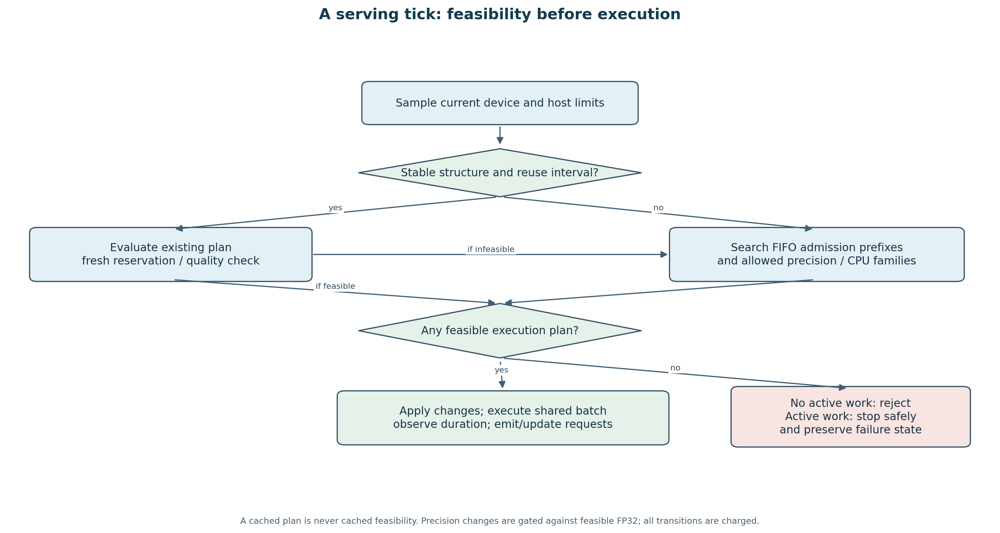<p class="caption"><strong>Figure 9.</strong> A control tick with plan reuse, fresh feasibility, search, execution and explicit failure paths. <em>[Original algorithm flowchart]</em><br />Source: prismserve/live_engine.py and efficient_policy.py</p></div>

### 5.2 Conservative adaptation and observability

The conservative gate compares uncertainty-adjusted predicted time per serviced request against a feasible FP32 reference, which may have a smaller batch. It requires a 10% minimum benefit after margins; transition amortization is included. If FP32 has no feasible reference, adaptation remains allowed. Uncertainty margins are engineering heuristics, not statistical confidence bounds. Cooldown can retain a current feasible action, while safety constraints take priority.

Failure snapshots preserve the last sampled profile, control state, active work and current-plan estimate before request state is cleared. Replay saves failed partial observations and propagates the error. Such an attempt is not accepted as a successful benchmark. These checks improve diagnosis; they do not make a shared laptop immune to external memory pressure.

```text
for each worker tick:
    sample capacities; build active work and FIFO candidate additions
    if stable reuse is eligible:
        re-evaluate the current plan with fresh resource limits
    otherwise, or if that plan no longer fits:
        check FP32 prefixes; search permitted precision/placement candidates
        reject plans exceeding host/device/transition or quality budgets
        compare admitted-batch cost and apply the conservative FP32 gate
    if no plan fits:
        reject an unadmitted request, or stop unsafe active work with diagnosis
    else:
        apply precision/cache movement; execute the actual shared batch
        record token readiness, update feedback, complete/release requests
```

## 6. Experimental design, metrics and reproducibility

All stages identify their evidence type. Actual timing uses tensor execution and synchronized CUDA or host wall-clock observations; the simulator advances virtual time from an analytical estimator. These quantities are not combined into a single speedup. The real pretrained studies use local pinned safetensors and the original GPT-2 BPE tokenizer. Model assets are not downloaded implicitly by generation paths.

The final GPU studies pair prompt IDs, arrivals and output limits across policies. Kernel warmup, device synchronization, explicit EOS disabling, per-request state isolation and complete queue drain avoid easy work-count confounds. Calibration precedes replay. GPU tests and other project model jobs do not run concurrently with timed studies. Policy order rotates and cell/scenario order is shuffled where specified. Read-only telemetry records AC state, clocks, thermal/power-limit flags, utilization, available RAM and process RSS.

Quality selection uses the validation split, while audits use a separate stored test prefix. Teacher-forced quality is a separate trajectory from greedy serving: input continuations and timing decisions can change both precision choices and cached history. Reference comparisons therefore publish target identity/count and precision exposure. Repeated evaluations across arms do not multiply the number of independent target positions.

<div class="figure" id="figure-10">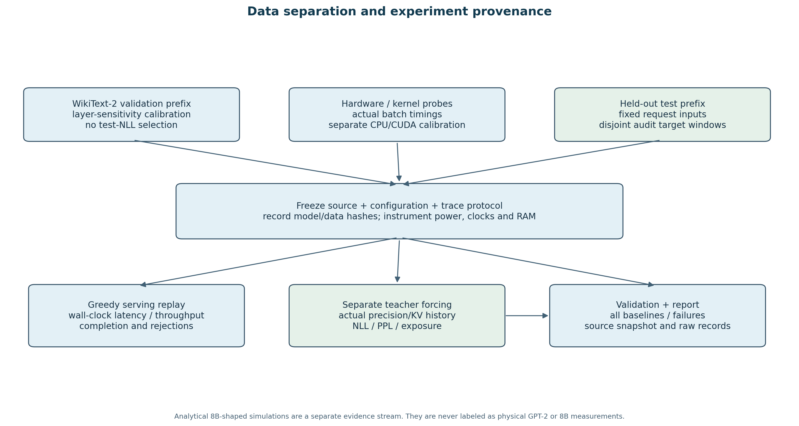<p class="caption"><strong>Figure 10.</strong> Separation of calibration, greedy serving, quality auditing and preserved experiment provenance. <em>[Original validation flowchart]</em><br />Source: prismserve/live_experiments.py, validation_study.py and frontier.py</p></div>

<div class="figure"><p class="caption"><strong>Equation 5.</strong> Token-readiness timing definitions; gaps and TPOT are undefined for a single-token completion.</p></div>

<div class="figure"><p class="caption"><strong>Equation 6.</strong> Held-out teacher-forced likelihood and perplexity, evaluated on identical target positions within each comparison.</p></div>

<p class="caption" id="table-5"><strong>Table 5.</strong> Metric definitions and common interpretation errors</p>

| Metric | Implemented definition | Interpretation |
| --- | --- | --- |
| Output token/s | Completed output tokens / full trace-and-drain wall time | Includes admission, transition and scheduling costs in actual replay |
| Request SLO failure | Rejections plus completed requests violating TTFT or any available TBT limit | Rejecting work never improves the apparent violation fraction |
| Control overhead | Telemetry + planning/admission time / workload wall time | A fraction depends on execution speed as well as absolute search cost |
| TTFT P95 | Per-run percentile of completed request readiness times | Means of run P95 values are not pooled-request P95 |
| TBT P95 | Per-run percentile of observed successive output gaps | Not end-to-end latency divided by output count |
| Quality relative PPL | 100 x expm1(NLL_variant - NLL_reference) | Corpus/protocol-specific; not task-accuracy percentage loss |
| Capacity frontier | Lowest sampled quota completing all configured requests in every repeat | Neither an interpolated exact minimum nor a physical OOM limit |

<p class="caption" id="table-6"><strong>Table 6.</strong> Recorded software and model environment (rows 1-18)</p>

| Item | Recorded value |
| --- | --- |
| CPU/GPU environment | Windows-10-10.0.26200-SP0 |
| Python | 3.10.11 |
| torch | 2.5.1+cu121 |
| numpy | 1.26.4 |
| psutil | 7.1.3 |
| fastapi | 0.122.0 |
| uvicorn | 0.38.0 |
| pydantic | 2.12.5 |
| matplotlib | 3.10.9 |
| python-pptx | 1.0.2 |
| pymupdf | 1.28.2 |
| markdown | 3.10.3 |
| transformers | 4.57.3 |
| safetensors | 0.7.0 |
| tokenizers | 0.22.1 |
| Actual GPU | NVIDIA GeForce RTX 4050 Laptop GPU, about 6 GB VRAM |
| Host memory | About 16 GB installed; free capacity varies substantially |
| GPT-2 shape | 12 layers, width 768, 12 attention/KV heads, head dimension 64, 1024 positions |

<p class="small">Source: results/environment.json and pinned model manifest</p>

<p class="caption" id="table-7"><strong>Table 7.</strong> Recorded software and model environment (rows 19-19)</p>

| Item | Recorded value |
| --- | --- |
| GPT-2 source revision | 607a30d783dfa663caf39e06633721c8d4cfcd7e |

<p class="small">Source: results/environment.json and pinned model manifest</p>

Memory units in this document are MiB = 2^20 bytes unless explicitly described otherwise. A driver-reported power/thermal reason flag is an observation, not proof that it caused a particular latency change. Bootstrap intervals over a few same-laptop repeats are exploratory and conditional; they do not establish independent-machine population confidence.

## 7. Tiny-decoder training, correctness and storage checks

<p class="caption" id="table-8"><strong>Table 8.</strong> Tiny-model quality and storage — published results</p>

| Variant | NLL | Perplexity | Resident bytes | CPU master bytes | Maximum unpack scratch bytes |
| --- | --- | --- | --- | --- | --- |
| FP32 | 2.626656 | 13.827457 | 596,992 | 0 | 0 |
| Layer 0 INT4 | 2.626067 | 13.819310 | 428,032 | 196,608 | 65,536 |
| Both layers INT4 | 2.626034 | 13.818851 | 259,072 | 393,216 | 65,536 |

<p class="small">Source: docs/final_report.md</p>


One quantized layer reduces resident model storage by 28.3%; both reduce it by 56.6%. Embeddings, output projection, and other unquantized tensors limit whole-model compression. The two-layer packed representation plus CPU masters totals 652,288 bytes, more than the initial 596,992 resident bytes. Quantization therefore relocates and compresses device storage while retaining an explicit host recovery cost; it does not reduce every memory category.


Relative perplexity changes are −0.0589% for one layer and −0.0622% for both. Their mean logit KL values are 0.0001345 and 0.0001565. The tiny negative perplexity changes are small corpus-specific perturbations, not evidence that quantization improves general accuracy. After restoring original weights, maximum absolute logit error is 0.0 and NLL returns to 2.626656. This fresh-inference restoration check does not erase approximation already stored in a cache produced under quantized weights.


<p class="caption" id="table-9"><strong>Table 9.</strong> Tiny-model quality and storage — published results</p>

| Device and variant | Mean TTFT (ms) | Mean TBT (ms) |
| --- | --- | --- |
| CPU FP32 | 4.461 | 2.889 |
| CPU INT4, layer 0 | 5.989 | 4.256 |
| CUDA FP32 | 4.191 | 4.174 |
| CUDA INT4, layer 0 | 6.161 | 6.624 |
| CUDA CPU attention | 4.653 | 4.103 |
| CUDA hybrid | 6.621 | 6.160 |

<p class="small">Source: docs/final_report.md</p>


The unpack-and-matmul implementation is slower after quantization. CUDA INT4 TBT is approximately 58.7% above CUDA FP32 in this short benchmark. This negative result matters: memory savings alone do not imply faster service. CPU FP32 is also faster than CUDA for this tiny shape, where device launch overhead is substantial. The small CPU-attention timing difference should not be presented as a reliable acceleration without repeated, controlled measurements. All variants in this microbenchmark emit the same recorded 16 output IDs, but that single-generation agreement does not replace held-out logit evaluation.


In the adaptive execution diagnostic, the controller initially keeps KV on CUDA under an 8 MiB declared quota. At decode index 8, the quota becomes 1,809,920 bytes and CPU attention is selected. It remains on the CPU for 12 output steps, then returns to CUDA at index 20 when the quota recovers. Measured application/migration time is approximately 0.608 ms at the CPU transition and 0.478 ms at restoration. No quantized layers are chosen: conservative scratch accounting and reference unpacking costs make host placement preferable for this diagnostic. Separate static mechanism runs exercise real INT4 storage.


The adaptive generation records 6.065 ms TTFT and 222.783 ms elapsed generation time. Mean planner search is 406 microseconds across 31 decisions. These are wall-clock observations; the estimator's roughly 0.1 ms component predictions are not measurements of this Python-heavy tiny executor. The mismatch shows why resource profiling must be extended with shape-dependent kernel and launch calibration before using the model as a latency predictor.


<div class="figure" id="figure-11">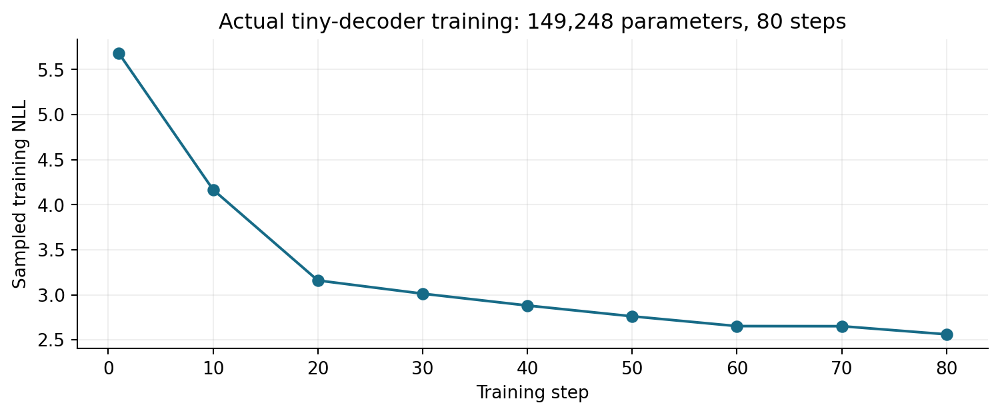<p class="caption"><strong>Figure 11.</strong> Sampled training NLL for the actual 80-step tiny-decoder run. This demonstrates executable training, not general language capability. <em>[Derived measured training curve]</em><br />Source: results/demo/real_backend.json</p></div>

<div class="figure" id="figure-12">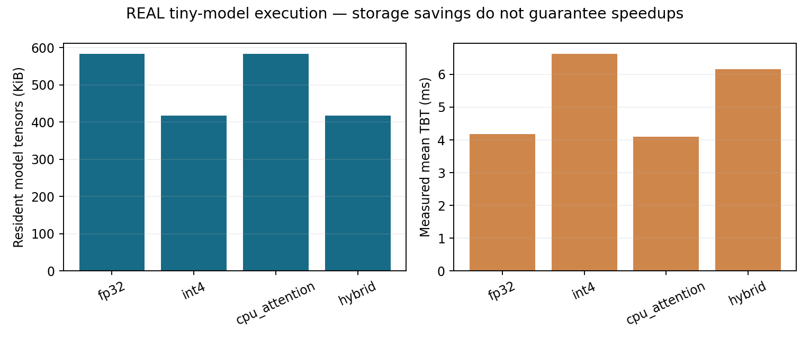<p class="caption"><strong>Figure 12.</strong> Actual tiny-decoder resident storage and mean reference latency. Packed storage does not imply accelerated arithmetic. <em>[Measured experiment]</em><br />Source: results/demo/figures/measured_storage_latency.png</p></div>

The tiny model scores 480 held-out byte targets. Fresh restored weights produce maximum logit error 0.0. A tiny negative PPL perturbation on authored text is not evidence of improved general model quality.

## 8. Actual pretrained GPT-2: parity, quality and execution

The pretrained milestone uses 124,439,808 parameters from the pinned GPT-2 revision recorded in `models/gpt2/prismserve_source.json`. It has 12 blocks, width 768, 12 heads and a 1024-position context; no pretrained-model training was performed. The official model is an English base completion model, not an instruction-tuned chatbot [4]. The executor uses FP32 and 64-weight quantization groups. Original-forward maximum logit error is 0.0, cached-versus-full-prefix error is 9.16×10⁻⁵, and CPU-attention placement error is 4.58×10⁻⁵. All pass the declared 0.002 absolute tolerance. Fresh restored inference also has 0.0 error against the original forward path.


Layer calibration quantizes one block at a time on the first 128 GPT-2 tokens from the WikiText-2 validation prefix, ranking logit KL. The three selected blocks are 1,7 and 9. Test quality uses the first 4096 BPE tokens from a separate test prefix: windows 256, stride 128, every next-token target counted once, for 4095 scored targets. Both prefixes derive from the first 100 rows of their respective `wikitext-2-raw-v1` splits, joined with two newlines; original responses and hashes are retained. This is a subset diagnostic, not the canonical full-test perplexity [5]. Test data never selects layers.


<p class="caption" id="table-10"><strong>Table 10.</strong> Pretrained GPT-2 measured variants — published results</p>

| Variant | Resident MiB | Test-subset PPL | PPL change (%) | CUDA mean TBT (ms) | Output tokens/s |
| --- | --- | --- | --- | --- | --- |
| FP32 | 486.70 | 36.550 | 0.000 | 21.095 | 47.40 |
| INT4 blocks 1, 7, 9 | 417.09 | 37.822 | 3.480 | 25.953 | 38.53 |
| CPU attention, FP32 | 486.70 | 36.550 | 0.000 | 22.688 | 43.90 |
| Three-block hybrid | 417.09 | 37.822 | 3.480 | 27.267 | 36.54 |
| All 12 blocks INT4 | 208.26 | 45.997 | 25.845 | 37.440 | 26.66 |

<p class="small">Source: docs/final_report.md</p>


Measured timings cover three authored prompts, three repeats each and 32 outputs per run, with EOS stopping disabled so work lengths match. Warmup and precision setup are excluded from generation timing and recorded separately. GPU FP32 mean TTFT is 20.363 ms; CPU FP32 reaches 20.00 output tokens/s with 49.374 ms mean TBT. These are serialized local generations, not concurrent-load SLO measurements.


Three-block packing saves 14.30% resident model storage; all-block packing saves 57.21%. However, the run retains 324 MiB of CPU masters touched during validation calibration, even for restored FP32 variants, plus up to 9 MiB of floating-point unpack scratch for quantized matrices. Allocator-reserved bytes and KV are separately reported. Quantization is slower here: the three-block mean TBT increases 23.03%. Its 3.48% perplexity rise is also not within a 1.5% tolerance, and perplexity change is not task accuracy. All-block quantization deteriorates much more. The reference uniform quantizer is not AWQ; these are implementation-specific outcomes.


CPU-placement quality rows evaluate fresh primary-device prefill, so their equal perplexity does not independently measure a whole sequence of CPU decode. CPU KV decoding correctness is established separately by placement parity and actual generated token traces. This distinction avoids assigning a misleading full-CPU interpretation to the NLL table.


The common controller also executes real GPT-2 generation in `adaptive.json`, using validation-derived sensitivity and per-decision physical-memory telemetry. During declared quota indices 8–19, it selects CPU attention for 12 outputs, restoring CUDA KV at index 20. Application/migration takes 3.864 ms at offload and 1.502 ms at restoration. Recorded TTFT is 22.575 ms and elapsed generation 769.094 ms; mean planner search is 1.079 ms. No quantization is selected in this diagnostic because the conservative reference-kernel costs favour placement. Physical VRAM is not artificially filled. Thus real adaptive placement is demonstrated, while a runtime quantization benefit is not claimed.


The live HTTP check also succeeds with actual GPT-2, block 0 INT4 and host KV, returning eight outputs with queue/setup metadata. Setup takes 71.93 ms and cold service TTFT is 1017.91 ms; this functional cold check is not comparable to the warm 20 ms model TTFT. The full response and health/metrics are preserved in `results/pretrained_api_smoke.json`.


<div class="figure" id="figure-13">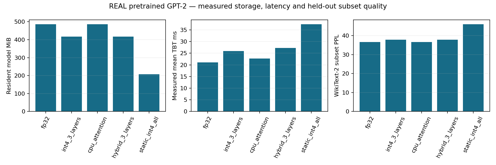<p class="caption"><strong>Figure 13.</strong> Real pretrained GPT-2: measured storage, reference latency and WikiText-2 subset quality <em>[Measured experiment]</em><br />Source: results/pretrained/figures/pretrained_tradeoffs.png</p></div>

<div class="figure" id="figure-14">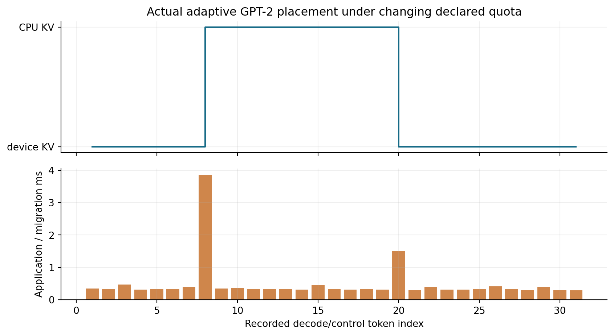<p class="caption"><strong>Figure 14.</strong> Real GPT-2 placement transitions under declared capacity changes. Measured application/migration cost is displayed separately from execution. <em>[Derived measured execution trace]</em><br />Source: results/pretrained/adaptive.json</p></div>

<p class="caption" id="table-11"><strong>Table 11.</strong> Independent numerical and batching checks</p>

| Check | Maximum absolute error / observation | Declared tolerance |
| --- | --- | --- |
| Original GPT-2 forward | 0.00000000 | 0.002 |
| Cached decode vs full prefix | 0.00009155 | 0.002 |
| CPU attention placement | 0.00004578 | 0.002 |
| Actual unequal-context batch | 0.00028992 | 0.002 |
| Mixed CPU/device batch decode | 0.00030518 | 0.002 |
| Dense projection calls per iteration | 48 | 48 expected across 12 blocks |

## 9. Analytical 8B-shaped study and offered-load sensitivity

**Evidence label: analytical simulation.** No physical 8B inference or original-paper engine reproduction is implied by this section.

The following are means across three workload seeds, computed from the final 63-run `results/simulation/summary.csv`. TTFT is the mean of each run's P95, not a P95 over pooled requests. All runs complete all 96 requests with zero rejections.


<p class="caption" id="table-12"><strong>Table 12.</strong> Analytical synthetic-profile comparison — published results</p>

| Synthetic profile | Policy | P95 TTFT (ms) | P95 TBT (ms) | SLO failure (%) | Output tokens/s |
| --- | --- | --- | --- | --- | --- |
| 20 GiB balanced | Full | 18,180.02 | 307.53 | 94.79 | 120.03 |
| 20 GiB balanced | Naive | 18,488.02 | 365.80 | 94.79 | 118.46 |
| 20 GiB balanced | Joint | 18,581.81 | 365.40 | 94.79 | 117.77 |
| 20 GiB slow host/link | Full | 18,180.02 | 307.53 | 94.79 | 120.03 |
| 20 GiB slow host/link | Naive | 33,397.11 | 426.85 | 95.83 | 74.14 |
| 20 GiB slow host/link | Joint | 19,917.59 | 376.89 | 94.79 | 112.64 |
| 48 GiB server | Full | 3,690.17 | 107.47 | 76.04 | 212.99 |
| 48 GiB server | Naive | 4,030.83 | 110.96 | 77.08 | 212.97 |
| 48 GiB server | Joint | 3,690.17 | 107.47 | 76.04 | 212.99 |

<p class="small">Source: docs/final_report.md</p>


Joint control avoids much of naive stacking's slow-host penalty: mean P95 TTFT falls 40.36% and output throughput rises 51.94%. The paired baseline-minus-joint TTFT difference is 13.48 s, with exploratory seed-bootstrap bounds 11.52–14.57 s. However, joint control is 9.56% slower than full precision in that same regime, and 2.21% slower on the balanced 20 GiB profile. The joint hypothesis is therefore supported against naive stacking in one regime, but a benefit over full precision or either mechanism alone is not established by this study.


The controller reacts to profile balance. Its mean CPU-attention request count per iteration falls from 9.44 in the balanced 20 GiB profile to 3.32 with the slow host/link, while mean quantized layers rise from 0.005 to 1.08. On the 48 GiB profile, joint control chooses full precision and no CPU offload, matching the full baseline. Disabling hysteresis produces identical simulated outcomes in this workload, so this experiment supplies no evidence of a hysteresis benefit.


These are overloaded regimes: joint request-SLO failure is 94.79% for the 20 GiB profiles and 76.04% for the 48 GiB profile. The proposal's universal latency claim and numerical SLO-improvement targets are not achieved. Static INT4 modestly improves TTFT and throughput but exceeds the adaptive quality-risk budget; it cannot be ranked as quality-equivalent. Unoptimized joint search has a mean seed-level measured P95 of roughly 33–36 ms per call. That wall time is excluded from analytical service time and cannot substantiate the proposed <2% production overhead target. Full policy tables, individual seeds, transition traces, and bootstrap intervals are retained with the results.


<div class="figure" id="figure-15">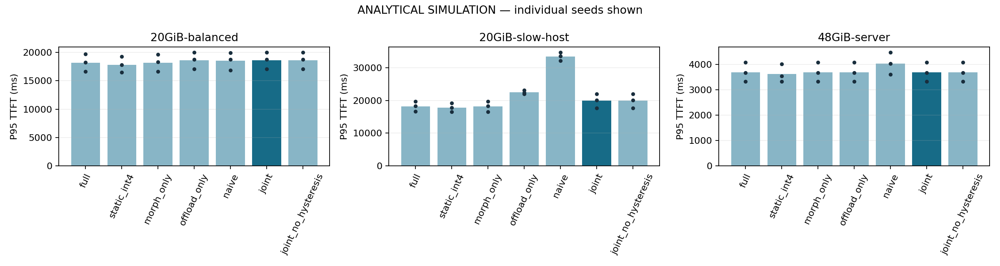<p class="caption"><strong>Figure 15.</strong> Analytical simulation: mean P95 TTFT and individual workload seeds <em>[Analytical simulation]</em><br />Source: results/simulation/figures/ttft_p95_ms.png</p></div>


<div class="figure" id="figure-16">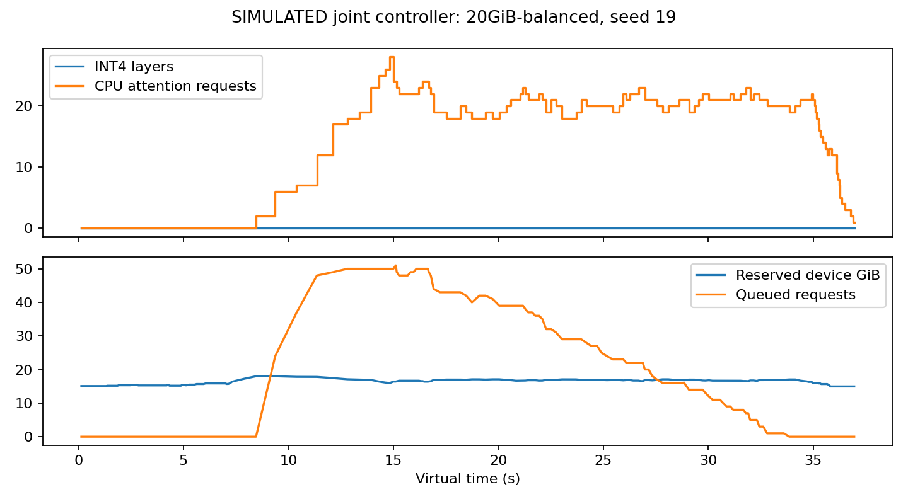<p class="caption"><strong>Figure 16.</strong> Analytical simulation: joint precision, placement and device reservation timeline <em>[Analytical simulation]</em><br />Source: results/simulation/figures/controller_timeline.png</p></div>


#### Offered-load sensitivity


A separate 25-run exploratory sweep keeps the same 48 requests and token lengths while scaling every arrival timestamp by the inverse load factor. Five policies run at 0.6, 1.2, 2.4, 4.8 and 9.6 offered requests/s on the balanced 20 GiB profile, with one seed. Joint P95 TTFT is respectively 1.291, 5.204, 7.938, 10.054 and 11.120 seconds. Full precision gives 1.291, 4.520, 8.219, 9.574 and 11.117 seconds. The crossover is workload dependent; joint control does not show consistent superiority.


At 0.6 requests/s, P95 TTFT meets the 2-second objective, but worst inter-token-gap violations still cause a 50% request-SLO failure rate. Failure rises to 100% at the largest load; every run completes all 48 requests with zero rejections. This exposes prefill/decode contention and the limits of an iteration-cost objective without deadline-aware chunk scheduling. The single-seed curves are diagnostic, not confidence intervals. Raw outputs and assumptions are retained in `results/load_sweep/`.


<div class="figure" id="figure-17">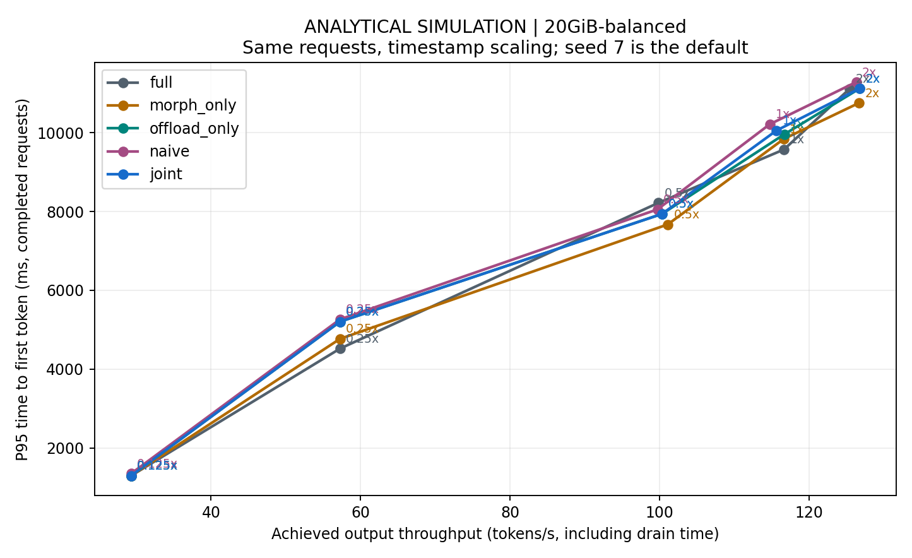<p class="caption"><strong>Figure 17.</strong> Analytical simulation: throughput versus tail latency across offered loads <em>[Analytical simulation]</em><br />Source: results/load_sweep/throughput_latency.png</p></div>

<div class="figure" id="figure-18">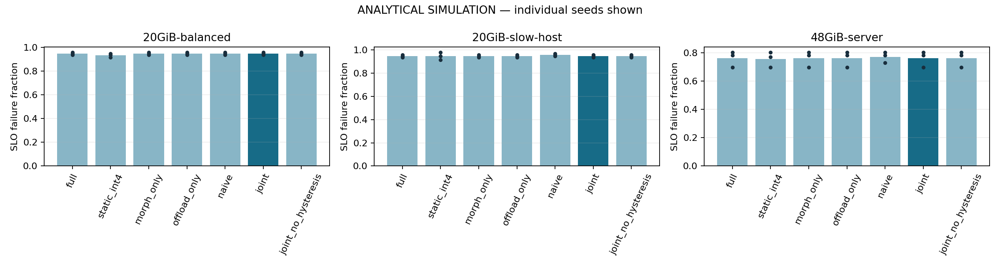<p class="caption"><strong>Figure 18.</strong> Analytical request-SLO violation rates across synthetic profiles and policies. These are virtual-service outcomes. <em>[Analytical simulation]</em><br />Source: results/simulation/figures/slo_violation_rate.png</p></div>

<div class="figure" id="figure-19">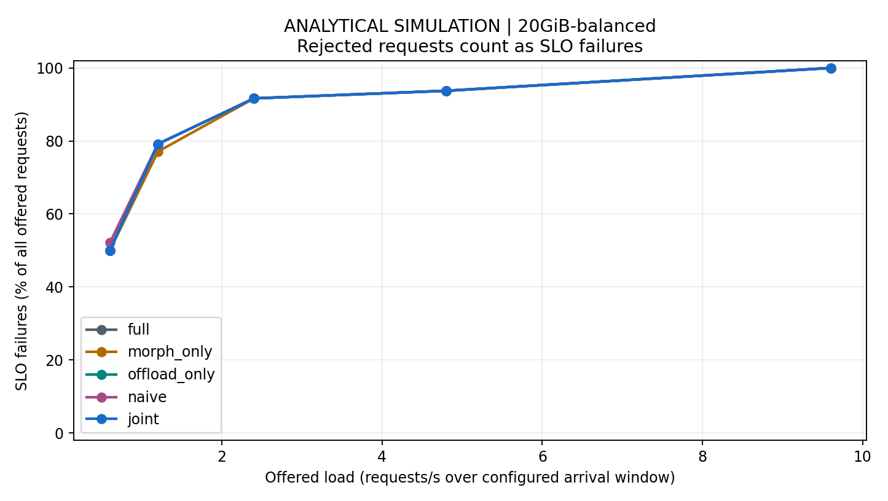<p class="caption"><strong>Figure 19.</strong> Analytical offered-load sensitivity of request-SLO failure. One load-sweep seed limits uncertainty claims. <em>[Analytical simulation]</em><br />Source: results/load_sweep/failures_vs_load.png</p></div>

## 10. M8: real continuous batching and concurrent serving

This stage changes the evidence from serialized local generation to actual scheduled-arrival continuous serving. Twelve requests use 384-token prompts, 24 output tokens, a two-second window and maximum batch eight. Shared dense computation, independent KV and chunked prefill execute in real wall time. Seventy-five calibrated shapes cover batch sizes 1/4/8, current contexts, mixtures, precision sets and CPU-attention families. The three scenarios use steady/bursty arrivals and 1400/700 MiB enforced quotas. Two seeds/orderings yield 42 policy runs; a separate 64-target audit runs for each policy.

The serialized control uses the same optimized batch primitive with maximum batch one. It is therefore a useful concurrency control, not a comparison with a different vocabulary-head implementation. Tables below report means over two runs; the individual repeats are retained in the appendices and source CSV. Large timing variation makes a mean an insufficient universal speedup claim.


**Actual pretrained GPT-2 tensor execution. All reported times are measured wall-clock observations.**


Same prompt/arrival/output-budget traces across policies. Dense projections batch all current tokens. Ragged attention loops per request. Quotas are enforced admission budgets, not physical OOM events.


<p class="caption" id="table-13"><strong>Table 13.</strong> report — published results (field panel 1) (rows 1-18)</p>

| Scenario | Policy | P95 TTFT ms | P95 TBT ms | Output token/s | SLO failure % | Max active | INT4 output % |
| --- | --- | --- | --- | --- | --- | --- | --- |
| bursty_constrained | full | 2680.21 | 21.36 | 72.83 | 29.17 | 2 | 0.00 |
| bursty_constrained | joint | 3285.92 | 51.17 | 62.83 | 37.50 | 4 | 4.69 |
| bursty_constrained | joint_uncalibrated | 7767.06 | 80.91 | 34.48 | 79.17 | 2 | 0.00 |
| bursty_constrained | morph_only | 2960.01 | 23.39 | 68.48 | 37.50 | 2 | 7.81 |
| bursty_constrained | naive | 7505.31 | 114.46 | 39.88 | 62.50 | 4 | 0.00 |
| bursty_constrained | offload_only | 2801.59 | 32.52 | 71.10 | 37.50 | 4 | 0.00 |
| bursty_constrained | serial_full | 4215.61 | 16.66 | 52.23 | 54.17 | 1 | 0.00 |
| bursty_roomy | full | 1923.06 | 47.76 | 89.98 | 8.33 | 8 | 0.00 |
| bursty_roomy | joint | 2369.54 | 70.03 | 75.21 | 50.00 | 8 | 27.08 |
| bursty_roomy | joint_uncalibrated | 2741.94 | 74.87 | 66.69 | 58.33 | 8 | 0.00 |
| bursty_roomy | morph_only | 2015.23 | 48.66 | 87.40 | 12.50 | 8 | 3.30 |
| bursty_roomy | naive | 3245.78 | 87.01 | 57.74 | 50.00 | 8 | 0.00 |
| bursty_roomy | offload_only | 2139.13 | 58.56 | 83.92 | 20.83 | 8 | 0.00 |
| bursty_roomy | serial_full | 4877.73 | 21.57 | 46.32 | 62.50 | 1 | 0.00 |
| steady_roomy | full | 3195.09 | 108.10 | 62.53 | 50.00 | 8 | 0.00 |
| steady_roomy | joint | 3297.51 | 137.42 | 53.02 | 83.33 | 8 | 24.83 |
| steady_roomy | joint_uncalibrated | 5336.71 | 141.55 | 48.01 | 50.00 | 8 | 0.00 |
| steady_roomy | morph_only | 750.54 | 115.27 | 75.90 | 29.17 | 7 | 42.53 |

<p class="small">Source: results/live/report.md</p>

<p class="caption" id="table-14"><strong>Table 14.</strong> report — published results (field panel 1) (rows 19-21)</p>

| Scenario | Policy | P95 TTFT ms | P95 TBT ms | Output token/s | SLO failure % | Max active | INT4 output % |
| --- | --- | --- | --- | --- | --- | --- | --- |
| steady_roomy | naive | 6393.66 | 257.27 | 41.14 | 50.00 | 8 | 0.00 |
| steady_roomy | offload_only | 3721.24 | 179.16 | 47.58 | 83.33 | 8 | 0.00 |
| steady_roomy | serial_full | 7271.55 | 36.54 | 36.61 | 58.33 | 1 | 0.00 |

<p class="small">Source: results/live/report.md</p>

<p class="caption" id="table-15"><strong>Table 15.</strong> report — published results (field panel 2) (rows 1-18)</p>

| Scenario | Policy | P95 TTFT ms | CPU offload output % |
| --- | --- | --- | --- |
| bursty_constrained | full | 2680.21 | 0.00 |
| bursty_constrained | joint | 3285.92 | 34.20 |
| bursty_constrained | joint_uncalibrated | 7767.06 | 95.66 |
| bursty_constrained | morph_only | 2960.01 | 0.00 |
| bursty_constrained | naive | 7505.31 | 95.83 |
| bursty_constrained | offload_only | 2801.59 | 7.99 |
| bursty_constrained | serial_full | 4215.61 | 0.00 |
| bursty_roomy | full | 1923.06 | 0.00 |
| bursty_roomy | joint | 2369.54 | 2.08 |
| bursty_roomy | joint_uncalibrated | 2741.94 | 49.65 |
| bursty_roomy | morph_only | 2015.23 | 0.00 |
| bursty_roomy | naive | 3245.78 | 95.83 |
| bursty_roomy | offload_only | 2139.13 | 0.00 |
| bursty_roomy | serial_full | 4877.73 | 0.00 |
| steady_roomy | full | 3195.09 | 0.00 |
| steady_roomy | joint | 3297.51 | 10.59 |
| steady_roomy | joint_uncalibrated | 5336.71 | 53.99 |
| steady_roomy | morph_only | 750.54 | 0.00 |

<p class="small">Source: results/live/report.md</p>

<p class="caption" id="table-16"><strong>Table 16.</strong> report — published results (field panel 2) (rows 19-21)</p>

| Scenario | Policy | P95 TTFT ms | CPU offload output % |
| --- | --- | --- | --- |
| steady_roomy | naive | 6393.66 | 95.83 |
| steady_roomy | offload_only | 3721.24 | 4.86 |
| steady_roomy | serial_full | 7271.55 | 0.00 |

<p class="small">Source: results/live/report.md</p>


### Quality audit


A separate teacher-forced replay uses the same held-out continuations for each policy and records token NLL under the actual selected precision and historical KV. It has its own policy trajectory. See quality.json and quality_runs/; these results do not label greedy generation as teacher-forced work.


<p class="caption" id="table-17"><strong>Table 17.</strong> Quality audit — published results</p>

| Policy | Audit targets | Audit perplexity | Relative PPL % | INT4 output % |
| --- | --- | --- | --- | --- |
| serial_full | 64 | 68.284 | -0.000 | 0.00 |
| full | 64 | 68.284 | 0.000 | 0.00 |
| morph_only | 64 | 68.785 | 0.733 | 25.00 |
| offload_only | 64 | 68.284 | 0.000 | 0.00 |
| naive | 64 | 68.284 | -0.000 | 0.00 |
| joint | 64 | 68.816 | 0.779 | 21.88 |
| joint_uncalibrated | 64 | 68.284 | -0.000 | 0.00 |

<p class="small">Source: results/live/report.md</p>


### Interpretation limits


Do not assume a controller win: inspect the full baseline, admission, overhead, transition, and failure records. The measured nearest-shape model and EWMA feedback are estimates; real elapsed timings remain authoritative. Quality uses an additive validation-KL surrogate and a small separate audit, not a guaranteed task bound.


TTFT starts at scheduled arrival, including delayed submission and queueing. All token gaps include scheduling, precision transitions and migrations. Throughput includes the complete trace and queue drain. Rejected requests count as SLO failures. Memory includes independently reported live KV, reserved budgets and CUDA peak allocations.


<div class="figure" id="figure-20">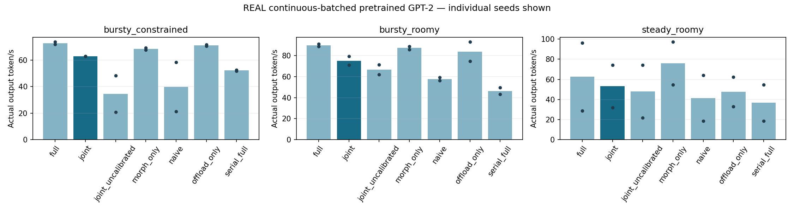<p class="caption"><strong>Figure 20.</strong> Actual output token/s <em>[Measured experiment]</em><br />Source: results/live/figures/output_tokens_per_s.png</p></div>


<div class="figure" id="figure-21">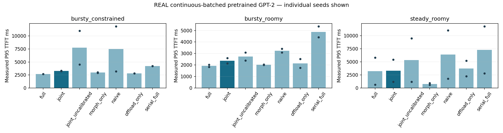<p class="caption"><strong>Figure 21.</strong> Measured P95 TTFT ms <em>[Measured experiment]</em><br />Source: results/live/figures/ttft_p95_ms.png</p></div>

<div class="figure" id="figure-22">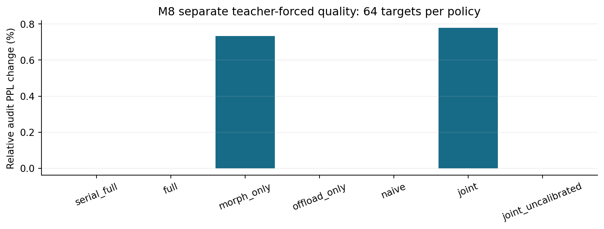<p class="caption"><strong>Figure 22.</strong> Separate M8 teacher-forced policy-quality changes. Exposure and 64-target counts must accompany the small PPL differences. <em>[Derived measured audit data]</em><br />Source: results/live/quality.json</p></div>

## 11. M9: efficient control and gate/reuse ablations

This stage compares fresh legacy full/joint controllers, efficient full/joint paths, joint without the conservative gate and joint without decision reuse. Workload geometry, quotas and saved calibration match M8. The comparison addresses whether controller work can be reduced; it does not assume that greater active concurrency or additional feedback improves throughput. Original calibration/resource formulas are retained in the compiled implementation and regression-tested against randomized plans.


All six optimized joint runs meet the exploratory <5% control-overhead target (worst 2.82%).


36 actual serving runs complete 432 requests with 0 rejections, plus 6 independent teacher-forced audits (384 targets total). 1246 reused iterations retain fresh resource checks. 106 tests and four-client real HTTP verification pass. Actual CUDA peaks exceed the declared device quota in 0 runs.


<p class="caption" id="table-18"><strong>Table 18.</strong> comparison — published results</p>

| Scenario | Old joint control % | New joint control % | Old joint token/s | New joint token/s | Change % | New full token/s |
| --- | --- | --- | --- | --- | --- | --- |
| steady_roomy | 8.12 | 2.26 | 67.04 | 41.11 | -38.68 | 53.03 |
| bursty_roomy | 6.50 | 2.07 | 32.41 | 37.02 | +14.24 | 37.06 |
| bursty_constrained | 16.88 | 2.42 | 24.34 | 26.88 | +10.45 | 32.76 |

<p class="small">Source: results/controller/comparison.md</p>


Lower overhead does not establish a general throughput or prediction-accuracy improvement. The optimized joint controller improves mean throughput over its old counterpart in 2 of 3 scenarios. The steady scenario's old joint repeats range from 37.0 to 97.0 token/s. Optimized full precision is faster than optimized joint control under the tight quota. Joint prediction MAE increases in 3 of 3 scenarios; phase isolation passes its correctness test but does not demonstrate better overall prediction in these different executed trajectories. Disabling reuse increases control cost, yet its throughput result varies by scenario. The evidence supports reducing scheduling cost, not a universal performance win.


### Complete policy results


<p class="caption" id="table-19"><strong>Table 19.</strong> Complete policy results — published results</p>

| Scenario | Policy | Token/s | Control % | Reuse % | P95 TTFT ms | P95 TBT ms | Prediction MAE ms |
| --- | --- | --- | --- | --- | --- | --- | --- |
| steady_roomy | full_v03 | 31.94 | 5.43 | 0.00 | 5338.29 | 157.50 | 22.40 |
| steady_roomy | joint_v03 | 67.04 | 8.12 | 0.00 | 2510.27 | 134.86 | 10.74 |
| steady_roomy | full | 53.03 | 2.19 | 60.15 | 2610.54 | 120.38 | 14.17 |
| steady_roomy | joint | 41.11 | 2.26 | 58.25 | 4064.02 | 147.87 | 18.81 |
| steady_roomy | joint_no_gate | 32.65 | 1.96 | 57.23 | 4899.62 | 197.42 | 23.66 |
| steady_roomy | joint_no_reuse | 36.61 | 3.12 | 0.00 | 4524.32 | 158.61 | 20.28 |
| bursty_roomy | full_v03 | 35.97 | 4.81 | 0.00 | 5787.64 | 130.73 | 17.90 |
| bursty_roomy | joint_v03 | 32.41 | 6.50 | 0.00 | 6565.77 | 201.50 | 15.79 |
| bursty_roomy | full | 37.06 | 1.62 | 57.01 | 5500.40 | 144.36 | 16.19 |
| bursty_roomy | joint | 37.02 | 2.07 | 57.13 | 5674.97 | 154.09 | 18.79 |
| bursty_roomy | joint_no_gate | 33.34 | 2.05 | 60.21 | 6618.72 | 174.21 | 18.07 |
| bursty_roomy | joint_no_reuse | 38.81 | 2.70 | 0.00 | 5215.66 | 137.99 | 16.09 |
| bursty_constrained | full_v03 | 28.84 | 9.90 | 0.00 | 7906.69 | 58.93 | 21.50 |
| bursty_constrained | joint_v03 | 24.34 | 16.88 | 0.00 | 9702.29 | 129.23 | 10.65 |
| bursty_constrained | full | 32.76 | 2.95 | 70.61 | 6845.58 | 55.47 | 7.22 |
| bursty_constrained | joint | 26.88 | 2.42 | 65.02 | 8506.38 | 148.40 | 16.25 |
| bursty_constrained | joint_no_gate | 26.21 | 2.43 | 66.55 | 8719.91 | 151.61 | 15.21 |
| bursty_constrained | joint_no_reuse | 26.96 | 4.54 | 0.00 | 8382.70 | 154.92 | 14.02 |

<p class="small">Source: results/controller/comparison.md</p>


<div class="figure" id="figure-23">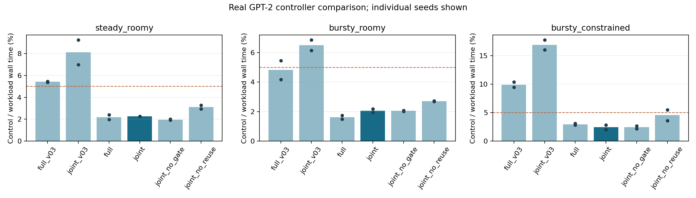<p class="caption"><strong>Figure 23.</strong> Actual control overhead <em>[Measured experiment]</em><br />Source: results/controller/figures/control_overhead.png</p></div>


<div class="figure" id="figure-24">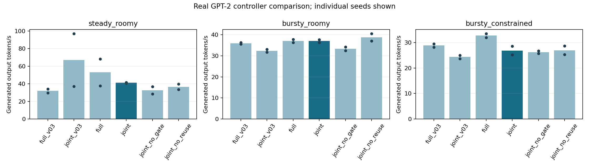<p class="caption"><strong>Figure 24.</strong> Actual throughput <em>[Measured experiment]</em><br />Source: results/controller/figures/controller_throughput.png</p></div>


### Separate policy quality audits


<p class="caption" id="table-20"><strong>Table 20.</strong> Separate policy quality audits — published results</p>

| Policy | Audit targets | Perplexity | Relative PPL % | INT4 output % | INT4 iterations |
| --- | --- | --- | --- | --- | --- |
| full_v03 | 64 | 68.284 | +0.000 | 0.00 | 0 |
| joint_v03 | 64 | 68.403 | +0.174 | 21.88 | 9 |
| full | 64 | 68.284 | +0.000 | 0.00 | 0 |
| joint | 64 | 67.770 | -0.753 | 0.00 | 5 |
| joint_no_gate | 64 | 68.344 | +0.088 | 9.38 | 7 |
| joint_no_reuse | 64 | 67.730 | -0.811 | 0.00 | 3 |

<p class="small">Source: results/controller/comparison.md</p>


The joint audit uses INT4 during 5 iterations containing prefill and emits 0.00% of outputs under INT4. Historical KV can remain affected after FP32 restoration. A small perplexity decrease is not evidence of improved model quality. Greedy serving can use different precision histories; this short audit does not certify all quantized serving outputs.


Means summarize two seeds per scenario; individual points are retained. Policy order is shuffled, but laptop thermal state, OS activity and limited repeats remain confounders. Throughput includes the entire scheduled trace and drain. Control overhead includes live telemetry, planning and admission. TTFT is engine token readiness from scheduled arrival, not streaming HTTP delivery. Quotas are enforced reservation budgets, not physical VRAM exhaustion. The small quality audit and heuristic uncertainty margins do not prove a task-quality bound or statistical confidence. Fresh v0.3 comparators run in the new study; historical results/live measurements remain separately archived.

<div class="figure" id="figure-25">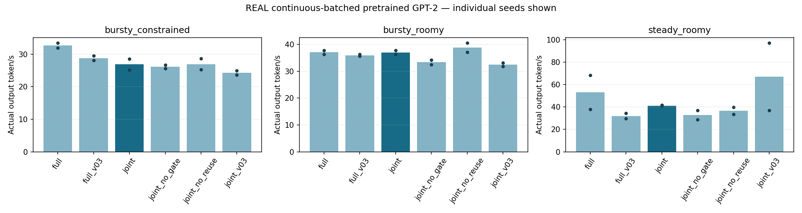<p class="caption"><strong>Figure 25.</strong> M9 automatic throughput view, retained alongside the focused comparison figure for complete chart coverage. Individual repeats are visible. <em>[Measured experiment]</em><br />Source: results/controller/figures/output_tokens_per_s.png</p></div>

<div class="figure" id="figure-26">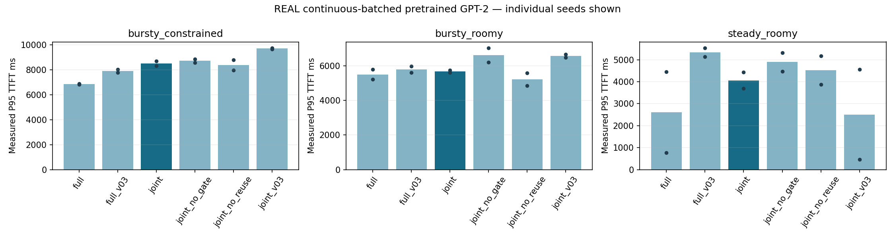<p class="caption"><strong>Figure 26.</strong> M9 automatic P95 TTFT view. Lower planning cost does not by itself imply improved tail latency. <em>[Measured experiment]</em><br />Source: results/controller/figures/ttft_p95_ms.png</p></div>

## 12. M10: controlled repeats, matched prediction and portability

The primary M10 session uses fresh calibration, three warmup passes, five rounds, rotating policy positions and shuffled scenario order. The main comparison preserves the v0.4 serving policy while improving measurement controls. AC is checked before execution and at every recorded 500 ms host sample; clocks and ambient conditions remain observed rather than fixed. The four predictors in the matched test forecast identical tensor executions before observing duration, removing the different-policy-trajectory confound from MAE comparisons.

CPU/CUDA portability uses separate 33/75-shape timing calibration and the same serving/controller source. Its smaller workload is four 128-token prompts with eight outputs, three seeds and two policies. The CPU checks combined host allocation; CUDA checks separate memory pools. Equal quota values do not make these backends physically equivalent.


60 instrumented GPU runs complete 720 requests, plus 12 matched CPU/CUDA runs (48 requests). There are zero rejections. 54 prediction shapes supply 270 matched executions. Eight quality arms score 2048 held-out targets each. All 112 tests pass.


The first complete study changed power source during measurement and is retained separately in `results/validation_study/`. It is diagnostic, not the primary controlled comparison. The new study requires AC power before execution and at every recorded 500 ms host sample, including calibration; a failed condition refuses the affected measurement. Observed clock settings still vary.


<p class="caption" id="table-21"><strong>Table 21.</strong> report — published results</p>

| Original steady joint subgroup | Runs | Mean token/s | Mean observed SM MHz |
| --- | --- | --- | --- |
| AC | 2 | 121.17 | 2006 |
| battery | 3 | 72.48 | 1244 |

<p class="small">Source: results/validation_study_final/report.md</p>


This subgroup split is observational and also differs in round/order. It exposes a power/clock confound; it does not isolate a causal effect. Primary throughput comparisons below use the separate AC-conditioned session.


An intermediate AC attempt stopped when a constrained joint worker reported no feasible plan for admitted work. It remains incomplete in `results/validation_study_ac/` and is excluded from successful-run aggregates. Available host RAM was about 0.8–1.0 GiB during that attempt; the same trace later completed with more than 2 GiB available. Its exact original cause remains unproven. The final source adds failure-only state/reservation snapshots and saves failed replay records; it does not bypass the safety check. Completion and zero-rejection statements below refer to the final accepted series, not every diagnostic attempt.


### Repeated GPU comparison


<p class="caption" id="table-22"><strong>Table 22.</strong> Repeated GPU comparison — published results</p>

| Scenario | Old joint token/s | New joint token/s | Paired change % | Exploratory 95% interval | Old/new control % |
| --- | --- | --- | --- | --- | --- |
| steady_roomy | 121.19 | 123.73 | +2.1 | [+1.3, +2.7] | 12.78 / 4.62 |
| bursty_roomy | 134.51 | 138.74 | +3.2 | [+1.8, +5.2] | 7.49 / 2.77 |
| bursty_constrained | 93.11 | 113.37 | +21.9 | [+18.8, +24.8] | 17.92 / 4.48 |

<p class="small">Source: results/validation_study_final/report.md</p>


Optimized joint control stays below 5% of workload wall time in 15/15 runs; its worst observed fraction is 4.97%. This is a new session, not a re-labeling of M9's six-run overhead result. The fraction depends on execution speed as well as absolute controller cost. All request latency includes telemetry, planning, transitions and drain.


Optimized full precision has higher mean throughput than optimized joint control in 3/3 scenarios. Improvements over the older joint controller do not establish an advantage over optimized full precision. Decision reuse also trades admission responsiveness for lower control cost: compare TTFT as well as throughput. Raw action histories distinguish control-overhead savings from gains due to actual quantization/offload. Optimized joint control selects FP32 and device attention for every emitted token in this final session; its measured gains therefore concern control cost/admission, not active quantization or CPU offload.


<p class="caption" id="table-23"><strong>Table 23.</strong> Repeated GPU comparison — published results (field panel 1)</p>

| Scenario | Policy | Mean token/s | Median token/s | SD | CV % | Control % | P95 TTFT ms |
| --- | --- | --- | --- | --- | --- | --- | --- |
| steady_roomy | full_v03 | 122.80 | 122.99 | 0.69 | 0.6 | 9.02 | 99.6 |
| steady_roomy | joint_v03 | 121.19 | 121.25 | 0.51 | 0.4 | 12.78 | 111.9 |
| steady_roomy | full | 124.33 | 124.13 | 0.36 | 0.3 | 3.95 | 164.7 |
| steady_roomy | joint | 123.73 | 124.02 | 1.41 | 1.1 | 4.62 | 149.3 |
| bursty_roomy | full_v03 | 138.47 | 137.06 | 3.04 | 2.2 | 5.10 | 777.5 |
| bursty_roomy | joint_v03 | 134.51 | 134.96 | 4.54 | 3.4 | 7.49 | 829.0 |
| bursty_roomy | full | 141.66 | 140.87 | 4.57 | 3.2 | 2.17 | 750.3 |
| bursty_roomy | joint | 138.74 | 137.95 | 2.90 | 2.1 | 2.77 | 786.7 |
| bursty_constrained | full_v03 | 107.51 | 105.17 | 6.29 | 5.9 | 9.94 | 1487.9 |
| bursty_constrained | joint_v03 | 93.11 | 90.81 | 6.64 | 7.1 | 17.92 | 1820.0 |
| bursty_constrained | full | 115.52 | 111.89 | 7.01 | 6.1 | 3.49 | 1349.0 |
| bursty_constrained | joint | 113.37 | 112.26 | 5.37 | 4.7 | 4.48 | 1395.2 |

<p class="small">Source: results/validation_study_final/report.md</p>

<p class="caption" id="table-24"><strong>Table 24.</strong> Repeated GPU comparison — published results (field panel 2)</p>

| Scenario | Policy | Mean token/s | P95 TBT ms |
| --- | --- | --- | --- |
| steady_roomy | full_v03 | 122.80 | 15.8 |
| steady_roomy | joint_v03 | 121.19 | 17.7 |
| steady_roomy | full | 124.33 | 15.7 |
| steady_roomy | joint | 123.73 | 15.7 |
| bursty_roomy | full_v03 | 138.47 | 32.9 |
| bursty_roomy | joint_v03 | 134.51 | 33.6 |
| bursty_roomy | full | 141.66 | 31.5 |
| bursty_roomy | joint | 138.74 | 31.9 |
| bursty_constrained | full_v03 | 107.51 | 14.3 |
| bursty_constrained | joint_v03 | 93.11 | 25.8 |
| bursty_constrained | full | 115.52 | 13.3 |
| bursty_constrained | joint | 113.37 | 13.5 |

<p class="small">Source: results/validation_study_final/report.md</p>


<p class="caption" id="table-25"><strong>Table 25.</strong> Repeated GPU comparison — published results</p>

| Scenario | Policy | INT4 outputs % | CPU-attention outputs % | Max active | SLO failure % |
| --- | --- | --- | --- | --- | --- |
| steady_roomy | full_v03 | 0.00 | 0.00 | 3 | 0.00 |
| steady_roomy | joint_v03 | 0.00 | 0.00 | 3 | 0.00 |
| steady_roomy | full | 0.00 | 0.00 | 3 | 0.00 |
| steady_roomy | joint | 0.00 | 0.00 | 3 | 0.00 |
| bursty_roomy | full_v03 | 0.00 | 0.00 | 8 | 0.00 |
| bursty_roomy | joint_v03 | 0.00 | 0.00 | 8 | 0.00 |
| bursty_roomy | full | 0.00 | 0.00 | 8 | 0.00 |
| bursty_roomy | joint | 0.00 | 0.00 | 8 | 0.00 |
| bursty_constrained | full_v03 | 0.00 | 0.00 | 2 | 0.00 |
| bursty_constrained | joint_v03 | 0.00 | 22.15 | 4 | 6.67 |
| bursty_constrained | full | 0.00 | 0.00 | 2 | 0.00 |
| bursty_constrained | joint | 0.00 | 0.00 | 2 | 0.00 |

<p class="small">Source: results/validation_study_final/report.md</p>


Observed SM clocks span 1185–2565 MHz; GPU temperatures span 59–64 °C. AC-state observations are ['True']. Driver power/thermal reason flags are retained per sample. These observations do not prove that a particular performance change was caused by throttling; clock settings and external OS activity were not controlled.


<div class="figure" id="figure-27">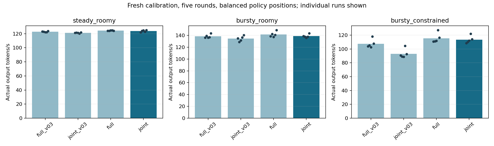<p class="caption"><strong>Figure 27.</strong> Repeated real throughput <em>[Measured experiment]</em><br />Source: results/validation_study_final/figures/repeated_throughput.png</p></div>


<div class="figure" id="figure-28">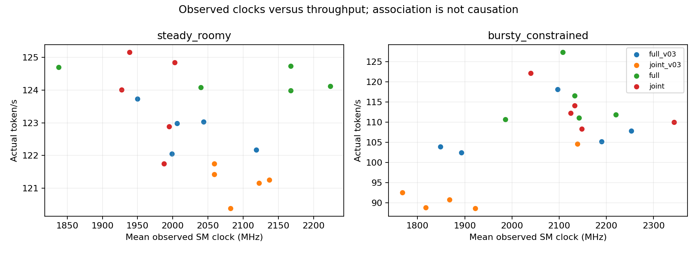<p class="caption"><strong>Figure 28.</strong> Observed GPU clocks <em>[Measured experiment]</em><br />Source: results/validation_study_final/figures/clock_throughput.png</p></div>


### Prediction on identical actual executions


On identical executed batches, overall MAE is 71.88 ms with the old static table, 10.31 ms with the fresh static table, 4.55 ms with legacy feedback and 5.54 ms with phase feedback. These forecasts share actual execution durations and are made before observing each result. They therefore diagnose calibration/feedback without conflating different serving trajectories. Feedback remains dependent on probe order, action-family granularity and unobserved shapes; the best predictor here need not produce the best admission policy.


<p class="caption" id="table-26"><strong>Table 26.</strong> Prediction on identical actual executions — published results</p>

| Predictor | Phase | Executions | MAE ms | Bias ms | MAPE % |
| --- | --- | --- | --- | --- | --- |
| fresh_legacy_ewma | all | 270 | 4.55 | +2.01 | 25.3 |
| fresh_legacy_ewma | decode | 120 | 4.31 | +1.46 | 25.9 |
| fresh_legacy_ewma | mixed | 90 | 4.78 | +4.15 | 25.7 |
| fresh_legacy_ewma | prefill | 60 | 4.69 | -0.10 | 23.3 |
| fresh_phase_ewma | all | 270 | 5.54 | +3.60 | 30.8 |
| fresh_phase_ewma | decode | 120 | 5.86 | +2.82 | 35.9 |
| fresh_phase_ewma | mixed | 90 | 5.08 | +4.61 | 26.7 |
| fresh_phase_ewma | prefill | 60 | 5.61 | +3.63 | 26.8 |
| fresh_static | all | 270 | 10.31 | +10.20 | 59.8 |
| fresh_static | decode | 120 | 10.01 | +9.81 | 66.3 |
| fresh_static | mixed | 90 | 11.92 | +11.92 | 64.1 |
| fresh_static | prefill | 60 | 8.50 | +8.41 | 40.1 |
| old_static | all | 270 | 71.88 | +71.88 | 384.7 |
| old_static | decode | 120 | 46.14 | +46.14 | 274.3 |
| old_static | mixed | 90 | 95.81 | +95.81 | 504.8 |
| old_static | prefill | 60 | 87.47 | +87.47 | 425.4 |

<p class="small">Source: results/validation_study_final/report.md</p>


<div class="figure" id="figure-29">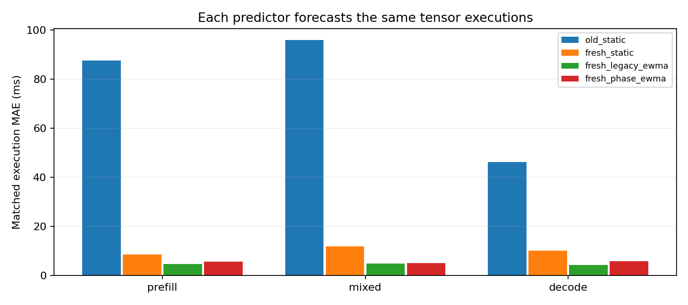<p class="caption"><strong>Figure 29.</strong> Matched prediction error <em>[Measured experiment]</em><br />Source: results/validation_study_final/figures/matched_prediction_mae.png</p></div>


### CPU/CUDA execution portability


<p class="caption" id="table-27"><strong>Table 27.</strong> CPU/CUDA execution portability — published results</p>

| Backend | Policy | Mean token/s | P95 TTFT ms | P95 TBT ms | Control % | Max batch | INT4 output % |
| --- | --- | --- | --- | --- | --- | --- | --- |
| cpu | full | 31.71 | 472.6 | 61.4 | 1.17 | 3 | 0.00 |
| cpu | joint | 31.97 | 468.0 | 60.0 | 1.35 | 3 | 0.00 |
| cuda | full | 71.23 | 51.8 | 16.4 | 1.98 | 4 | 0.00 |
| cuda | joint | 69.85 | 53.2 | 19.2 | 2.55 | 4 | 0.00 |

<p class="small">Source: results/validation_study_final/report.md</p>


All 12 matched backend runs complete. CPU/CUDA full-precision greedy outputs match in 96/96 token positions. CPU-primary execution selects no CPU-offload requests, as required by its capability contract. Both use the same controller/batching source and separate calibration. This establishes execution portability across two backends on one laptop, not physical multi-machine or GPU-vendor portability. CPU's combined host quota and CUDA's separate memory pools are not equivalent resources.


### Expanded history-aware quality audit


<p class="caption" id="table-28"><strong>Table 28.</strong> Expanded history-aware quality audit — published results</p>

| Audit arm | Targets | Perplexity | Relative PPL % | INT4 output % | Quantized prefill iterations |
| --- | --- | --- | --- | --- | --- |
| dynamic_full | 2048 | 36.451 | +0.000 | 0.00 | 0 |
| dynamic_joint | 2048 | 36.451 | +0.000 | 0.00 | 0 |
| dynamic_joint_no_gate | 2048 | 36.451 | +0.000 | 0.00 | 0 |
| fixed_fp32 | 2048 | 36.451 | +0.000 | 0.00 | 0 |
| fixed_static_int4 | 2048 | 37.648 | +3.284 | 100.00 | 8 |
| fixed_early_prefill_int4_restore | 2048 | 36.772 | +0.881 | 0.00 | 4 |
| fixed_decode_int4 | 2048 | 36.976 | +1.440 | 99.22 | 0 |
| fixed_cpu_attention | 2048 | 36.451 | +0.000 | 0.00 | 0 |

<p class="small">Source: results/validation_study_final/report.md</p>


Each arm scores the same 2048 distinct held-out positions in 16 disjoint prompt/continuation windows; eight arms repeat those targets. Early-prefill quantization restores FP32 before output emission but retains affected KV. Controlled schedules isolate this history effect and bypass admission; their times are not serving benchmarks. Dynamic teacher forcing has its own policy trajectory. These subset perplexities are not downstream-task accuracy or proof of a quality bound. FP32 dynamic/fixed token NLL and CPU-attention comparisons pass the 0.002 tolerance; the maximum observed token-NLL discrepancy across both checks is 4.58e-05. All three dynamic audits remain unquantized in this session. Their equal perplexities do not certify adaptive quantized outputs; the controlled schedules supply the separate precision-history evidence.


<div class="figure" id="figure-30">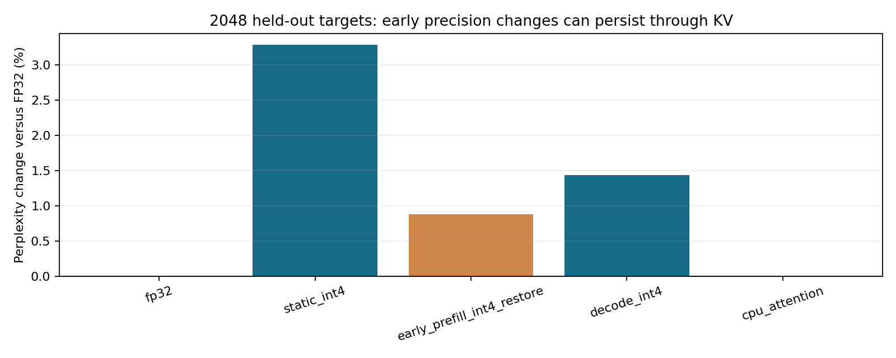<p class="caption"><strong>Figure 30.</strong> Controlled precision-history audit <em>[Measured experiment]</em><br />Source: results/validation_study_final/figures/quality_history.png</p></div>


### Evidence limits


Five rounds and a single laptop remain a limited sample. Paired-change intervals bootstrap paired percent changes, not independent machines; they are exploratory, not population confidence guarantees. Steady traces repeat unchanged; burst arrivals vary by seed. Fresh calibration and standardized warmup change conditions relative to M9, so cross-session absolute rates are not controlled speedup evidence. TTFT measures engine token readiness in a non-streaming service. Reference INT4 still unpacks to floating point, and CPU attention remains synchronous. Broader hardware/model/task validation remains open.


Protocol: validation_study.md (`../../docs/validation_study.md` in the source artifact). Raw timing, telemetry, sources and target histories are retained alongside this report.

<div class="figure" id="figure-31">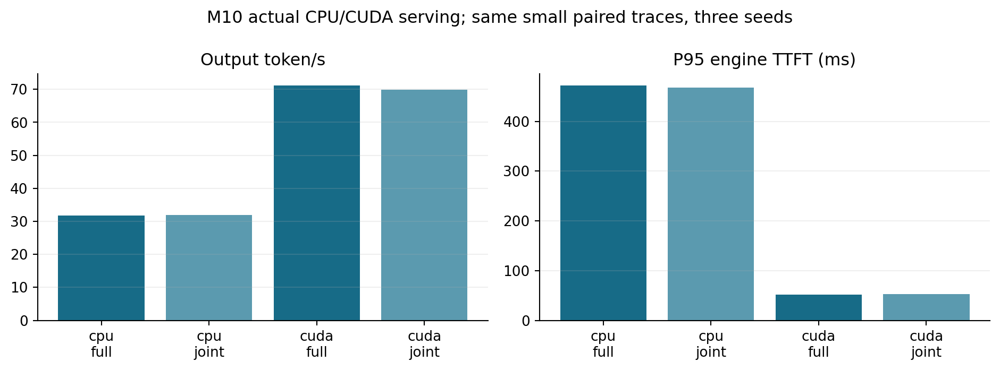<p class="caption"><strong>Figure 31.</strong> Measured backend throughput and P95 engine TTFT for the matched smaller CPU/CUDA workload. These are means of three repeats. <em>[Derived measured portability results]</em><br />Source: results/validation_study_final/portability_runs/*.json</p></div>

<div class="figure" id="figure-32">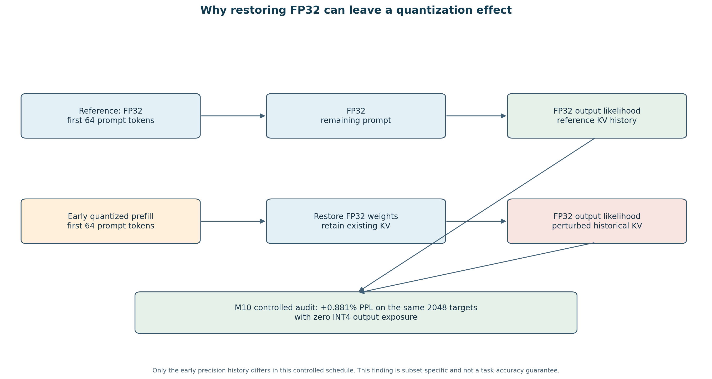<p class="caption"><strong>Figure 32.</strong> Controlled precision history explains why FP32 restoration can leave later quality effects through retained KV. The 0.881% observation belongs to the M10 controlled audit. <em>[Original causal mechanism diagram]</em><br />Source: results/validation_study_final/quality_fixed/early_prefill_int4_restore.json</p></div>

## 13. M11: capacity frontier and quality during actual adaptation

The final study freezes a 6-quota x 3-prompt-length x 4-policy x 3-repeat grid before the full sweep. Inputs are paired across quotas and policies; maximum batch size is four and every request reserves 16 outputs. Unlike M10, tight quotas actively exercise quantization and CPU placement. The default FP32 starting state and transition workspace must fit: the study does not start from a specially prepacked low-memory checkpoint.

The first pilot missed a narrow transition-feasible region. A calibration-based, validation-side resource preflight motivated adding a 675 MiB quota before the main experiment. Both pilots and the estimate are retained. This protocol refinement is disclosed rather than described as an untouched initial grid. Quality cases are selected using completion and observed quantization, never test NLL, and keep the same output reservation so the capacity boundary is not shifted by the audit.


216 actual serving runs request 864 completions: 552 complete and 312 are explicitly rejected. There are 138 all-complete runs, 78 all-rejected runs and 0 partial runs. No worker failure is accepted. All 116 tests pass.


### Lowest tested quota completing every request in every repeat


<p class="caption" id="table-29"><strong>Table 29.</strong> Lowest tested quota completing every request in every repeat — published results</p>

| Prompt tokens | FP32 | Quantization only | Offload only | Joint |
| --- | --- | --- | --- | --- |
| 128 | 600 | 600 | 600 | 600 |
| 384 | 630 | 630 | 630 | 630 |
| 768 | 700 | 675 | 700 | 675 |

<p class="small">Source: results/capacity_frontier/report.md</p>


There are 6 paired policy/seed observations where an adaptive policy completes every request while FP32 rejects every request under the same quota and inputs. Quantization and offload are evaluated independently as well as jointly. Joint control need not beat the single mechanisms. The measured frontier includes full-context KV reservation, calibration-derived workspace, headroom and FP32-to-INT4 transition staging. It is conditional on this warm-start implementation, not a physical-memory optimum or a cold-load feasibility result. Joint and quantization-only control share the same sampled minimum quotas here; a capacity advantage of joint control over quantization alone is not demonstrated.


<div class="figure" id="figure-33">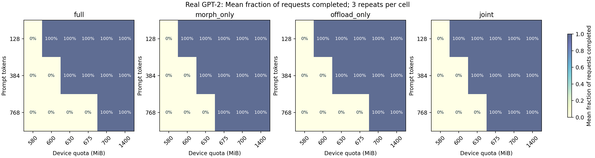<p class="caption"><strong>Figure 33.</strong> Actual completion frontier <em>[Measured experiment]</em><br />Source: results/capacity_frontier/figures/capacity_frontier.png</p></div>


<p class="caption" id="table-30"><strong>Table 30.</strong> Lowest tested quota completing every request in every repeat — published results</p>

| Prompt | Quota MiB | Policy completing all requests | Paired repeats with FP32 rejecting all |
| --- | --- | --- | --- |
| 768 | 675 | joint | 3/3 |
| 768 | 675 | morph_only | 3/3 |

<p class="small">Source: results/capacity_frontier/report.md</p>


<div class="figure" id="figure-34">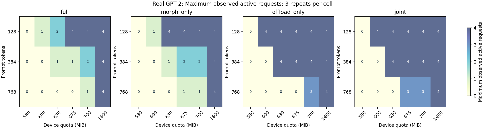<p class="caption"><strong>Figure 34.</strong> Observed concurrency <em>[Measured experiment]</em><br />Source: results/capacity_frontier/figures/concurrency.png</p></div>


### Quality where the policy actually quantizes


<p class="caption" id="table-31"><strong>Table 31.</strong> Quality where the policy actually quantizes — published results</p>

| Prompt | Quota MiB | Policy | Audit targets | FP32 PPL | Actual PPL | PPL change % | INT4 output % |
| --- | --- | --- | --- | --- | --- | --- | --- |
| 128 | 630 | joint | 192 | 65.666 | 65.838 | +0.262 | 84.90 |
| 128 | 630 | morph_only | 192 | 65.666 | 67.281 | +2.459 | 99.48 |
| 384 | 675 | joint | 192 | 34.126 | 35.192 | +3.125 | 98.44 |
| 384 | 675 | morph_only | 192 | 34.126 | 34.126 | +0.000 | 0.00 |
| 768 | 675 | joint | 96 | 45.587 | 46.841 | +2.752 | 100.00 |
| 768 | 675 | morph_only | 96 | 45.587 | 47.274 | +3.702 | 100.00 |

<p class="small">Source: results/capacity_frontier/report.md</p>


Quality audits keep each selected cell's exact prompt/output lengths and quota. For each prompt and precision-capable policy, the lowest all-repeat-complete quota with observed quantization is selected without consulting test NLL. Disjoint held-out windows are compared with the same targets under FP32 at a roomy quota. Target counts are limited by the stored prefix and long prompts. Audit trajectories remain separate from greedy trajectories; this supplements M10's larger controlled audits and does not prove a task-accuracy bound. Actual quantization occurs in 5/6 selected adaptive audits; an audit that remains FP32 cannot certify the quantized trajectory observed during its separate greedy replay.


<div class="figure" id="figure-35">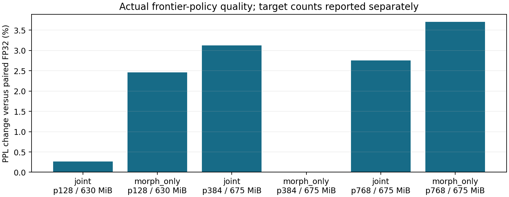<p class="caption"><strong>Figure 35.</strong> Frontier quality tradeoff <em>[Measured experiment]</em><br />Source: results/capacity_frontier/figures/quality.png</p></div>


### Complete cell results


<p class="caption" id="table-32"><strong>Table 32.</strong> Complete cell results — published results (field panel 1) (rows 1-18)</p>

| Prompt | Quota | Policy | Completed/requested per repeat | Token/s if all complete | P95 TTFT ms | P95 TBT ms | SLO failure % |
| --- | --- | --- | --- | --- | --- | --- | --- |
| 128 | 580 | full | 0.00/4 | N/A | N/A | N/A | 100.00 |
| 128 | 580 | joint | 0.00/4 | N/A | N/A | N/A | 100.00 |
| 128 | 580 | morph_only | 0.00/4 | N/A | N/A | N/A | 100.00 |
| 128 | 580 | offload_only | 0.00/4 | N/A | N/A | N/A | 100.00 |
| 128 | 600 | full | 4.00/4 | 84.18 | 440.18 | 10.53 | 0.00 |
| 128 | 600 | joint | 4.00/4 | 106.35 | 124.30 | 27.25 | 0.00 |
| 128 | 600 | morph_only | 4.00/4 | 83.22 | 447.61 | 11.91 | 0.00 |
| 128 | 600 | offload_only | 4.00/4 | 109.11 | 116.32 | 26.91 | 0.00 |
| 128 | 630 | full | 4.00/4 | 116.71 | 210.20 | 14.46 | 0.00 |
| 128 | 630 | joint | 4.00/4 | 101.45 | 125.67 | 39.59 | 0.00 |
| 128 | 630 | morph_only | 4.00/4 | 112.65 | 207.66 | 16.85 | 0.00 |
| 128 | 630 | offload_only | 4.00/4 | 116.83 | 73.30 | 27.54 | 0.00 |
| 128 | 675 | full | 4.00/4 | 132.17 | 66.79 | 21.83 | 0.00 |
| 128 | 675 | joint | 4.00/4 | 112.21 | 92.60 | 45.61 | 0.00 |
| 128 | 675 | morph_only | 4.00/4 | 121.95 | 85.73 | 24.59 | 0.00 |
| 128 | 675 | offload_only | 4.00/4 | 122.94 | 89.40 | 30.79 | 0.00 |
| 128 | 700 | full | 4.00/4 | 133.35 | 68.58 | 21.01 | 0.00 |
| 128 | 700 | joint | 4.00/4 | 108.00 | 89.80 | 48.03 | 0.00 |

<p class="small">Source: results/capacity_frontier/report.md</p>

<p class="caption" id="table-33"><strong>Table 33.</strong> Complete cell results — published results (field panel 1) (rows 19-36)</p>

| Prompt | Quota | Policy | Completed/requested per repeat | Token/s if all complete | P95 TTFT ms | P95 TBT ms | SLO failure % |
| --- | --- | --- | --- | --- | --- | --- | --- |
| 128 | 700 | morph_only | 4.00/4 | 124.76 | 89.32 | 21.78 | 0.00 |
| 128 | 700 | offload_only | 4.00/4 | 124.32 | 83.54 | 28.62 | 0.00 |
| 128 | 1400 | full | 4.00/4 | 130.53 | 70.65 | 24.14 | 0.00 |
| 128 | 1400 | joint | 4.00/4 | 116.75 | 90.36 | 31.84 | 0.00 |
| 128 | 1400 | morph_only | 4.00/4 | 114.72 | 98.69 | 27.23 | 0.00 |
| 128 | 1400 | offload_only | 4.00/4 | 123.42 | 87.83 | 31.57 | 0.00 |
| 384 | 580 | full | 0.00/4 | N/A | N/A | N/A | 100.00 |
| 384 | 580 | joint | 0.00/4 | N/A | N/A | N/A | 100.00 |
| 384 | 580 | morph_only | 0.00/4 | N/A | N/A | N/A | 100.00 |
| 384 | 580 | offload_only | 0.00/4 | N/A | N/A | N/A | 100.00 |
| 384 | 600 | full | 0.00/4 | N/A | N/A | N/A | 100.00 |
| 384 | 600 | joint | 0.00/4 | N/A | N/A | N/A | 100.00 |
| 384 | 600 | morph_only | 0.00/4 | N/A | N/A | N/A | 100.00 |
| 384 | 600 | offload_only | 0.00/4 | N/A | N/A | N/A | 100.00 |
| 384 | 630 | full | 4.00/4 | 69.14 | 600.63 | 10.62 | 0.00 |
| 384 | 630 | joint | 4.00/4 | 76.73 | 416.56 | 30.29 | 0.00 |
| 384 | 630 | morph_only | 4.00/4 | 69.78 | 592.98 | 10.92 | 0.00 |
| 384 | 630 | offload_only | 4.00/4 | 78.33 | 414.95 | 29.08 | 0.00 |

<p class="small">Source: results/capacity_frontier/report.md</p>

<p class="caption" id="table-34"><strong>Table 34.</strong> Complete cell results — published results (field panel 1) (rows 37-54)</p>

| Prompt | Quota | Policy | Completed/requested per repeat | Token/s if all complete | P95 TTFT ms | P95 TBT ms | SLO failure % |
| --- | --- | --- | --- | --- | --- | --- | --- |
| 384 | 675 | full | 4.00/4 | 67.55 | 615.84 | 12.11 | 0.00 |
| 384 | 675 | joint | 4.00/4 | 74.86 | 398.57 | 36.16 | 0.00 |
| 384 | 675 | morph_only | 4.00/4 | 74.79 | 501.68 | 15.47 | 0.00 |
| 384 | 675 | offload_only | 4.00/4 | 74.41 | 440.50 | 31.31 | 0.00 |
| 384 | 700 | full | 4.00/4 | 94.58 | 340.11 | 16.02 | 0.00 |
| 384 | 700 | joint | 4.00/4 | 90.78 | 260.84 | 32.47 | 0.00 |
| 384 | 700 | morph_only | 4.00/4 | 95.17 | 335.79 | 15.29 | 0.00 |
| 384 | 700 | offload_only | 4.00/4 | 86.15 | 267.24 | 38.18 | 0.00 |
| 384 | 1400 | full | 4.00/4 | 98.11 | 245.58 | 27.39 | 0.00 |
| 384 | 1400 | joint | 4.00/4 | 91.67 | 277.78 | 34.99 | 0.00 |
| 384 | 1400 | morph_only | 4.00/4 | 74.13 | 454.19 | 58.03 | 25.00 |
| 384 | 1400 | offload_only | 4.00/4 | 103.38 | 226.42 | 22.42 | 0.00 |
| 768 | 580 | full | 0.00/4 | N/A | N/A | N/A | 100.00 |
| 768 | 580 | joint | 0.00/4 | N/A | N/A | N/A | 100.00 |
| 768 | 580 | morph_only | 0.00/4 | N/A | N/A | N/A | 100.00 |
| 768 | 580 | offload_only | 0.00/4 | N/A | N/A | N/A | 100.00 |
| 768 | 600 | full | 0.00/4 | N/A | N/A | N/A | 100.00 |
| 768 | 600 | joint | 0.00/4 | N/A | N/A | N/A | 100.00 |

<p class="small">Source: results/capacity_frontier/report.md</p>

<p class="caption" id="table-35"><strong>Table 35.</strong> Complete cell results — published results (field panel 1) (rows 55-72)</p>

| Prompt | Quota | Policy | Completed/requested per repeat | Token/s if all complete | P95 TTFT ms | P95 TBT ms | SLO failure % |
| --- | --- | --- | --- | --- | --- | --- | --- |
| 768 | 600 | morph_only | 0.00/4 | N/A | N/A | N/A | 100.00 |
| 768 | 600 | offload_only | 0.00/4 | N/A | N/A | N/A | 100.00 |
| 768 | 630 | full | 0.00/4 | N/A | N/A | N/A | 100.00 |
| 768 | 630 | joint | 0.00/4 | N/A | N/A | N/A | 100.00 |
| 768 | 630 | morph_only | 0.00/4 | N/A | N/A | N/A | 100.00 |
| 768 | 630 | offload_only | 0.00/4 | N/A | N/A | N/A | 100.00 |
| 768 | 675 | full | 0.00/4 | N/A | N/A | N/A | 100.00 |
| 768 | 675 | joint | 4.00/4 | 43.04 | 1020.26 | 36.78 | 0.00 |
| 768 | 675 | morph_only | 4.00/4 | 45.04 | 1057.89 | 12.91 | 0.00 |
| 768 | 675 | offload_only | 0.00/4 | N/A | N/A | N/A | 100.00 |
| 768 | 700 | full | 4.00/4 | 57.17 | 783.91 | 10.28 | 0.00 |
| 768 | 700 | joint | 4.00/4 | 52.04 | 812.22 | 35.27 | 0.00 |
| 768 | 700 | morph_only | 4.00/4 | 55.18 | 832.21 | 10.08 | 0.00 |
| 768 | 700 | offload_only | 4.00/4 | 51.17 | 859.19 | 36.36 | 0.00 |
| 768 | 1400 | full | 4.00/4 | 77.68 | 460.38 | 27.30 | 0.00 |
| 768 | 1400 | joint | 4.00/4 | 74.68 | 449.25 | 40.06 | 0.00 |
| 768 | 1400 | morph_only | 4.00/4 | 71.95 | 476.80 | 38.59 | 0.00 |
| 768 | 1400 | offload_only | 4.00/4 | 77.66 | 465.71 | 22.57 | 0.00 |

<p class="small">Source: results/capacity_frontier/report.md</p>

<p class="caption" id="table-36"><strong>Table 36.</strong> Complete cell results — published results (field panel 2) (rows 1-18)</p>

| Prompt | Quota | Policy | INT4 % | CPU attention % | Max active |
| --- | --- | --- | --- | --- | --- |
| 128 | 580 | full | 0.00 | 0.00 | 0 |
| 128 | 580 | joint | 0.00 | 0.00 | 0 |
| 128 | 580 | morph_only | 0.00 | 0.00 | 0 |
| 128 | 580 | offload_only | 0.00 | 0.00 | 0 |
| 128 | 600 | full | 0.00 | 0.00 | 1 |
| 128 | 600 | joint | 0.00 | 74.48 | 4 |
| 128 | 600 | morph_only | 0.00 | 0.00 | 1 |
| 128 | 600 | offload_only | 0.00 | 75.00 | 4 |
| 128 | 630 | full | 0.00 | 0.00 | 2 |
| 128 | 630 | joint | 94.27 | 61.98 | 4 |
| 128 | 630 | morph_only | 32.81 | 0.00 | 4 |
| 128 | 630 | offload_only | 0.00 | 53.12 | 4 |
| 128 | 675 | full | 0.00 | 0.00 | 4 |
| 128 | 675 | joint | 88.02 | 22.40 | 4 |
| 128 | 675 | morph_only | 33.33 | 0.00 | 4 |
| 128 | 675 | offload_only | 0.00 | 7.29 | 4 |
| 128 | 700 | full | 0.00 | 0.00 | 4 |
| 128 | 700 | joint | 86.98 | 24.48 | 4 |

<p class="small">Source: results/capacity_frontier/report.md</p>

<p class="caption" id="table-37"><strong>Table 37.</strong> Complete cell results — published results (field panel 2) (rows 19-36)</p>

| Prompt | Quota | Policy | INT4 % | CPU attention % | Max active |
| --- | --- | --- | --- | --- | --- |
| 128 | 700 | morph_only | 97.92 | 0.00 | 4 |
| 128 | 700 | offload_only | 0.00 | 7.29 | 4 |
| 128 | 1400 | full | 0.00 | 0.00 | 4 |
| 128 | 1400 | joint | 93.75 | 20.31 | 4 |
| 128 | 1400 | morph_only | 97.92 | 0.00 | 4 |
| 128 | 1400 | offload_only | 0.00 | 7.81 | 4 |
| 384 | 580 | full | 0.00 | 0.00 | 0 |
| 384 | 580 | joint | 0.00 | 0.00 | 0 |
| 384 | 580 | morph_only | 0.00 | 0.00 | 0 |
| 384 | 580 | offload_only | 0.00 | 0.00 | 0 |
| 384 | 600 | full | 0.00 | 0.00 | 0 |
| 384 | 600 | joint | 0.00 | 0.00 | 0 |
| 384 | 600 | morph_only | 0.00 | 0.00 | 0 |
| 384 | 600 | offload_only | 0.00 | 0.00 | 0 |
| 384 | 630 | full | 0.00 | 0.00 | 1 |
| 384 | 630 | joint | 0.00 | 73.44 | 4 |
| 384 | 630 | morph_only | 0.00 | 0.00 | 1 |
| 384 | 630 | offload_only | 0.00 | 72.40 | 4 |

<p class="small">Source: results/capacity_frontier/report.md</p>

<p class="caption" id="table-38"><strong>Table 38.</strong> Complete cell results — published results (field panel 2) (rows 37-54)</p>

| Prompt | Quota | Policy | INT4 % | CPU attention % | Max active |
| --- | --- | --- | --- | --- | --- |
| 384 | 675 | full | 0.00 | 0.00 | 1 |
| 384 | 675 | joint | 33.33 | 76.04 | 4 |
| 384 | 675 | morph_only | 66.67 | 0.00 | 2 |
| 384 | 675 | offload_only | 0.00 | 73.44 | 4 |
| 384 | 700 | full | 0.00 | 0.00 | 2 |
| 384 | 700 | joint | 0.00 | 44.79 | 4 |
| 384 | 700 | morph_only | 0.00 | 0.00 | 2 |
| 384 | 700 | offload_only | 0.00 | 45.31 | 4 |
| 384 | 1400 | full | 0.00 | 0.00 | 4 |
| 384 | 1400 | joint | 73.96 | 0.00 | 4 |
| 384 | 1400 | morph_only | 60.94 | 0.00 | 4 |
| 384 | 1400 | offload_only | 0.00 | 0.00 | 4 |
| 768 | 580 | full | 0.00 | 0.00 | 0 |
| 768 | 580 | joint | 0.00 | 0.00 | 0 |
| 768 | 580 | morph_only | 0.00 | 0.00 | 0 |
| 768 | 580 | offload_only | 0.00 | 0.00 | 0 |
| 768 | 600 | full | 0.00 | 0.00 | 0 |
| 768 | 600 | joint | 0.00 | 0.00 | 0 |

<p class="small">Source: results/capacity_frontier/report.md</p>

<p class="caption" id="table-39"><strong>Table 39.</strong> Complete cell results — published results (field panel 2) (rows 55-72)</p>

| Prompt | Quota | Policy | INT4 % | CPU attention % | Max active |
| --- | --- | --- | --- | --- | --- |
| 768 | 600 | morph_only | 0.00 | 0.00 | 0 |
| 768 | 600 | offload_only | 0.00 | 0.00 | 0 |
| 768 | 630 | full | 0.00 | 0.00 | 0 |
| 768 | 630 | joint | 0.00 | 0.00 | 0 |
| 768 | 630 | morph_only | 0.00 | 0.00 | 0 |
| 768 | 630 | offload_only | 0.00 | 0.00 | 0 |
| 768 | 675 | full | 0.00 | 0.00 | 0 |
| 768 | 675 | joint | 100.00 | 92.19 | 3 |
| 768 | 675 | morph_only | 100.00 | 0.00 | 1 |
| 768 | 675 | offload_only | 0.00 | 0.00 | 0 |
| 768 | 700 | full | 0.00 | 0.00 | 1 |
| 768 | 700 | joint | 9.38 | 75.00 | 3 |
| 768 | 700 | morph_only | 0.00 | 0.00 | 1 |
| 768 | 700 | offload_only | 0.00 | 75.00 | 3 |
| 768 | 1400 | full | 0.00 | 0.00 | 4 |
| 768 | 1400 | joint | 50.52 | 0.00 | 4 |
| 768 | 1400 | morph_only | 52.60 | 0.00 | 4 |
| 768 | 1400 | offload_only | 0.00 | 0.00 | 4 |

<p class="small">Source: results/capacity_frontier/report.md</p>


<div class="figure" id="figure-36">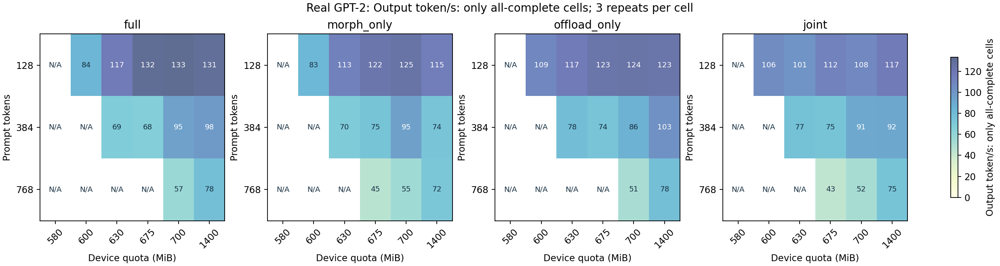<p class="caption"><strong>Figure 36.</strong> Throughput among fully completed cells <em>[Measured experiment]</em><br />Source: results/capacity_frontier/figures/throughput.png</p></div>


The first pilot missed a narrow transition-feasible region. Before the full sweep, validation-calibration reservation bounds motivated the final grid (580/600/630/675/700/1400 MiB); both pilots and the diagnostic preflight are retained. Cold model loading/calibration/warmup precede timed enforcement. Reference INT4 has unpacking costs, CPU attention is synchronous, and prefill CPU offload is unsupported. Rejections count as SLO failures, and missing latency is N/A. Finite grid spacing and three seeds on one GPU limit generalization. Resource limits are sampled and cannot isolate the worker from competing processes. Actual CUDA peaks above quota are separately reported: 0 runs.


See protocol and reproduction (`../../docs/capacity_frontier.md` in the source artifact) and demo/viva guide (`../../docs/demo_and_viva.md` in the source artifact).

<div class="figure" id="figure-37">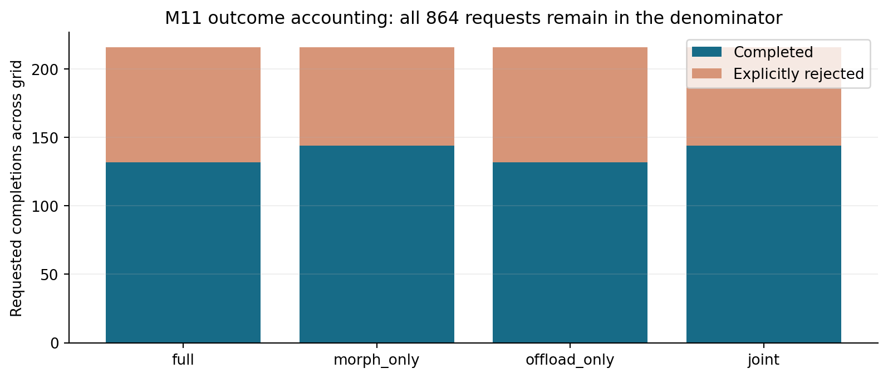<p class="caption"><strong>Figure 37.</strong> Complete requested-work accounting across all frontier cells. Rejections remain in the denominator and count as SLO failures. <em>[Derived measured outcome counts]</em><br />Source: results/capacity_frontier/summary.csv</p></div>

## 14. Synthesis: supported claims, negative results and limitations

<p class="caption" id="table-40"><strong>Table 40.</strong> Research conclusions and their evidence bounds</p>

| Question | Observed finding | Supported conclusion / limit |
| --- | --- | --- |
| Can one policy interface drive CPU and CUDA? | Same controller, separate calibration, 12 portability runs; 96/96 FP32 outputs match | Backend execution portability on one laptop; not physical multi-vendor validation |
| Can precision enlarge feasible workloads? | 768-token prompts complete at 675 MiB with quantization, FP32 rejects | A sampled warm-start capacity benefit under this reservation contract |
| Does joint control beat quantization alone in capacity? | Both have the same sampled minima in M11 | A joint capacity advantage over quantization alone is not established |
| Does adaptation always improve speed? | Optimized FP32 has the highest M10 mean throughput in all scenarios | No universal throughput or SLO win |
| Does controller optimization reduce overhead? | M10 optimized joint below 5% in 15/15 runs; worst 4.97% | Observed scheduling-cost reduction in the tested sessions |
| Is phase feedback the most accurate predictor? | Matched MAE: legacy 4.55 ms, phase 5.54 ms | Fresh calibration matters; phase isolation did not establish better MAE |
| Does restoring FP32 remove all error? | Early-prefill audit: +0.881% PPL after restoration | Stored weights can restore exactly while historical KV remains affected |
| Is the additive risk budget a task-quality guarantee? | M11 joint frontier audit +2.752% PPL on 96 targets | No downstream-accuracy guarantee follows from validation KL |
| Are simulated large-model gains physical results? | 88 analytical main/load records on synthetic profiles | Sensitivity evidence only; no 8B hardware deployment claim |

The study's internal controls are useful but finite. Synchronous Python attention, dequantize-and-matmul INT4, conservative full-context admission and a small pretrained model differ from optimized production serving. A fixed sensitivity order ignores layer interactions and prompt dependence. Actual quality audits have their own state trajectories and several protocols/target counts; their PPL values must not be ranked across incompatible contexts as a single leaderboard. One audit selected from a quantized greedy cell remains FP32, explicitly showing that greedy exposure does not certify audit exposure.

Clock and available-memory variation remain real confounders on a shared laptop. The mixed-power diagnostic is retained separately, and the incomplete AC attempt's exact original cause is unproven. A later same-trace reproduction completed with more free RAM; this association does not establish causality. New failure-only snapshots improve future diagnosis but do not retroactively supply the lost original plan state.

The next research extensions are optimized low-bit kernels, asynchronous placement/stream ownership, paged KV, larger model adapters, downstream task tests and independently calibrated physical machines. These are research directions, not unfinished requirements for the delivered course prototype. The version 1.0.0 result is a reproducible implementation and a measured capacity/quality tradeoff with explicit negative regimes.

## 15. Live demonstration, reproduction and submission artifacts

The one-command demonstration first labels and prints saved validated evidence. It then performs an actual matched capacity replay under the selected tight quota, followed by a temporary concurrent HTTP server check. The server is stopped automatically. Live demonstration timings are not substituted for the controlled experiment. After release freeze, new demo outputs are placed in timestamped session folders, preserving the released reference evidence.

```powershell
# Run from the project folder with the prepared local CUDA model
python scripts/demo_project.py

# Read saved validated evidence without model execution
python scripts/demo_project.py --evidence-only

# Verify the frozen accepted experiment and packaged submission
python scripts/check_capacity_frontier.py --check-current
python scripts/check_submission.py --package
```

<p class="caption" id="table-41"><strong>Table 41.</strong> Recorded live capacity demonstration</p>

| Policy | Prompt / quota | Completed | Rejected | Max batch | Quantized iterations | CPU-attention iterations |
| --- | --- | --- | --- | --- | --- | --- |
| full | 768 / 675 MiB | 0 | 4 | 0 | 0 | 0 |
| joint | 768 / 675 MiB | 4 | 0 | 3 | 63 | 51 |

<p class="small">Source: results/final_demo/capacity_summary.json; demonstration, not a controlled benchmark</p>

The frozen project ZIP contains code, configurations, tests, the original report/slides, raw result traces, source snapshots, the tiny checkpoint and model/data provenance. The 124M-parameter pretrained weights are deliberately prepared separately from their pinned public source. This detailed companion adds a PDF, self-contained HTML, figure atlas and reproducible report sources without altering that submission freeze.

For exact software setup and API calls, use the repository README. For the presentation and viva, `docs/demo_and_viva.md` includes an architecture walkthrough and answers on hardware agnosticism, transition peaks, CPU compute, quality scope and unsuccessful outcomes. Reproducing historical runs with newer code requires a new output folder; archived wheels/snapshots retain the exact implementations that generated earlier physical measurements.

## 16. References and source attribution

[1] Zhaoyuan Su, Zeyu Zhang, Tingfeng Lan, Zirui Wang, Haiying Shen, Juncheng Yang and Yue Cheng. *MorphServe: Efficient and Workload-Aware LLM Serving via Runtime Quantized Layer Swapping and KV Cache Resizing.* MLSys 2026. User-supplied 20-page paper. Mechanism discussion is based on its runtime layer swapping and KV-capacity management; this report does not present the paper's results as ours.

[2] Xuanlin Jiang, Yang Zhou, Shiyi Cao, Ion Stoica and Minlan Yu. *NEO: Saving GPU Memory Crisis with CPU Offloading for Online LLM Inference.* MLSys 2025. User-supplied 16-page paper. CPU attention/KV placement and asymmetric pipelining are the research inspiration. [Author repository](https://github.com/NEO-MLSys25/NEO).

[3] PyTorch contributors. [CUDA semantics](https://docs.pytorch.org/docs/stable/notes/cuda.html) and [serialization semantics](https://docs.pytorch.org/docs/stable/notes/serialization.html). The recorded environment uses PyTorch 2.5.1+cu121; current online documentation is not substituted for the archived execution environment.

[4] GPT-2 model assets and documentation: [model card](https://huggingface.co/openai-community/gpt2) and [Transformers GPT-2 adapter documentation](https://huggingface.co/docs/transformers/model_doc/gpt2). Pinned checkpoint revision: `607a30d783dfa663caf39e06633721c8d4cfcd7e`. Exact model asset hashes are retained in the project source manifest.

[5] Stephen Merity et al. [WikiText dataset card](https://huggingface.co/datasets/Salesforce/wikitext), `wikitext-2-raw-v1`. Stored validation/test prefixes derive from the first 100 rows per split, with retained response payloads and hashes. Wikipedia-derived text attribution and CC BY-SA 3.0/GFDL information accompany the data manifest.

The supplied project proposal and midterm slides were used as planning context, not as instructions controlling execution. All architecture diagrams and added data visualizations in this companion are original renderings of the implemented code and archived records. Figures copied from the project's results are identified by their exact source paths; no research-paper figure is represented as an implementation measurement.

## Appendix A. Complete run-level numerical results

The following tables retain one row per run in the main experiment suites: 63 analytical main runs, 25 analytical offered-load runs, 42 M8 serving runs, 36 M9 serving runs, 60 M10 GPU runs, 12 M10 backend-portability runs and 216 M11 frontier runs. These 454 rows include 88 analytical records and 366 actual serving records. They do not count quality arms or microbenchmark repetitions as additional independent serving trials. Full-field CSV copies accompany the report; tables select interpretable units and preserve all seeds/outcomes.

### A.1 Analytical main study

<p class="caption" id="table-42"><strong>Table 42.</strong> A.1 Analytical main study — every recorded run (rows 1-18)</p>

| Profile | Policy | Seed | P95 TTFT ms | P95 TBT ms | Output token/s | SLO fail % |
| --- | --- | --- | --- | --- | --- | --- |
| 20GiB-balanced | full | 7 | 18,247.45 | 318.41 | 124.23 | 93.75 |
| 20GiB-balanced | full | 19 | 19,667.59 | 261.00 | 115.80 | 94.79 |
| 20GiB-balanced | full | 41 | 16,625.04 | 343.19 | 120.05 | 95.83 |
| 20GiB-balanced | static_int4 | 7 | 17,755.17 | 307.82 | 131.22 | 93.75 |
| 20GiB-balanced | static_int4 | 19 | 19,227.41 | 305.41 | 119.87 | 94.79 |
| 20GiB-balanced | static_int4 | 41 | 16,474.29 | 352.12 | 126.08 | 91.67 |
| 20GiB-balanced | morph_only | 7 | 18,327.98 | 350.12 | 123.59 | 93.75 |
| 20GiB-balanced | morph_only | 19 | 19,605.83 | 348.17 | 114.26 | 94.79 |
| 20GiB-balanced | morph_only | 41 | 16,594.73 | 391.37 | 119.56 | 95.83 |
| 20GiB-balanced | offload_only | 7 | 18,713.47 | 360.24 | 121.97 | 93.75 |
| 20GiB-balanced | offload_only | 19 | 19,968.89 | 339.47 | 113.47 | 94.79 |
| 20GiB-balanced | offload_only | 41 | 17,044.26 | 396.50 | 118.05 | 95.83 |
| 20GiB-balanced | naive | 7 | 18,712.89 | 358.20 | 122.57 | 93.75 |
| 20GiB-balanced | naive | 19 | 19,882.44 | 348.07 | 113.39 | 94.79 |
| 20GiB-balanced | naive | 41 | 16,868.72 | 391.13 | 119.43 | 95.83 |
| 20GiB-balanced | joint | 7 | 18,732.28 | 360.24 | 121.81 | 93.75 |
| 20GiB-balanced | joint | 19 | 19,968.89 | 339.47 | 113.47 | 94.79 |
| 20GiB-balanced | joint | 41 | 17,044.26 | 396.50 | 118.05 | 95.83 |

<p class="small">Source: results/simulation/summary.csv</p>

<p class="caption" id="table-43"><strong>Table 43.</strong> A.1 Analytical main study — every recorded run (rows 19-36)</p>

| Profile | Policy | Seed | P95 TTFT ms | P95 TBT ms | Output token/s | SLO fail % |
| --- | --- | --- | --- | --- | --- | --- |
| 20GiB-balanced | joint_no_hysteresis | 7 | 18,732.28 | 360.24 | 121.81 | 93.75 |
| 20GiB-balanced | joint_no_hysteresis | 19 | 19,968.89 | 339.47 | 113.47 | 94.79 |
| 20GiB-balanced | joint_no_hysteresis | 41 | 17,044.26 | 396.50 | 118.05 | 95.83 |
| 20GiB-slow-host | full | 7 | 18,247.45 | 318.41 | 124.23 | 93.75 |
| 20GiB-slow-host | full | 19 | 19,667.59 | 261.00 | 115.80 | 94.79 |
| 20GiB-slow-host | full | 41 | 16,625.04 | 343.19 | 120.05 | 95.83 |
| 20GiB-slow-host | static_int4 | 7 | 17,755.17 | 307.82 | 131.22 | 97.92 |
| 20GiB-slow-host | static_int4 | 19 | 19,227.41 | 305.41 | 119.87 | 94.79 |
| 20GiB-slow-host | static_int4 | 41 | 16,474.29 | 352.12 | 126.08 | 91.67 |
| 20GiB-slow-host | morph_only | 7 | 18,326.45 | 347.80 | 124.49 | 93.75 |
| 20GiB-slow-host | morph_only | 19 | 19,681.74 | 348.17 | 115.24 | 94.79 |
| 20GiB-slow-host | morph_only | 41 | 16,575.76 | 391.37 | 120.63 | 95.83 |
| 20GiB-slow-host | offload_only | 7 | 22,342.00 | 393.02 | 108.55 | 93.75 |
| 20GiB-slow-host | offload_only | 19 | 23,154.35 | 401.46 | 101.53 | 94.79 |
| 20GiB-slow-host | offload_only | 41 | 21,993.02 | 459.86 | 102.75 | 95.83 |
| 20GiB-slow-host | naive | 7 | 34,618.30 | 443.70 | 75.35 | 96.88 |
| 20GiB-slow-host | naive | 19 | 33,504.33 | 408.76 | 72.33 | 94.79 |
| 20GiB-slow-host | naive | 41 | 32,068.72 | 428.10 | 74.73 | 95.83 |

<p class="small">Source: results/simulation/summary.csv</p>

<p class="caption" id="table-44"><strong>Table 44.</strong> A.1 Analytical main study — every recorded run (rows 37-54)</p>

| Profile | Policy | Seed | P95 TTFT ms | P95 TBT ms | Output token/s | SLO fail % |
| --- | --- | --- | --- | --- | --- | --- |
| 20GiB-slow-host | joint | 7 | 20,051.60 | 350.09 | 116.50 | 93.75 |
| 20GiB-slow-host | joint | 19 | 21,986.70 | 372.86 | 106.24 | 94.79 |
| 20GiB-slow-host | joint | 41 | 17,714.46 | 407.71 | 115.18 | 95.83 |
| 20GiB-slow-host | joint_no_hysteresis | 7 | 20,051.60 | 350.09 | 116.50 | 93.75 |
| 20GiB-slow-host | joint_no_hysteresis | 19 | 21,986.70 | 372.86 | 106.24 | 94.79 |
| 20GiB-slow-host | joint_no_hysteresis | 41 | 17,714.46 | 407.71 | 115.18 | 95.83 |
| 48GiB-server | full | 7 | 3,670.66 | 104.14 | 220.26 | 78.12 |
| 48GiB-server | full | 19 | 4,074.74 | 116.27 | 209.89 | 80.21 |
| 48GiB-server | full | 41 | 3,325.11 | 101.99 | 208.83 | 69.79 |
| 48GiB-server | static_int4 | 7 | 3,535.04 | 102.67 | 225.33 | 77.08 |
| 48GiB-server | static_int4 | 19 | 4,007.23 | 116.27 | 214.87 | 80.21 |
| 48GiB-server | static_int4 | 41 | 3,331.65 | 105.61 | 215.79 | 69.79 |
| 48GiB-server | morph_only | 7 | 3,670.66 | 104.14 | 220.26 | 78.12 |
| 48GiB-server | morph_only | 19 | 4,074.74 | 116.27 | 209.89 | 80.21 |
| 48GiB-server | morph_only | 41 | 3,325.11 | 101.99 | 208.83 | 69.79 |
| 48GiB-server | offload_only | 7 | 3,670.66 | 104.14 | 220.26 | 78.12 |
| 48GiB-server | offload_only | 19 | 4,074.74 | 116.27 | 209.89 | 80.21 |
| 48GiB-server | offload_only | 41 | 3,325.11 | 101.99 | 208.83 | 69.79 |

<p class="small">Source: results/simulation/summary.csv</p>

<p class="caption" id="table-45"><strong>Table 45.</strong> A.1 Analytical main study — every recorded run (rows 55-63)</p>

| Profile | Policy | Seed | P95 TTFT ms | P95 TBT ms | Output token/s | SLO fail % |
| --- | --- | --- | --- | --- | --- | --- |
| 48GiB-server | naive | 7 | 4,024.72 | 106.30 | 220.28 | 78.12 |
| 48GiB-server | naive | 19 | 4,469.55 | 117.80 | 209.86 | 80.21 |
| 48GiB-server | naive | 41 | 3,598.23 | 108.79 | 208.76 | 72.92 |
| 48GiB-server | joint | 7 | 3,670.66 | 104.14 | 220.26 | 78.12 |
| 48GiB-server | joint | 19 | 4,074.74 | 116.27 | 209.89 | 80.21 |
| 48GiB-server | joint | 41 | 3,325.11 | 101.99 | 208.83 | 69.79 |
| 48GiB-server | joint_no_hysteresis | 7 | 3,670.66 | 104.14 | 220.26 | 78.12 |
| 48GiB-server | joint_no_hysteresis | 19 | 4,074.74 | 116.27 | 209.89 | 80.21 |
| 48GiB-server | joint_no_hysteresis | 41 | 3,325.11 | 101.99 | 208.83 | 69.79 |

<p class="small">Source: results/simulation/summary.csv</p>

### A.2 Analytical offered-load study

<p class="caption" id="table-46"><strong>Table 46.</strong> A.2 Analytical offered-load study — every recorded run (rows 1-18)</p>

| Offered req/s | Policy | P95 TTFT ms | P95 TBT ms | Output token/s | SLO fail % |
| --- | --- | --- | --- | --- | --- |
| 0.60 | full | 1,291.17 | 129.29 | 29.28 | 50.00 |
| 0.60 | morph_only | 1,291.17 | 129.29 | 29.28 | 50.00 |
| 0.60 | offload_only | 1,291.17 | 129.29 | 29.28 | 50.00 |
| 0.60 | naive | 1,344.51 | 129.22 | 29.28 | 52.08 |
| 0.60 | joint | 1,291.17 | 129.29 | 29.28 | 50.00 |
| 1.20 | full | 4,519.70 | 272.83 | 57.26 | 79.17 |
| 1.20 | morph_only | 4,767.51 | 433.04 | 57.26 | 77.08 |
| 1.20 | offload_only | 5,203.86 | 444.99 | 57.26 | 79.17 |
| 1.20 | naive | 5,262.09 | 430.65 | 57.26 | 79.17 |
| 1.20 | joint | 5,203.86 | 444.99 | 57.26 | 79.17 |
| 2.40 | full | 8,219.17 | 373.34 | 99.86 | 91.67 |
| 2.40 | morph_only | 7,671.20 | 299.37 | 101.11 | 91.67 |
| 2.40 | offload_only | 7,938.07 | 356.13 | 100.34 | 91.67 |
| 2.40 | naive | 8,053.42 | 356.13 | 99.74 | 91.67 |
| 2.40 | joint | 7,938.07 | 356.13 | 100.34 | 91.67 |
| 4.80 | full | 9,574.10 | 275.08 | 116.67 | 93.75 |
| 4.80 | morph_only | 9,840.18 | 383.01 | 116.63 | 93.75 |
| 4.80 | offload_only | 9,958.23 | 331.53 | 116.70 | 93.75 |

<p class="small">Source: results/load_sweep/summary.csv</p>

<p class="caption" id="table-47"><strong>Table 47.</strong> A.2 Analytical offered-load study — every recorded run (rows 19-25)</p>

| Offered req/s | Policy | P95 TTFT ms | P95 TBT ms | Output token/s | SLO fail % |
| --- | --- | --- | --- | --- | --- |
| 4.80 | naive | 10,214.41 | 408.24 | 114.76 | 93.75 |
| 4.80 | joint | 10,054.20 | 407.94 | 115.65 | 93.75 |
| 9.60 | full | 11,116.88 | 236.60 | 125.47 | 100.00 |
| 9.60 | morph_only | 10,755.94 | 367.48 | 126.71 | 100.00 |
| 9.60 | offload_only | 11,119.56 | 363.94 | 126.78 | 100.00 |
| 9.60 | naive | 11,285.68 | 374.58 | 126.33 | 100.00 |
| 9.60 | joint | 11,119.56 | 363.94 | 126.78 | 100.00 |

<p class="small">Source: results/load_sweep/summary.csv</p>

### A.3 M8 actual serving

<p class="caption" id="table-48"><strong>Table 48.</strong> A.3 M8 actual serving — every recorded run (rows 1-18)</p>

| Scenario | Policy | Seed | P95 TTFT ms | P95 TBT ms | Output token/s | Control % | SLO fail % |
| --- | --- | --- | --- | --- | --- | --- | --- |
| steady_roomy | joint | 7 | 5,436.03 | 195.27 | 31.78 | 6.95 | 100.00 |
| steady_roomy | joint_uncalibrated | 7 | 9,492.47 | 227.44 | 21.76 | 7.47 | 100.00 |
| steady_roomy | naive | 7 | 11,013.93 | 421.45 | 18.34 | 4.49 | 100.00 |
| steady_roomy | serial_full | 7 | 11,755.50 | 56.44 | 18.63 | 8.53 | 83.33 |
| steady_roomy | offload_only | 7 | 5,222.09 | 185.77 | 32.74 | 5.03 | 100.00 |
| steady_roomy | full | 7 | 608.32 | 50.39 | 96.38 | 7.10 | 0.00 |
| steady_roomy | morph_only | 7 | 917.62 | 183.65 | 54.61 | 5.70 | 58.33 |
| steady_roomy | full | 19 | 5,781.87 | 165.82 | 28.67 | 5.46 | 100.00 |
| steady_roomy | offload_only | 19 | 2,220.40 | 172.55 | 62.41 | 5.46 | 66.67 |
| steady_roomy | morph_only | 19 | 583.46 | 46.89 | 97.20 | 7.70 | 0.00 |
| steady_roomy | joint_uncalibrated | 19 | 1,180.96 | 55.66 | 74.26 | 9.98 | 0.00 |
| steady_roomy | naive | 19 | 1,773.38 | 93.09 | 63.93 | 7.94 | 0.00 |
| steady_roomy | serial_full | 19 | 2,787.59 | 16.65 | 54.60 | 10.80 | 33.33 |
| steady_roomy | joint | 19 | 1,158.99 | 79.57 | 74.27 | 7.90 | 66.67 |
| bursty_roomy | joint | 7 | 2,595.18 | 67.45 | 70.99 | 8.37 | 25.00 |
| bursty_roomy | joint_uncalibrated | 7 | 3,088.61 | 83.23 | 61.97 | 7.42 | 83.33 |
| bursty_roomy | naive | 7 | 3,415.55 | 89.12 | 56.32 | 6.15 | 66.67 |
| bursty_roomy | serial_full | 7 | 5,350.10 | 23.59 | 43.07 | 8.67 | 66.67 |

<p class="small">Source: results/live/summary.csv</p>

<p class="caption" id="table-49"><strong>Table 49.</strong> A.3 M8 actual serving — every recorded run (rows 19-36)</p>

| Scenario | Policy | Seed | P95 TTFT ms | P95 TBT ms | Output token/s | Control % | SLO fail % |
| --- | --- | --- | --- | --- | --- | --- | --- |
| bursty_roomy | offload_only | 7 | 2,530.26 | 71.38 | 74.79 | 6.09 | 25.00 |
| bursty_roomy | full | 7 | 2,019.61 | 48.01 | 88.87 | 6.10 | 16.67 |
| bursty_roomy | morph_only | 7 | 2,035.24 | 47.86 | 88.85 | 7.79 | 16.67 |
| bursty_roomy | full | 19 | 1,826.51 | 47.52 | 91.09 | 5.06 | 0.00 |
| bursty_roomy | offload_only | 19 | 1,748.00 | 45.74 | 93.05 | 5.88 | 16.67 |
| bursty_roomy | morph_only | 19 | 1,995.22 | 49.47 | 85.94 | 6.05 | 8.33 |
| bursty_roomy | joint_uncalibrated | 19 | 2,395.27 | 66.51 | 71.40 | 7.85 | 33.33 |
| bursty_roomy | naive | 19 | 3,076.01 | 84.90 | 59.17 | 6.21 | 33.33 |
| bursty_roomy | serial_full | 19 | 4,405.36 | 19.54 | 49.57 | 9.85 | 58.33 |
| bursty_roomy | joint | 19 | 2,143.89 | 72.61 | 79.44 | 6.05 | 75.00 |
| bursty_constrained | joint | 7 | 3,231.83 | 49.91 | 62.84 | 16.63 | 41.67 |
| bursty_constrained | joint_uncalibrated | 7 | 11,004.70 | 122.59 | 20.71 | 16.11 | 91.67 |
| bursty_constrained | naive | 7 | 11,833.05 | 169.91 | 21.34 | 14.27 | 91.67 |
| bursty_constrained | serial_full | 7 | 4,213.45 | 17.29 | 52.60 | 10.72 | 50.00 |
| bursty_constrained | offload_only | 7 | 2,789.15 | 22.87 | 70.63 | 14.63 | 41.67 |
| bursty_constrained | full | 7 | 2,664.15 | 21.67 | 71.97 | 11.15 | 25.00 |
| bursty_constrained | morph_only | 7 | 2,894.28 | 23.24 | 69.31 | 15.85 | 41.67 |
| bursty_constrained | full | 19 | 2,696.27 | 21.05 | 73.68 | 10.24 | 33.33 |

<p class="small">Source: results/live/summary.csv</p>

<p class="caption" id="table-50"><strong>Table 50.</strong> A.3 M8 actual serving — every recorded run (rows 37-42)</p>

| Scenario | Policy | Seed | P95 TTFT ms | P95 TBT ms | Output token/s | Control % | SLO fail % |
| --- | --- | --- | --- | --- | --- | --- | --- |
| bursty_constrained | offload_only | 19 | 2,814.02 | 42.18 | 71.58 | 11.80 | 33.33 |
| bursty_constrained | morph_only | 19 | 3,025.75 | 23.54 | 67.65 | 14.38 | 33.33 |
| bursty_constrained | joint_uncalibrated | 19 | 4,529.41 | 39.23 | 48.26 | 19.38 | 66.67 |
| bursty_constrained | naive | 19 | 3,177.58 | 59.01 | 58.43 | 11.11 | 33.33 |
| bursty_constrained | serial_full | 19 | 4,217.78 | 16.03 | 51.86 | 10.25 | 58.33 |
| bursty_constrained | joint | 19 | 3,340.00 | 52.42 | 62.82 | 15.38 | 33.33 |

<p class="small">Source: results/live/summary.csv</p>

### A.4 M9 actual serving

<p class="caption" id="table-51"><strong>Table 51.</strong> A.4 M9 actual serving — every recorded run (rows 1-18)</p>

| Scenario | Policy | Seed | P95 TTFT ms | P95 TBT ms | Output token/s | Control % | SLO fail % |
| --- | --- | --- | --- | --- | --- | --- | --- |
| steady_roomy | joint_no_gate | 7 | 5,319.06 | 204.66 | 28.51 | 1.92 | 100.00 |
| steady_roomy | full_v03 | 7 | 5,540.82 | 163.67 | 29.60 | 5.47 | 100.00 |
| steady_roomy | joint_no_reuse | 7 | 5,179.45 | 181.26 | 33.40 | 2.95 | 100.00 |
| steady_roomy | joint | 7 | 4,439.29 | 161.71 | 41.68 | 2.27 | 100.00 |
| steady_roomy | joint_v03 | 7 | 460.65 | 51.64 | 97.05 | 9.26 | 41.67 |
| steady_roomy | full | 7 | 765.66 | 106.35 | 68.33 | 2.40 | 50.00 |
| steady_roomy | joint_v03 | 19 | 4,559.88 | 218.08 | 37.03 | 6.98 | 100.00 |
| steady_roomy | joint | 19 | 3,688.75 | 134.03 | 40.54 | 2.25 | 100.00 |
| steady_roomy | full | 19 | 4,455.43 | 134.41 | 37.73 | 1.98 | 91.67 |
| steady_roomy | joint_no_gate | 19 | 4,480.19 | 190.18 | 36.79 | 2.01 | 100.00 |
| steady_roomy | full_v03 | 19 | 5,135.75 | 151.34 | 34.27 | 5.38 | 91.67 |
| steady_roomy | joint_no_reuse | 19 | 3,869.19 | 135.95 | 39.83 | 3.28 | 100.00 |
| bursty_roomy | joint_no_gate | 7 | 6,207.11 | 186.49 | 34.19 | 2.01 | 100.00 |
| bursty_roomy | full_v03 | 7 | 5,971.34 | 123.13 | 35.63 | 5.45 | 91.67 |
| bursty_roomy | joint_no_reuse | 7 | 4,840.66 | 141.13 | 40.55 | 2.68 | 100.00 |
| bursty_roomy | joint | 7 | 5,605.62 | 167.61 | 37.70 | 2.17 | 100.00 |
| bursty_roomy | joint_v03 | 7 | 6,482.22 | 188.77 | 33.08 | 6.86 | 100.00 |
| bursty_roomy | full | 7 | 5,795.69 | 159.50 | 36.33 | 1.74 | 100.00 |

<p class="small">Source: results/controller/summary.csv</p>

<p class="caption" id="table-52"><strong>Table 52.</strong> A.4 M9 actual serving — every recorded run (rows 19-36)</p>

| Scenario | Policy | Seed | P95 TTFT ms | P95 TBT ms | Output token/s | Control % | SLO fail % |
| --- | --- | --- | --- | --- | --- | --- | --- |
| bursty_roomy | joint_v03 | 19 | 6,649.33 | 214.23 | 31.74 | 6.15 | 100.00 |
| bursty_roomy | joint | 19 | 5,744.31 | 140.57 | 36.34 | 1.96 | 100.00 |
| bursty_roomy | full | 19 | 5,205.11 | 129.21 | 37.80 | 1.49 | 100.00 |
| bursty_roomy | joint_no_gate | 19 | 7,030.33 | 161.93 | 32.49 | 2.08 | 100.00 |
| bursty_roomy | full_v03 | 19 | 5,603.94 | 138.33 | 36.31 | 4.18 | 100.00 |
| bursty_roomy | joint_no_reuse | 19 | 5,590.66 | 134.86 | 37.06 | 2.73 | 100.00 |
| bursty_constrained | joint_no_gate | 7 | 8,865.77 | 154.77 | 25.67 | 2.18 | 100.00 |
| bursty_constrained | full_v03 | 7 | 8,029.59 | 59.46 | 28.17 | 10.34 | 75.00 |
| bursty_constrained | joint_no_reuse | 7 | 7,971.86 | 142.97 | 28.65 | 5.50 | 100.00 |
| bursty_constrained | joint | 7 | 8,697.26 | 150.66 | 25.19 | 2.01 | 100.00 |
| bursty_constrained | joint_v03 | 7 | 9,753.34 | 109.81 | 23.70 | 17.75 | 100.00 |
| bursty_constrained | full | 7 | 6,880.81 | 54.01 | 32.01 | 3.09 | 75.00 |
| bursty_constrained | joint_v03 | 19 | 9,651.23 | 148.65 | 24.98 | 16.00 | 100.00 |
| bursty_constrained | joint | 19 | 8,315.50 | 146.13 | 28.57 | 2.82 | 100.00 |
| bursty_constrained | full | 19 | 6,810.34 | 56.93 | 33.51 | 2.82 | 66.67 |
| bursty_constrained | joint_no_gate | 19 | 8,574.05 | 148.45 | 26.74 | 2.68 | 100.00 |
| bursty_constrained | full_v03 | 19 | 7,783.79 | 58.40 | 29.51 | 9.45 | 66.67 |
| bursty_constrained | joint_no_reuse | 19 | 8,793.55 | 166.86 | 25.26 | 3.58 | 100.00 |

<p class="small">Source: results/controller/summary.csv</p>

### A.5 M10 final GPU repeats

<p class="caption" id="table-53"><strong>Table 53.</strong> A.5 M10 final GPU repeats — every recorded run (rows 1-18)</p>

| Scenario / backend | Policy | Seed | P95 TTFT ms | P95 TBT ms | Output token/s | Control % | SLO fail % |
| --- | --- | --- | --- | --- | --- | --- | --- |
| bursty_constrained | full | 19 | 1,557.74 | 14.00 | 110.73 | 3.21 | 0.00 |
| bursty_constrained | full | 31 | 1,563.84 | 13.39 | 111.08 | 3.46 | 0.00 |
| bursty_constrained | full | 43 | 1,451.62 | 12.94 | 111.89 | 3.19 | 0.00 |
| bursty_constrained | full | 59 | 730.45 | 12.85 | 127.34 | 3.67 | 0.00 |
| bursty_constrained | full | 7 | 1,441.33 | 13.16 | 116.56 | 3.94 | 0.00 |
| bursty_constrained | full_v03 | 19 | 1,694.53 | 14.31 | 103.91 | 9.53 | 0.00 |
| bursty_constrained | full_v03 | 31 | 1,667.39 | 14.23 | 105.17 | 9.67 | 0.00 |
| bursty_constrained | full_v03 | 43 | 1,654.56 | 14.93 | 102.42 | 9.49 | 0.00 |
| bursty_constrained | full_v03 | 59 | 805.06 | 13.99 | 118.19 | 10.08 | 0.00 |
| bursty_constrained | full_v03 | 7 | 1,618.05 | 14.21 | 107.87 | 10.92 | 0.00 |
| bursty_constrained | joint | 19 | 1,601.73 | 14.29 | 108.34 | 4.23 | 0.00 |
| bursty_constrained | joint | 31 | 1,569.31 | 13.81 | 109.98 | 4.18 | 0.00 |
| bursty_constrained | joint | 43 | 1,467.17 | 13.26 | 112.26 | 4.09 | 0.00 |
| bursty_constrained | joint | 59 | 833.86 | 12.94 | 122.12 | 4.92 | 0.00 |
| bursty_constrained | joint | 7 | 1,503.90 | 13.43 | 114.16 | 4.97 | 0.00 |
| bursty_constrained | joint_v03 | 19 | 1,880.69 | 35.29 | 90.81 | 11.66 | 0.00 |
| bursty_constrained | joint_v03 | 31 | 2,170.36 | 19.21 | 88.88 | 22.88 | 16.67 |
| bursty_constrained | joint_v03 | 43 | 1,956.78 | 38.05 | 88.65 | 11.58 | 8.33 |

<p class="small">Source: results/validation_study_final/gpu_runs/*.json</p>

<p class="caption" id="table-54"><strong>Table 54.</strong> A.5 M10 final GPU repeats — every recorded run (rows 19-36)</p>

| Scenario / backend | Policy | Seed | P95 TTFT ms | P95 TBT ms | Output token/s | Control % | SLO fail % |
| --- | --- | --- | --- | --- | --- | --- | --- |
| bursty_constrained | joint_v03 | 59 | 1,061.56 | 17.33 | 104.65 | 20.16 | 0.00 |
| bursty_constrained | joint_v03 | 7 | 2,030.72 | 19.13 | 92.55 | 23.32 | 8.33 |
| bursty_roomy | full | 19 | 870.92 | 32.70 | 138.63 | 1.73 | 0.00 |
| bursty_roomy | full | 31 | 858.43 | 31.74 | 142.47 | 1.71 | 0.00 |
| bursty_roomy | full | 43 | 849.32 | 33.19 | 137.31 | 1.87 | 0.00 |
| bursty_roomy | full | 59 | 314.42 | 28.28 | 140.87 | 3.21 | 0.00 |
| bursty_roomy | full | 7 | 858.33 | 31.58 | 149.02 | 2.32 | 0.00 |
| bursty_roomy | full_v03 | 19 | 923.12 | 33.37 | 136.23 | 4.02 | 0.00 |
| bursty_roomy | full_v03 | 31 | 876.69 | 32.85 | 139.22 | 4.09 | 0.00 |
| bursty_roomy | full_v03 | 43 | 867.66 | 33.93 | 136.38 | 4.33 | 0.00 |
| bursty_roomy | full_v03 | 59 | 314.73 | 29.95 | 137.06 | 7.34 | 0.00 |
| bursty_roomy | full_v03 | 7 | 905.53 | 34.62 | 143.47 | 5.71 | 0.00 |
| bursty_roomy | joint | 19 | 895.93 | 32.11 | 138.82 | 2.15 | 0.00 |
| bursty_roomy | joint | 31 | 888.19 | 34.54 | 137.75 | 2.24 | 0.00 |
| bursty_roomy | joint | 43 | 837.98 | 32.49 | 135.69 | 2.61 | 0.00 |
| bursty_roomy | joint | 59 | 370.03 | 28.31 | 137.95 | 3.98 | 0.00 |
| bursty_roomy | joint | 7 | 941.15 | 32.17 | 143.50 | 2.90 | 0.00 |
| bursty_roomy | joint_v03 | 19 | 921.00 | 33.78 | 134.96 | 6.20 | 0.00 |

<p class="small">Source: results/validation_study_final/gpu_runs/*.json</p>

<p class="caption" id="table-55"><strong>Table 55.</strong> A.5 M10 final GPU repeats — every recorded run (rows 37-54)</p>

| Scenario / backend | Policy | Seed | P95 TTFT ms | P95 TBT ms | Output token/s | Control % | SLO fail % |
| --- | --- | --- | --- | --- | --- | --- | --- |
| bursty_roomy | joint_v03 | 31 | 1,014.49 | 35.68 | 128.81 | 6.15 | 0.00 |
| bursty_roomy | joint_v03 | 43 | 921.72 | 34.09 | 131.61 | 6.44 | 0.00 |
| bursty_roomy | joint_v03 | 59 | 343.86 | 30.07 | 136.57 | 10.51 | 0.00 |
| bursty_roomy | joint_v03 | 7 | 943.74 | 34.29 | 140.60 | 8.14 | 0.00 |
| steady_roomy | full | 19 | 129.61 | 15.92 | 123.99 | 3.99 | 0.00 |
| steady_roomy | full | 31 | 180.41 | 16.04 | 124.08 | 4.06 | 0.00 |
| steady_roomy | full | 43 | 164.50 | 15.78 | 124.70 | 3.85 | 0.00 |
| steady_roomy | full | 59 | 180.52 | 15.59 | 124.74 | 3.92 | 0.00 |
| steady_roomy | full | 7 | 168.42 | 14.95 | 124.13 | 3.90 | 0.00 |
| steady_roomy | full_v03 | 19 | 101.06 | 16.47 | 123.03 | 9.03 | 0.00 |
| steady_roomy | full_v03 | 31 | 99.31 | 16.21 | 122.99 | 9.26 | 0.00 |
| steady_roomy | full_v03 | 43 | 108.11 | 17.89 | 122.17 | 8.79 | 0.00 |
| steady_roomy | full_v03 | 59 | 98.90 | 14.67 | 122.06 | 8.93 | 0.00 |
| steady_roomy | full_v03 | 7 | 90.48 | 13.74 | 123.74 | 9.11 | 0.00 |
| steady_roomy | joint | 19 | 126.67 | 17.73 | 121.75 | 4.65 | 0.00 |
| steady_roomy | joint | 31 | 188.81 | 15.88 | 124.02 | 4.76 | 0.00 |
| steady_roomy | joint | 43 | 108.37 | 13.98 | 124.85 | 4.48 | 0.00 |
| steady_roomy | joint | 59 | 133.97 | 15.89 | 122.89 | 4.54 | 0.00 |

<p class="small">Source: results/validation_study_final/gpu_runs/*.json</p>

<p class="caption" id="table-56"><strong>Table 56.</strong> A.5 M10 final GPU repeats — every recorded run (rows 55-60)</p>

| Scenario / backend | Policy | Seed | P95 TTFT ms | P95 TBT ms | Output token/s | Control % | SLO fail % |
| --- | --- | --- | --- | --- | --- | --- | --- |
| steady_roomy | joint | 7 | 188.73 | 15.11 | 125.16 | 4.69 | 0.00 |
| steady_roomy | joint_v03 | 19 | 111.59 | 17.79 | 121.16 | 12.61 | 0.00 |
| steady_roomy | joint_v03 | 31 | 110.81 | 17.53 | 121.42 | 12.97 | 0.00 |
| steady_roomy | joint_v03 | 43 | 120.43 | 18.23 | 121.25 | 12.74 | 0.00 |
| steady_roomy | joint_v03 | 59 | 113.90 | 17.74 | 120.38 | 12.77 | 0.00 |
| steady_roomy | joint_v03 | 7 | 102.60 | 17.05 | 121.75 | 12.83 | 0.00 |

<p class="small">Source: results/validation_study_final/gpu_runs/*.json</p>

### A.6 M10 backend portability

<p class="caption" id="table-57"><strong>Table 57.</strong> A.6 M10 backend portability — every recorded run</p>

| Scenario / backend | Policy | Seed | P95 TTFT ms | P95 TBT ms | Output token/s | Control % | SLO fail % |
| --- | --- | --- | --- | --- | --- | --- | --- |
| cpu | full | 19 | 444.54 | 59.12 | 31.68 | 1.15 | 0.00 |
| cpu | full | 31 | 478.90 | 65.35 | 31.36 | 1.20 | 0.00 |
| cpu | full | 7 | 494.25 | 59.73 | 32.07 | 1.18 | 0.00 |
| cpu | joint | 19 | 432.46 | 58.79 | 31.91 | 1.32 | 0.00 |
| cpu | joint | 31 | 475.53 | 60.48 | 31.80 | 1.33 | 0.00 |
| cpu | joint | 7 | 496.02 | 60.79 | 32.20 | 1.39 | 0.00 |
| cuda | full | 19 | 39.25 | 15.80 | 68.04 | 2.02 | 0.00 |
| cuda | full | 31 | 59.34 | 14.11 | 70.83 | 2.08 | 0.00 |
| cuda | full | 7 | 56.86 | 19.22 | 74.81 | 1.84 | 0.00 |
| cuda | joint | 19 | 44.85 | 16.71 | 66.90 | 2.82 | 0.00 |
| cuda | joint | 31 | 59.99 | 21.20 | 68.30 | 2.46 | 0.00 |
| cuda | joint | 7 | 54.62 | 19.75 | 74.35 | 2.38 | 0.00 |

<p class="small">Source: results/validation_study_final/portability_runs/*.json</p>

### A.7 M11 quota/context grid — every repeat

<p class="caption" id="table-58"><strong>Table 58.</strong> M11 all 216 repeats; C/R means completed/rejected (rows 1-18)</p>

| Prompt | MiB quota | Policy | Seed | C/R | Token/s if complete | P95 TTFT ms | SLO fail % |
| --- | --- | --- | --- | --- | --- | --- | --- |
| 128 | 1400 | full | 19 | 4/0 | 128.90 | 72.38 | 0.00 |
| 128 | 1400 | full | 31 | 4/0 | 136.93 | 57.97 | 0.00 |
| 128 | 1400 | full | 7 | 4/0 | 125.76 | 81.60 | 0.00 |
| 128 | 1400 | joint | 19 | 4/0 | 119.82 | 95.92 | 0.00 |
| 128 | 1400 | joint | 31 | 4/0 | 110.98 | 86.95 | 0.00 |
| 128 | 1400 | joint | 7 | 4/0 | 119.45 | 88.20 | 0.00 |
| 128 | 1400 | morph_only | 19 | 4/0 | 121.72 | 86.40 | 0.00 |
| 128 | 1400 | morph_only | 31 | 4/0 | 124.41 | 74.68 | 0.00 |
| 128 | 1400 | morph_only | 7 | 4/0 | 98.03 | 134.99 | 0.00 |
| 128 | 1400 | offload_only | 19 | 4/0 | 121.51 | 92.29 | 0.00 |
| 128 | 1400 | offload_only | 31 | 4/0 | 128.68 | 82.26 | 0.00 |
| 128 | 1400 | offload_only | 7 | 4/0 | 120.05 | 88.94 | 0.00 |
| 128 | 580 | full | 19 | 0/4 | N/A | N/A | 100.00 |
| 128 | 580 | full | 31 | 0/4 | N/A | N/A | 100.00 |
| 128 | 580 | full | 7 | 0/4 | N/A | N/A | 100.00 |
| 128 | 580 | joint | 19 | 0/4 | N/A | N/A | 100.00 |
| 128 | 580 | joint | 31 | 0/4 | N/A | N/A | 100.00 |
| 128 | 580 | joint | 7 | 0/4 | N/A | N/A | 100.00 |

<p class="small">Source: results/capacity_frontier/summary.csv</p>

<p class="caption" id="table-59"><strong>Table 59.</strong> M11 all 216 repeats; C/R means completed/rejected (rows 19-36)</p>

| Prompt | MiB quota | Policy | Seed | C/R | Token/s if complete | P95 TTFT ms | SLO fail % |
| --- | --- | --- | --- | --- | --- | --- | --- |
| 128 | 580 | morph_only | 19 | 0/4 | N/A | N/A | 100.00 |
| 128 | 580 | morph_only | 31 | 0/4 | N/A | N/A | 100.00 |
| 128 | 580 | morph_only | 7 | 0/4 | N/A | N/A | 100.00 |
| 128 | 580 | offload_only | 19 | 0/4 | N/A | N/A | 100.00 |
| 128 | 580 | offload_only | 31 | 0/4 | N/A | N/A | 100.00 |
| 128 | 580 | offload_only | 7 | 0/4 | N/A | N/A | 100.00 |
| 128 | 600 | full | 19 | 4/0 | 86.43 | 410.01 | 0.00 |
| 128 | 600 | full | 31 | 4/0 | 85.30 | 436.32 | 0.00 |
| 128 | 600 | full | 7 | 4/0 | 80.83 | 474.21 | 0.00 |
| 128 | 600 | joint | 19 | 4/0 | 109.70 | 108.61 | 0.00 |
| 128 | 600 | joint | 31 | 4/0 | 105.41 | 118.98 | 0.00 |
| 128 | 600 | joint | 7 | 4/0 | 103.96 | 145.32 | 0.00 |
| 128 | 600 | morph_only | 19 | 4/0 | 85.53 | 417.39 | 0.00 |
| 128 | 600 | morph_only | 31 | 4/0 | 82.70 | 450.79 | 0.00 |
| 128 | 600 | morph_only | 7 | 4/0 | 81.42 | 474.66 | 0.00 |
| 128 | 600 | offload_only | 19 | 4/0 | 111.36 | 94.90 | 0.00 |
| 128 | 600 | offload_only | 31 | 4/0 | 112.54 | 100.38 | 0.00 |
| 128 | 600 | offload_only | 7 | 4/0 | 103.42 | 153.69 | 0.00 |

<p class="small">Source: results/capacity_frontier/summary.csv</p>

<p class="caption" id="table-60"><strong>Table 60.</strong> M11 all 216 repeats; C/R means completed/rejected (rows 37-54)</p>

| Prompt | MiB quota | Policy | Seed | C/R | Token/s if complete | P95 TTFT ms | SLO fail % |
| --- | --- | --- | --- | --- | --- | --- | --- |
| 128 | 630 | full | 19 | 4/0 | 113.59 | 204.79 | 0.00 |
| 128 | 630 | full | 31 | 4/0 | 116.05 | 213.23 | 0.00 |
| 128 | 630 | full | 7 | 4/0 | 120.48 | 212.59 | 0.00 |
| 128 | 630 | joint | 19 | 4/0 | 91.30 | 192.38 | 0.00 |
| 128 | 630 | joint | 31 | 4/0 | 108.29 | 100.06 | 0.00 |
| 128 | 630 | joint | 7 | 4/0 | 104.75 | 84.57 | 0.00 |
| 128 | 630 | morph_only | 19 | 4/0 | 104.49 | 166.17 | 0.00 |
| 128 | 630 | morph_only | 31 | 4/0 | 116.01 | 217.27 | 0.00 |
| 128 | 630 | morph_only | 7 | 4/0 | 117.43 | 239.52 | 0.00 |
| 128 | 630 | offload_only | 19 | 4/0 | 113.99 | 70.18 | 0.00 |
| 128 | 630 | offload_only | 31 | 4/0 | 116.84 | 71.49 | 0.00 |
| 128 | 630 | offload_only | 7 | 4/0 | 119.67 | 78.24 | 0.00 |
| 128 | 675 | full | 19 | 4/0 | 136.09 | 53.36 | 0.00 |
| 128 | 675 | full | 31 | 4/0 | 138.50 | 55.92 | 0.00 |
| 128 | 675 | full | 7 | 4/0 | 121.94 | 91.07 | 0.00 |
| 128 | 675 | joint | 19 | 4/0 | 120.23 | 76.61 | 0.00 |
| 128 | 675 | joint | 31 | 4/0 | 104.56 | 113.69 | 0.00 |
| 128 | 675 | joint | 7 | 4/0 | 111.83 | 87.49 | 0.00 |

<p class="small">Source: results/capacity_frontier/summary.csv</p>

<p class="caption" id="table-61"><strong>Table 61.</strong> M11 all 216 repeats; C/R means completed/rejected (rows 55-72)</p>

| Prompt | MiB quota | Policy | Seed | C/R | Token/s if complete | P95 TTFT ms | SLO fail % |
| --- | --- | --- | --- | --- | --- | --- | --- |
| 128 | 675 | morph_only | 19 | 4/0 | 128.51 | 90.40 | 0.00 |
| 128 | 675 | morph_only | 31 | 4/0 | 121.52 | 88.24 | 0.00 |
| 128 | 675 | morph_only | 7 | 4/0 | 115.83 | 78.57 | 0.00 |
| 128 | 675 | offload_only | 19 | 4/0 | 124.12 | 69.95 | 0.00 |
| 128 | 675 | offload_only | 31 | 4/0 | 131.58 | 76.78 | 0.00 |
| 128 | 675 | offload_only | 7 | 4/0 | 113.12 | 121.45 | 0.00 |
| 128 | 700 | full | 19 | 4/0 | 137.75 | 54.97 | 0.00 |
| 128 | 700 | full | 31 | 4/0 | 142.49 | 56.71 | 0.00 |
| 128 | 700 | full | 7 | 4/0 | 119.81 | 94.04 | 0.00 |
| 128 | 700 | joint | 19 | 4/0 | 116.64 | 81.06 | 0.00 |
| 128 | 700 | joint | 31 | 4/0 | 110.86 | 97.40 | 0.00 |
| 128 | 700 | joint | 7 | 4/0 | 96.49 | 90.93 | 0.00 |
| 128 | 700 | morph_only | 19 | 4/0 | 126.66 | 76.29 | 0.00 |
| 128 | 700 | morph_only | 31 | 4/0 | 127.15 | 75.53 | 0.00 |
| 128 | 700 | morph_only | 7 | 4/0 | 120.47 | 116.13 | 0.00 |
| 128 | 700 | offload_only | 19 | 4/0 | 127.33 | 82.36 | 0.00 |
| 128 | 700 | offload_only | 31 | 4/0 | 127.30 | 74.27 | 0.00 |
| 128 | 700 | offload_only | 7 | 4/0 | 118.35 | 94.00 | 0.00 |

<p class="small">Source: results/capacity_frontier/summary.csv</p>

<p class="caption" id="table-62"><strong>Table 62.</strong> M11 all 216 repeats; C/R means completed/rejected (rows 73-90)</p>

| Prompt | MiB quota | Policy | Seed | C/R | Token/s if complete | P95 TTFT ms | SLO fail % |
| --- | --- | --- | --- | --- | --- | --- | --- |
| 384 | 1400 | full | 19 | 4/0 | 90.89 | 236.50 | 0.00 |
| 384 | 1400 | full | 31 | 4/0 | 112.09 | 181.52 | 0.00 |
| 384 | 1400 | full | 7 | 4/0 | 91.36 | 318.72 | 0.00 |
| 384 | 1400 | joint | 19 | 4/0 | 91.42 | 254.27 | 0.00 |
| 384 | 1400 | joint | 31 | 4/0 | 88.01 | 305.55 | 0.00 |
| 384 | 1400 | joint | 7 | 4/0 | 95.58 | 273.52 | 0.00 |
| 384 | 1400 | morph_only | 19 | 4/0 | 91.73 | 246.50 | 0.00 |
| 384 | 1400 | morph_only | 31 | 4/0 | 96.02 | 246.75 | 0.00 |
| 384 | 1400 | morph_only | 7 | 4/0 | 34.65 | 869.32 | 75.00 |
| 384 | 1400 | offload_only | 19 | 4/0 | 103.71 | 214.59 | 0.00 |
| 384 | 1400 | offload_only | 31 | 4/0 | 104.16 | 221.82 | 0.00 |
| 384 | 1400 | offload_only | 7 | 4/0 | 102.28 | 242.85 | 0.00 |
| 384 | 580 | full | 19 | 0/4 | N/A | N/A | 100.00 |
| 384 | 580 | full | 31 | 0/4 | N/A | N/A | 100.00 |
| 384 | 580 | full | 7 | 0/4 | N/A | N/A | 100.00 |
| 384 | 580 | joint | 19 | 0/4 | N/A | N/A | 100.00 |
| 384 | 580 | joint | 31 | 0/4 | N/A | N/A | 100.00 |
| 384 | 580 | joint | 7 | 0/4 | N/A | N/A | 100.00 |

<p class="small">Source: results/capacity_frontier/summary.csv</p>

<p class="caption" id="table-63"><strong>Table 63.</strong> M11 all 216 repeats; C/R means completed/rejected (rows 91-108)</p>

| Prompt | MiB quota | Policy | Seed | C/R | Token/s if complete | P95 TTFT ms | SLO fail % |
| --- | --- | --- | --- | --- | --- | --- | --- |
| 384 | 580 | morph_only | 19 | 0/4 | N/A | N/A | 100.00 |
| 384 | 580 | morph_only | 31 | 0/4 | N/A | N/A | 100.00 |
| 384 | 580 | morph_only | 7 | 0/4 | N/A | N/A | 100.00 |
| 384 | 580 | offload_only | 19 | 0/4 | N/A | N/A | 100.00 |
| 384 | 580 | offload_only | 31 | 0/4 | N/A | N/A | 100.00 |
| 384 | 580 | offload_only | 7 | 0/4 | N/A | N/A | 100.00 |
| 384 | 600 | full | 19 | 0/4 | N/A | N/A | 100.00 |
| 384 | 600 | full | 31 | 0/4 | N/A | N/A | 100.00 |
| 384 | 600 | full | 7 | 0/4 | N/A | N/A | 100.00 |
| 384 | 600 | joint | 19 | 0/4 | N/A | N/A | 100.00 |
| 384 | 600 | joint | 31 | 0/4 | N/A | N/A | 100.00 |
| 384 | 600 | joint | 7 | 0/4 | N/A | N/A | 100.00 |
| 384 | 600 | morph_only | 19 | 0/4 | N/A | N/A | 100.00 |
| 384 | 600 | morph_only | 31 | 0/4 | N/A | N/A | 100.00 |
| 384 | 600 | morph_only | 7 | 0/4 | N/A | N/A | 100.00 |
| 384 | 600 | offload_only | 19 | 0/4 | N/A | N/A | 100.00 |
| 384 | 600 | offload_only | 31 | 0/4 | N/A | N/A | 100.00 |
| 384 | 600 | offload_only | 7 | 0/4 | N/A | N/A | 100.00 |

<p class="small">Source: results/capacity_frontier/summary.csv</p>

<p class="caption" id="table-64"><strong>Table 64.</strong> M11 all 216 repeats; C/R means completed/rejected (rows 109-126)</p>

| Prompt | MiB quota | Policy | Seed | C/R | Token/s if complete | P95 TTFT ms | SLO fail % |
| --- | --- | --- | --- | --- | --- | --- | --- |
| 384 | 630 | full | 19 | 4/0 | 70.77 | 568.15 | 0.00 |
| 384 | 630 | full | 31 | 4/0 | 68.61 | 611.06 | 0.00 |
| 384 | 630 | full | 7 | 4/0 | 68.04 | 622.66 | 0.00 |
| 384 | 630 | joint | 19 | 4/0 | 78.95 | 385.12 | 0.00 |
| 384 | 630 | joint | 31 | 4/0 | 75.62 | 429.76 | 0.00 |
| 384 | 630 | joint | 7 | 4/0 | 75.63 | 434.80 | 0.00 |
| 384 | 630 | morph_only | 19 | 4/0 | 72.42 | 541.66 | 0.00 |
| 384 | 630 | morph_only | 31 | 4/0 | 70.67 | 580.47 | 0.00 |
| 384 | 630 | morph_only | 7 | 4/0 | 66.26 | 656.80 | 0.00 |
| 384 | 630 | offload_only | 19 | 4/0 | 80.72 | 385.32 | 0.00 |
| 384 | 630 | offload_only | 31 | 4/0 | 76.56 | 424.51 | 0.00 |
| 384 | 630 | offload_only | 7 | 4/0 | 77.70 | 435.03 | 0.00 |
| 384 | 675 | full | 19 | 4/0 | 64.48 | 629.68 | 0.00 |
| 384 | 675 | full | 31 | 4/0 | 72.40 | 565.56 | 0.00 |
| 384 | 675 | full | 7 | 4/0 | 65.77 | 652.27 | 0.00 |
| 384 | 675 | joint | 19 | 4/0 | 77.30 | 403.02 | 0.00 |
| 384 | 675 | joint | 31 | 4/0 | 74.34 | 327.22 | 0.00 |
| 384 | 675 | joint | 7 | 4/0 | 72.93 | 465.48 | 0.00 |

<p class="small">Source: results/capacity_frontier/summary.csv</p>

<p class="caption" id="table-65"><strong>Table 65.</strong> M11 all 216 repeats; C/R means completed/rejected (rows 127-144)</p>

| Prompt | MiB quota | Policy | Seed | C/R | Token/s if complete | P95 TTFT ms | SLO fail % |
| --- | --- | --- | --- | --- | --- | --- | --- |
| 384 | 675 | morph_only | 19 | 4/0 | 65.77 | 604.83 | 0.00 |
| 384 | 675 | morph_only | 31 | 4/0 | 80.97 | 430.43 | 0.00 |
| 384 | 675 | morph_only | 7 | 4/0 | 77.64 | 469.77 | 0.00 |
| 384 | 675 | offload_only | 19 | 4/0 | 75.51 | 410.94 | 0.00 |
| 384 | 675 | offload_only | 31 | 4/0 | 77.95 | 410.13 | 0.00 |
| 384 | 675 | offload_only | 7 | 4/0 | 69.76 | 500.44 | 0.00 |
| 384 | 700 | full | 19 | 4/0 | 88.91 | 351.73 | 0.00 |
| 384 | 700 | full | 31 | 4/0 | 102.00 | 299.02 | 0.00 |
| 384 | 700 | full | 7 | 4/0 | 92.83 | 369.58 | 0.00 |
| 384 | 700 | joint | 19 | 4/0 | 85.13 | 297.73 | 0.00 |
| 384 | 700 | joint | 31 | 4/0 | 95.58 | 220.87 | 0.00 |
| 384 | 700 | joint | 7 | 4/0 | 91.63 | 263.93 | 0.00 |
| 384 | 700 | morph_only | 19 | 4/0 | 91.81 | 334.11 | 0.00 |
| 384 | 700 | morph_only | 31 | 4/0 | 98.55 | 320.61 | 0.00 |
| 384 | 700 | morph_only | 7 | 4/0 | 95.14 | 352.64 | 0.00 |
| 384 | 700 | offload_only | 19 | 4/0 | 87.34 | 265.43 | 0.00 |
| 384 | 700 | offload_only | 31 | 4/0 | 95.73 | 219.73 | 0.00 |
| 384 | 700 | offload_only | 7 | 4/0 | 75.38 | 316.55 | 0.00 |

<p class="small">Source: results/capacity_frontier/summary.csv</p>

<p class="caption" id="table-66"><strong>Table 66.</strong> M11 all 216 repeats; C/R means completed/rejected (rows 145-162)</p>

| Prompt | MiB quota | Policy | Seed | C/R | Token/s if complete | P95 TTFT ms | SLO fail % |
| --- | --- | --- | --- | --- | --- | --- | --- |
| 768 | 1400 | full | 19 | 4/0 | 82.62 | 413.31 | 0.00 |
| 768 | 1400 | full | 31 | 4/0 | 80.09 | 447.15 | 0.00 |
| 768 | 1400 | full | 7 | 4/0 | 70.32 | 520.68 | 0.00 |
| 768 | 1400 | joint | 19 | 4/0 | 78.39 | 421.10 | 0.00 |
| 768 | 1400 | joint | 31 | 4/0 | 73.82 | 459.63 | 0.00 |
| 768 | 1400 | joint | 7 | 4/0 | 71.83 | 467.01 | 0.00 |
| 768 | 1400 | morph_only | 19 | 4/0 | 80.72 | 401.21 | 0.00 |
| 768 | 1400 | morph_only | 31 | 4/0 | 72.69 | 454.86 | 0.00 |
| 768 | 1400 | morph_only | 7 | 4/0 | 62.45 | 574.33 | 0.00 |
| 768 | 1400 | offload_only | 19 | 4/0 | 80.99 | 432.50 | 0.00 |
| 768 | 1400 | offload_only | 31 | 4/0 | 82.49 | 423.23 | 0.00 |
| 768 | 1400 | offload_only | 7 | 4/0 | 69.49 | 541.40 | 0.00 |
| 768 | 580 | full | 19 | 0/4 | N/A | N/A | 100.00 |
| 768 | 580 | full | 31 | 0/4 | N/A | N/A | 100.00 |
| 768 | 580 | full | 7 | 0/4 | N/A | N/A | 100.00 |
| 768 | 580 | joint | 19 | 0/4 | N/A | N/A | 100.00 |
| 768 | 580 | joint | 31 | 0/4 | N/A | N/A | 100.00 |
| 768 | 580 | joint | 7 | 0/4 | N/A | N/A | 100.00 |

<p class="small">Source: results/capacity_frontier/summary.csv</p>

<p class="caption" id="table-67"><strong>Table 67.</strong> M11 all 216 repeats; C/R means completed/rejected (rows 163-180)</p>

| Prompt | MiB quota | Policy | Seed | C/R | Token/s if complete | P95 TTFT ms | SLO fail % |
| --- | --- | --- | --- | --- | --- | --- | --- |
| 768 | 580 | morph_only | 19 | 0/4 | N/A | N/A | 100.00 |
| 768 | 580 | morph_only | 31 | 0/4 | N/A | N/A | 100.00 |
| 768 | 580 | morph_only | 7 | 0/4 | N/A | N/A | 100.00 |
| 768 | 580 | offload_only | 19 | 0/4 | N/A | N/A | 100.00 |
| 768 | 580 | offload_only | 31 | 0/4 | N/A | N/A | 100.00 |
| 768 | 580 | offload_only | 7 | 0/4 | N/A | N/A | 100.00 |
| 768 | 600 | full | 19 | 0/4 | N/A | N/A | 100.00 |
| 768 | 600 | full | 31 | 0/4 | N/A | N/A | 100.00 |
| 768 | 600 | full | 7 | 0/4 | N/A | N/A | 100.00 |
| 768 | 600 | joint | 19 | 0/4 | N/A | N/A | 100.00 |
| 768 | 600 | joint | 31 | 0/4 | N/A | N/A | 100.00 |
| 768 | 600 | joint | 7 | 0/4 | N/A | N/A | 100.00 |
| 768 | 600 | morph_only | 19 | 0/4 | N/A | N/A | 100.00 |
| 768 | 600 | morph_only | 31 | 0/4 | N/A | N/A | 100.00 |
| 768 | 600 | morph_only | 7 | 0/4 | N/A | N/A | 100.00 |
| 768 | 600 | offload_only | 19 | 0/4 | N/A | N/A | 100.00 |
| 768 | 600 | offload_only | 31 | 0/4 | N/A | N/A | 100.00 |
| 768 | 600 | offload_only | 7 | 0/4 | N/A | N/A | 100.00 |

<p class="small">Source: results/capacity_frontier/summary.csv</p>

<p class="caption" id="table-68"><strong>Table 68.</strong> M11 all 216 repeats; C/R means completed/rejected (rows 181-198)</p>

| Prompt | MiB quota | Policy | Seed | C/R | Token/s if complete | P95 TTFT ms | SLO fail % |
| --- | --- | --- | --- | --- | --- | --- | --- |
| 768 | 630 | full | 19 | 0/4 | N/A | N/A | 100.00 |
| 768 | 630 | full | 31 | 0/4 | N/A | N/A | 100.00 |
| 768 | 630 | full | 7 | 0/4 | N/A | N/A | 100.00 |
| 768 | 630 | joint | 19 | 0/4 | N/A | N/A | 100.00 |
| 768 | 630 | joint | 31 | 0/4 | N/A | N/A | 100.00 |
| 768 | 630 | joint | 7 | 0/4 | N/A | N/A | 100.00 |
| 768 | 630 | morph_only | 19 | 0/4 | N/A | N/A | 100.00 |
| 768 | 630 | morph_only | 31 | 0/4 | N/A | N/A | 100.00 |
| 768 | 630 | morph_only | 7 | 0/4 | N/A | N/A | 100.00 |
| 768 | 630 | offload_only | 19 | 0/4 | N/A | N/A | 100.00 |
| 768 | 630 | offload_only | 31 | 0/4 | N/A | N/A | 100.00 |
| 768 | 630 | offload_only | 7 | 0/4 | N/A | N/A | 100.00 |
| 768 | 675 | full | 19 | 0/4 | N/A | N/A | 100.00 |
| 768 | 675 | full | 31 | 0/4 | N/A | N/A | 100.00 |
| 768 | 675 | full | 7 | 0/4 | N/A | N/A | 100.00 |
| 768 | 675 | joint | 19 | 4/0 | 42.30 | 1,029.40 | 0.00 |
| 768 | 675 | joint | 31 | 4/0 | 41.89 | 1,042.40 | 0.00 |
| 768 | 675 | joint | 7 | 4/0 | 44.93 | 988.96 | 0.00 |

<p class="small">Source: results/capacity_frontier/summary.csv</p>

<p class="caption" id="table-69"><strong>Table 69.</strong> M11 all 216 repeats; C/R means completed/rejected (rows 199-216)</p>

| Prompt | MiB quota | Policy | Seed | C/R | Token/s if complete | P95 TTFT ms | SLO fail % |
| --- | --- | --- | --- | --- | --- | --- | --- |
| 768 | 675 | morph_only | 19 | 4/0 | 43.77 | 1,079.00 | 0.00 |
| 768 | 675 | morph_only | 31 | 4/0 | 44.64 | 1,064.04 | 0.00 |
| 768 | 675 | morph_only | 7 | 4/0 | 46.70 | 1,030.64 | 0.00 |
| 768 | 675 | offload_only | 19 | 0/4 | N/A | N/A | 100.00 |
| 768 | 675 | offload_only | 31 | 0/4 | N/A | N/A | 100.00 |
| 768 | 675 | offload_only | 7 | 0/4 | N/A | N/A | 100.00 |
| 768 | 700 | full | 19 | 4/0 | 58.75 | 743.40 | 0.00 |
| 768 | 700 | full | 31 | 4/0 | 58.43 | 763.42 | 0.00 |
| 768 | 700 | full | 7 | 4/0 | 54.34 | 844.92 | 0.00 |
| 768 | 700 | joint | 19 | 4/0 | 52.32 | 788.43 | 0.00 |
| 768 | 700 | joint | 31 | 4/0 | 52.30 | 803.48 | 0.00 |
| 768 | 700 | joint | 7 | 4/0 | 51.50 | 844.77 | 0.00 |
| 768 | 700 | morph_only | 19 | 4/0 | 54.33 | 837.24 | 0.00 |
| 768 | 700 | morph_only | 31 | 4/0 | 56.44 | 801.27 | 0.00 |
| 768 | 700 | morph_only | 7 | 4/0 | 54.77 | 858.11 | 0.00 |
| 768 | 700 | offload_only | 19 | 4/0 | 52.57 | 813.77 | 0.00 |
| 768 | 700 | offload_only | 31 | 4/0 | 52.38 | 827.60 | 0.00 |
| 768 | 700 | offload_only | 7 | 4/0 | 48.57 | 936.20 | 0.00 |

<p class="small">Source: results/capacity_frontier/summary.csv</p>

Run-index consistency check: **454 rows**. Report generation asserts that this equals 454. Each complete CSV retains fields omitted from the compact printed tables, including memory, exposure and timing metadata.

## Appendix B. Diagnostic sessions and functional-test charts

These charts are included to make the figure collection complete, but they are not additional accepted benchmark evidence. The initial M10 session switched from battery to AC; its observed subgroup clock/throughput difference is a confound, not a controlled causal estimate. The incomplete AC attempt stopped when active work became infeasible. Its precise original cause remains unproven. Original source snapshots and STATUS files retain these distinctions.

Smoke/regression charts below validate that experiment pipelines, numerical paths and resource checks execute. They use smaller or diagnostic protocols and must not be pooled with the main benchmark tables. Preview images of report pages/slides are presentation checks and are not scientific figures.

<div class="figure" id="figure-38">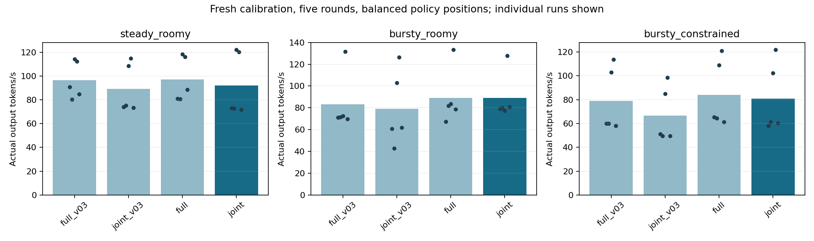<p class="caption"><strong>Figure 38.</strong> Mixed-power diagnostic session: repeated throughput; excluded from the primary AC comparison. <em>[Diagnostic / functional test]</em><br />Source: results/validation_study/figures/repeated_throughput.png</p></div>

<div class="figure" id="figure-39">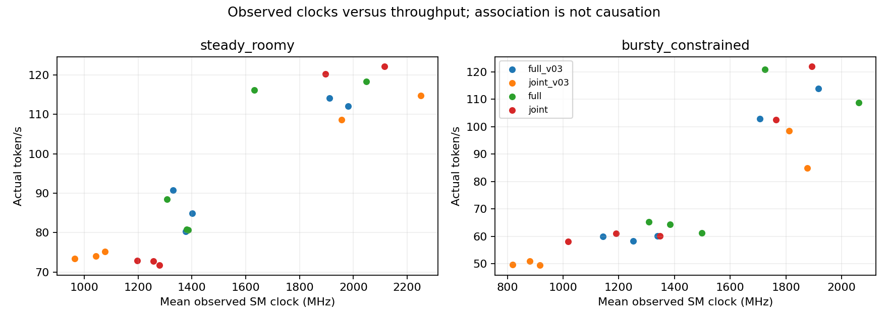<p class="caption"><strong>Figure 39.</strong> Mixed-power diagnostic clock/throughput association; correlation does not establish causality. <em>[Diagnostic / functional test]</em><br />Source: results/validation_study/figures/clock_throughput.png</p></div>

<div class="figure" id="figure-40">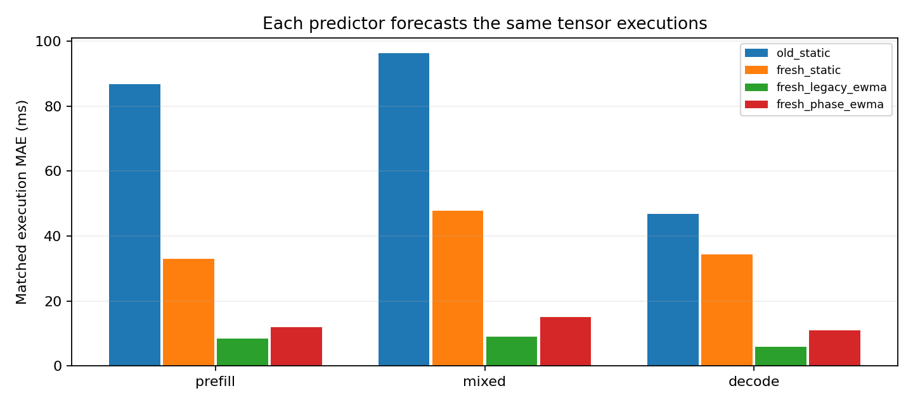<p class="caption"><strong>Figure 40.</strong> Matched prediction errors in the earlier mixed-power diagnostic session; use the final AC probe table for primary conclusions. <em>[Diagnostic / functional test]</em><br />Source: results/validation_study/figures/matched_prediction_mae.png</p></div>

<div class="figure" id="figure-41">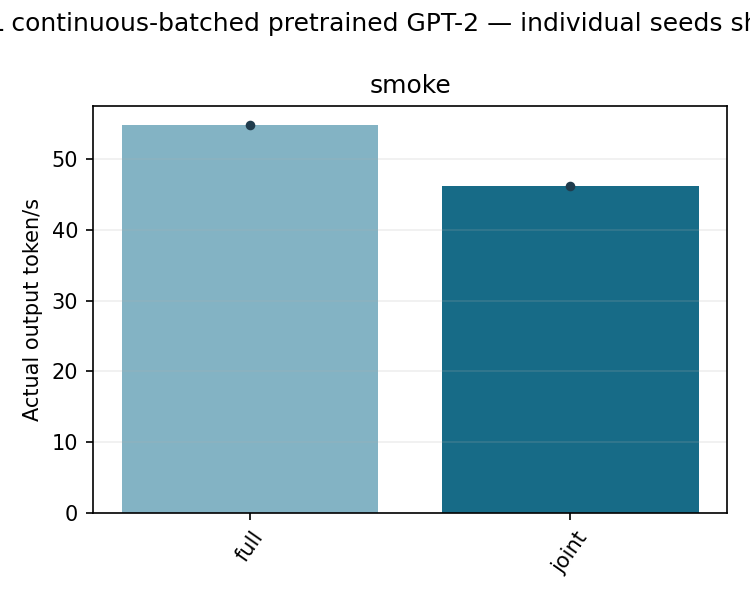<p class="caption"><strong>Figure 41.</strong> Functional actual-serving smoke chart; small-protocol diagnostic only. <em>[Diagnostic / functional test]</em><br />Source: results/live_smoke/figures/output_tokens_per_s.png</p></div>

<div class="figure" id="figure-42">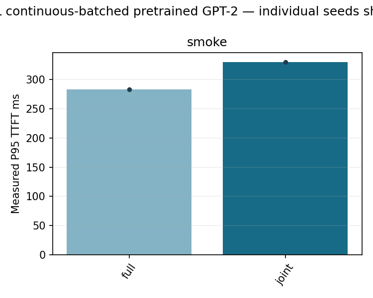<p class="caption"><strong>Figure 42.</strong> Functional actual-serving smoke TTFT chart; not a production performance result. <em>[Diagnostic / functional test]</em><br />Source: results/live_smoke/figures/ttft_p95_ms.png</p></div>

<div class="figure" id="figure-43">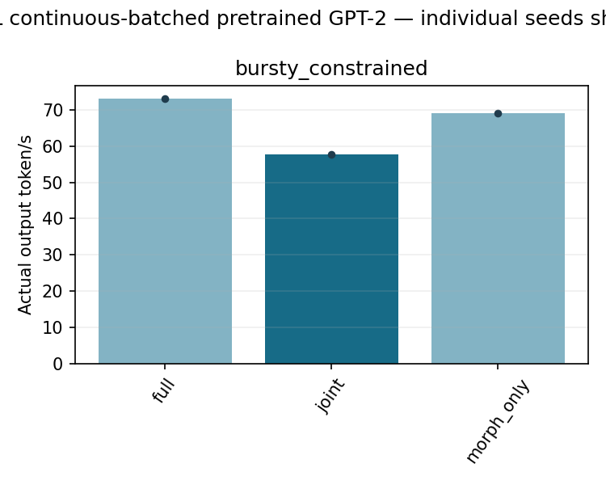<p class="caption"><strong>Figure 43.</strong> Serving regression chart retained for pipeline verification. <em>[Diagnostic / functional test]</em><br />Source: results/live_regression/figures/output_tokens_per_s.png</p></div>

<div class="figure" id="figure-44">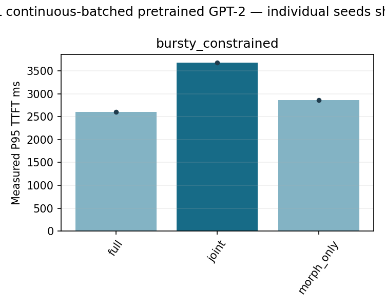<p class="caption"><strong>Figure 44.</strong> Serving regression TTFT chart retained for pipeline verification. <em>[Diagnostic / functional test]</em><br />Source: results/live_regression/figures/ttft_p95_ms.png</p></div>

<div class="figure" id="figure-45">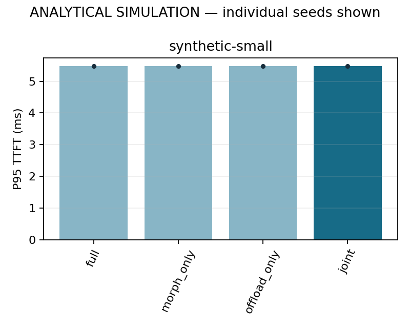<p class="caption"><strong>Figure 45.</strong> Analytical smoke-test TTFT chart; neither the main simulation nor physical serving. <em>[Diagnostic / functional test]</em><br />Source: results/smoke/figures/ttft_p95_ms.png</p></div>

<div class="figure" id="figure-46">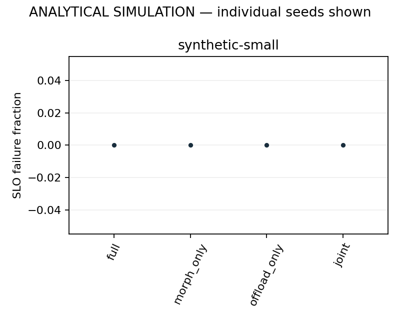<p class="caption"><strong>Figure 46.</strong> Analytical smoke-test SLO chart; diagnostic only. <em>[Diagnostic / functional test]</em><br />Source: results/smoke/figures/slo_violation_rate.png</p></div>

<div class="figure" id="figure-47">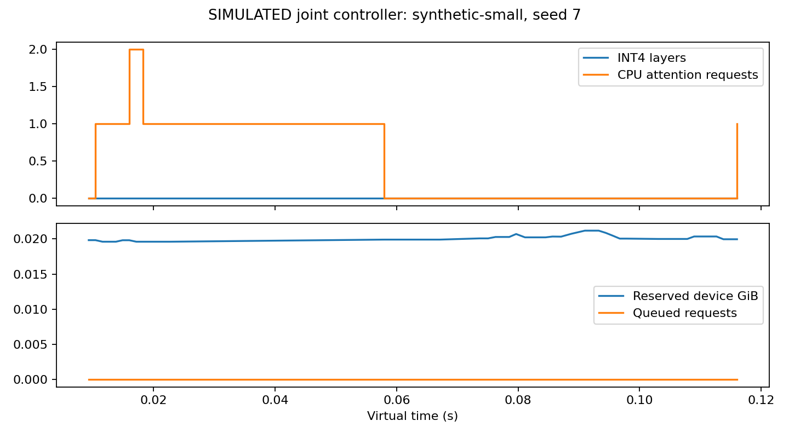<p class="caption"><strong>Figure 47.</strong> Analytical smoke-test control timeline; diagnostic only. <em>[Diagnostic / functional test]</em><br />Source: results/smoke/figures/controller_timeline.png</p></div>

## Appendix C. Provenance, validation and reader checklist

<p class="caption" id="table-70"><strong>Table 70.</strong> Final unit suite</p>

| Field | Recorded value |
| --- | --- |
| successful | True |
| tests_run | 116 |
| failures | 0 |
| errors | 0 |
| skipped | 0 |
| elapsed_s | 1.4795335000380874 |
| python | 3.10.11 (tags/v3.10.11:7d4cc5a, Apr  5 2023, 00:38:17) [MSC v.1929 64 bit (AMD64)] |
| platform | Windows-10-10.0.26200-SP0 |

<p class="small">Source: results/validation.json</p>

<p class="caption" id="table-71"><strong>Table 71.</strong> M10 final validation (rows 1-18)</p>

| Field | Recorded value |
| --- | --- |
| passed | True |
| version | 0.5.0 |
| gpu_runs | 60 |
| gpu_requests | 720 |
| gpu_runs_with_clock_temperature_samples | 60 |
| portability_runs | 12 |
| portability_requests | 48 |
| prediction_shapes | 54 |
| matched_prediction_executions | 270 |
| quality_targets_per_arm | 2048 |
| quality_arms | 8 |
| quality_target_evaluations | 16384 |
| fp32_protocol_and_cpu_attention_max_abs_nll_error | {"dynamic_full": 4.57763671875e-05, "cpu_attention": 4.57763671875e-05} |
| tests_passed | 112 |
| archived_sources_verified | True |
| paired_cpu_cuda_traces_verified | True |
| rejected_requests | 0 |
| required_ac_power_verified | True |

<p class="small">Source: results/validation_study_final/validation.json</p>

<p class="caption" id="table-72"><strong>Table 72.</strong> M10 final validation (rows 19-20)</p>

| Field | Recorded value |
| --- | --- |
| recorded_failed_attempts_in_this_series | 0 |
| concurrent_http_passed | True |

<p class="small">Source: results/validation_study_final/validation.json</p>

<p class="caption" id="table-73"><strong>Table 73.</strong> M11 final validation (rows 1-18)</p>

| Field | Recorded value |
| --- | --- |
| passed | True |
| version | 1.0.0 |
| serving_runs | 216 |
| requested_requests | 864 |
| completed_requests | 552 |
| rejected_requests | 312 |
| complete_runs | 138 |
| all_rejected_runs | 78 |
| partial_runs | 0 |
| rescue_policy_seed_cells | 6 |
| selected_adaptive_quality_audits | 6 |
| audits_with_actual_quantization | 5 |
| fp32_quality_references | 3 |
| quality_target_evaluations | 1440 |
| actual_cuda_peak_over_quota_runs | 0 |
| tests_passed | 116 |
| paired_traces_verified | True |
| reserved_quota_checks_passed | True |

<p class="small">Source: results/capacity_frontier/validation.json</p>

<p class="caption" id="table-74"><strong>Table 74.</strong> M11 final validation (rows 19-21)</p>

| Field | Recorded value |
| --- | --- |
| rejections_count_as_slo_failures | True |
| source_snapshot_verified | True |
| ac_samples_verified | True |

<p class="small">Source: results/capacity_frontier/validation.json</p>

The report bundle includes a figure registry, complete CSV copies, input hashes and report-generation sources. A separate high-resolution graph/diagram atlas puts each registered figure on its own portrait or landscape page for enlarged inspection. The Markdown report remains available as an editable source. The standalone HTML embeds all images and supports internal navigation offline.

Before presenting a number, identify: (1) actual or analytical execution, (2) model/checkpoint, (3) trace and quota, (4) completed and rejected work, (5) whether setup and drain are charged, (6) quality target/exposure protocol, and (7) physical session and uncertainty scope. The preserved frozen submission and its release checks remain the authority for the original implementation; this companion is a richer presentation of those archived observations.
