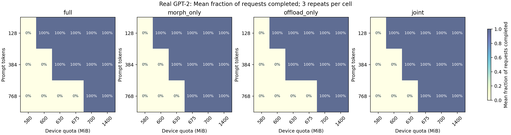
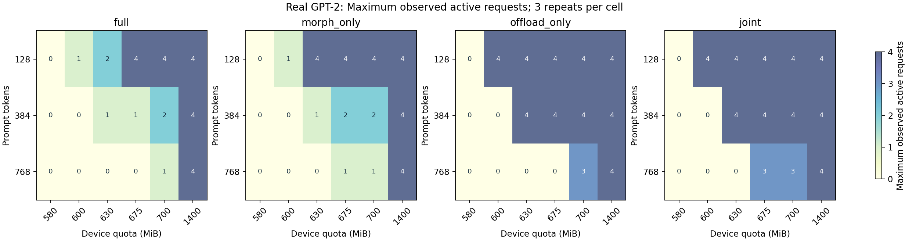
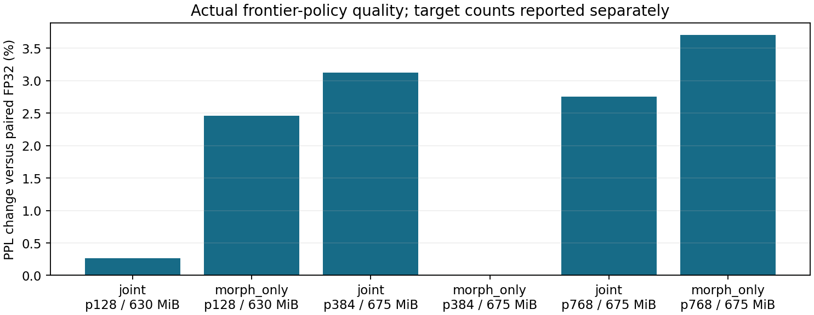
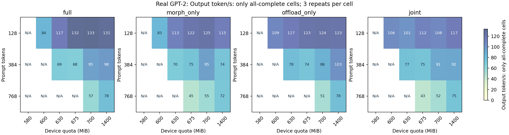

# M11: measured capacity frontier

216 actual serving runs request 864 completions: 552 complete and 312 are explicitly rejected. There are 138 all-complete runs, 78 all-rejected runs and 0 partial runs. No worker failure is accepted. All 116 tests pass.

## Lowest tested quota completing every request in every repeat

| Prompt tokens | FP32 | Quantization only | Offload only | Joint |
|---:|---:|---:|---:|---:|
| 128 | 600 | 600 | 600 | 600 |
| 384 | 630 | 630 | 630 | 630 |
| 768 | 700 | 675 | 700 | 675 |

There are 6 paired policy/seed observations where an adaptive policy completes every request while FP32 rejects every request under the same quota and inputs. Quantization and offload are evaluated independently as well as jointly. Joint control need not beat the single mechanisms. The measured frontier includes full-context KV reservation, calibration-derived workspace, headroom and FP32-to-INT4 transition staging. It is conditional on this warm-start implementation, not a physical-memory optimum or a cold-load feasibility result. Joint and quantization-only control share the same sampled minimum quotas here; a capacity advantage of joint control over quantization alone is not demonstrated.

| Prompt | Quota MiB | Policy completing all requests | Paired repeats with FP32 rejecting all |
|---:|---:|---|---:|
| 768 | 675 | joint | 3/3 |
| 768 | 675 | morph_only | 3/3 |

## Quality where the policy actually quantizes

| Prompt | Quota MiB | Policy | Audit targets | FP32 PPL | Actual PPL | PPL change % | INT4 output % |
|---:|---:|---|---:|---:|---:|---:|---:|
| 128 | 630 | joint | 192 | 65.666 | 65.838 | +0.262 | 84.90 |
| 128 | 630 | morph_only | 192 | 65.666 | 67.281 | +2.459 | 99.48 |
| 384 | 675 | joint | 192 | 34.126 | 35.192 | +3.125 | 98.44 |
| 384 | 675 | morph_only | 192 | 34.126 | 34.126 | +0.000 | 0.00 |
| 768 | 675 | joint | 96 | 45.587 | 46.841 | +2.752 | 100.00 |
| 768 | 675 | morph_only | 96 | 45.587 | 47.274 | +3.702 | 100.00 |

Quality audits keep each selected cell's exact prompt/output lengths and quota. For each prompt and precision-capable policy, the lowest all-repeat-complete quota with observed quantization is selected without consulting test NLL. Disjoint held-out windows are compared with the same targets under FP32 at a roomy quota. Target counts are limited by the stored prefix and long prompts. Audit trajectories remain separate from greedy trajectories; this supplements M10's larger controlled audits and does not prove a task-accuracy bound. Actual quantization occurs in 5/6 selected adaptive audits; an audit that remains FP32 cannot certify the quantized trajectory observed during its separate greedy replay.

## Complete cell results

| Prompt | Quota | Policy | Completed/requested per repeat | Token/s if all complete | P95 TTFT ms | P95 TBT ms | SLO failure % | INT4 % | CPU attention % | Max active |
|---:|---:|---|---|---:|---:|---:|---:|---:|---:|---:|
| 128 | 580 | full | 0.00/4 | N/A | N/A | N/A | 100.00 | 0.00 | 0.00 | 0 |
| 128 | 580 | joint | 0.00/4 | N/A | N/A | N/A | 100.00 | 0.00 | 0.00 | 0 |
| 128 | 580 | morph_only | 0.00/4 | N/A | N/A | N/A | 100.00 | 0.00 | 0.00 | 0 |
| 128 | 580 | offload_only | 0.00/4 | N/A | N/A | N/A | 100.00 | 0.00 | 0.00 | 0 |
| 128 | 600 | full | 4.00/4 | 84.18 | 440.18 | 10.53 | 0.00 | 0.00 | 0.00 | 1 |
| 128 | 600 | joint | 4.00/4 | 106.35 | 124.30 | 27.25 | 0.00 | 0.00 | 74.48 | 4 |
| 128 | 600 | morph_only | 4.00/4 | 83.22 | 447.61 | 11.91 | 0.00 | 0.00 | 0.00 | 1 |
| 128 | 600 | offload_only | 4.00/4 | 109.11 | 116.32 | 26.91 | 0.00 | 0.00 | 75.00 | 4 |
| 128 | 630 | full | 4.00/4 | 116.71 | 210.20 | 14.46 | 0.00 | 0.00 | 0.00 | 2 |
| 128 | 630 | joint | 4.00/4 | 101.45 | 125.67 | 39.59 | 0.00 | 94.27 | 61.98 | 4 |
| 128 | 630 | morph_only | 4.00/4 | 112.65 | 207.66 | 16.85 | 0.00 | 32.81 | 0.00 | 4 |
| 128 | 630 | offload_only | 4.00/4 | 116.83 | 73.30 | 27.54 | 0.00 | 0.00 | 53.12 | 4 |
| 128 | 675 | full | 4.00/4 | 132.17 | 66.79 | 21.83 | 0.00 | 0.00 | 0.00 | 4 |
| 128 | 675 | joint | 4.00/4 | 112.21 | 92.60 | 45.61 | 0.00 | 88.02 | 22.40 | 4 |
| 128 | 675 | morph_only | 4.00/4 | 121.95 | 85.73 | 24.59 | 0.00 | 33.33 | 0.00 | 4 |
| 128 | 675 | offload_only | 4.00/4 | 122.94 | 89.40 | 30.79 | 0.00 | 0.00 | 7.29 | 4 |
| 128 | 700 | full | 4.00/4 | 133.35 | 68.58 | 21.01 | 0.00 | 0.00 | 0.00 | 4 |
| 128 | 700 | joint | 4.00/4 | 108.00 | 89.80 | 48.03 | 0.00 | 86.98 | 24.48 | 4 |
| 128 | 700 | morph_only | 4.00/4 | 124.76 | 89.32 | 21.78 | 0.00 | 97.92 | 0.00 | 4 |
| 128 | 700 | offload_only | 4.00/4 | 124.32 | 83.54 | 28.62 | 0.00 | 0.00 | 7.29 | 4 |
| 128 | 1400 | full | 4.00/4 | 130.53 | 70.65 | 24.14 | 0.00 | 0.00 | 0.00 | 4 |
| 128 | 1400 | joint | 4.00/4 | 116.75 | 90.36 | 31.84 | 0.00 | 93.75 | 20.31 | 4 |
| 128 | 1400 | morph_only | 4.00/4 | 114.72 | 98.69 | 27.23 | 0.00 | 97.92 | 0.00 | 4 |
| 128 | 1400 | offload_only | 4.00/4 | 123.42 | 87.83 | 31.57 | 0.00 | 0.00 | 7.81 | 4 |
| 384 | 580 | full | 0.00/4 | N/A | N/A | N/A | 100.00 | 0.00 | 0.00 | 0 |
| 384 | 580 | joint | 0.00/4 | N/A | N/A | N/A | 100.00 | 0.00 | 0.00 | 0 |
| 384 | 580 | morph_only | 0.00/4 | N/A | N/A | N/A | 100.00 | 0.00 | 0.00 | 0 |
| 384 | 580 | offload_only | 0.00/4 | N/A | N/A | N/A | 100.00 | 0.00 | 0.00 | 0 |
| 384 | 600 | full | 0.00/4 | N/A | N/A | N/A | 100.00 | 0.00 | 0.00 | 0 |
| 384 | 600 | joint | 0.00/4 | N/A | N/A | N/A | 100.00 | 0.00 | 0.00 | 0 |
| 384 | 600 | morph_only | 0.00/4 | N/A | N/A | N/A | 100.00 | 0.00 | 0.00 | 0 |
| 384 | 600 | offload_only | 0.00/4 | N/A | N/A | N/A | 100.00 | 0.00 | 0.00 | 0 |
| 384 | 630 | full | 4.00/4 | 69.14 | 600.63 | 10.62 | 0.00 | 0.00 | 0.00 | 1 |
| 384 | 630 | joint | 4.00/4 | 76.73 | 416.56 | 30.29 | 0.00 | 0.00 | 73.44 | 4 |
| 384 | 630 | morph_only | 4.00/4 | 69.78 | 592.98 | 10.92 | 0.00 | 0.00 | 0.00 | 1 |
| 384 | 630 | offload_only | 4.00/4 | 78.33 | 414.95 | 29.08 | 0.00 | 0.00 | 72.40 | 4 |
| 384 | 675 | full | 4.00/4 | 67.55 | 615.84 | 12.11 | 0.00 | 0.00 | 0.00 | 1 |
| 384 | 675 | joint | 4.00/4 | 74.86 | 398.57 | 36.16 | 0.00 | 33.33 | 76.04 | 4 |
| 384 | 675 | morph_only | 4.00/4 | 74.79 | 501.68 | 15.47 | 0.00 | 66.67 | 0.00 | 2 |
| 384 | 675 | offload_only | 4.00/4 | 74.41 | 440.50 | 31.31 | 0.00 | 0.00 | 73.44 | 4 |
| 384 | 700 | full | 4.00/4 | 94.58 | 340.11 | 16.02 | 0.00 | 0.00 | 0.00 | 2 |
| 384 | 700 | joint | 4.00/4 | 90.78 | 260.84 | 32.47 | 0.00 | 0.00 | 44.79 | 4 |
| 384 | 700 | morph_only | 4.00/4 | 95.17 | 335.79 | 15.29 | 0.00 | 0.00 | 0.00 | 2 |
| 384 | 700 | offload_only | 4.00/4 | 86.15 | 267.24 | 38.18 | 0.00 | 0.00 | 45.31 | 4 |
| 384 | 1400 | full | 4.00/4 | 98.11 | 245.58 | 27.39 | 0.00 | 0.00 | 0.00 | 4 |
| 384 | 1400 | joint | 4.00/4 | 91.67 | 277.78 | 34.99 | 0.00 | 73.96 | 0.00 | 4 |
| 384 | 1400 | morph_only | 4.00/4 | 74.13 | 454.19 | 58.03 | 25.00 | 60.94 | 0.00 | 4 |
| 384 | 1400 | offload_only | 4.00/4 | 103.38 | 226.42 | 22.42 | 0.00 | 0.00 | 0.00 | 4 |
| 768 | 580 | full | 0.00/4 | N/A | N/A | N/A | 100.00 | 0.00 | 0.00 | 0 |
| 768 | 580 | joint | 0.00/4 | N/A | N/A | N/A | 100.00 | 0.00 | 0.00 | 0 |
| 768 | 580 | morph_only | 0.00/4 | N/A | N/A | N/A | 100.00 | 0.00 | 0.00 | 0 |
| 768 | 580 | offload_only | 0.00/4 | N/A | N/A | N/A | 100.00 | 0.00 | 0.00 | 0 |
| 768 | 600 | full | 0.00/4 | N/A | N/A | N/A | 100.00 | 0.00 | 0.00 | 0 |
| 768 | 600 | joint | 0.00/4 | N/A | N/A | N/A | 100.00 | 0.00 | 0.00 | 0 |
| 768 | 600 | morph_only | 0.00/4 | N/A | N/A | N/A | 100.00 | 0.00 | 0.00 | 0 |
| 768 | 600 | offload_only | 0.00/4 | N/A | N/A | N/A | 100.00 | 0.00 | 0.00 | 0 |
| 768 | 630 | full | 0.00/4 | N/A | N/A | N/A | 100.00 | 0.00 | 0.00 | 0 |
| 768 | 630 | joint | 0.00/4 | N/A | N/A | N/A | 100.00 | 0.00 | 0.00 | 0 |
| 768 | 630 | morph_only | 0.00/4 | N/A | N/A | N/A | 100.00 | 0.00 | 0.00 | 0 |
| 768 | 630 | offload_only | 0.00/4 | N/A | N/A | N/A | 100.00 | 0.00 | 0.00 | 0 |
| 768 | 675 | full | 0.00/4 | N/A | N/A | N/A | 100.00 | 0.00 | 0.00 | 0 |
| 768 | 675 | joint | 4.00/4 | 43.04 | 1020.26 | 36.78 | 0.00 | 100.00 | 92.19 | 3 |
| 768 | 675 | morph_only | 4.00/4 | 45.04 | 1057.89 | 12.91 | 0.00 | 100.00 | 0.00 | 1 |
| 768 | 675 | offload_only | 0.00/4 | N/A | N/A | N/A | 100.00 | 0.00 | 0.00 | 0 |
| 768 | 700 | full | 4.00/4 | 57.17 | 783.91 | 10.28 | 0.00 | 0.00 | 0.00 | 1 |
| 768 | 700 | joint | 4.00/4 | 52.04 | 812.22 | 35.27 | 0.00 | 9.38 | 75.00 | 3 |
| 768 | 700 | morph_only | 4.00/4 | 55.18 | 832.21 | 10.08 | 0.00 | 0.00 | 0.00 | 1 |
| 768 | 700 | offload_only | 4.00/4 | 51.17 | 859.19 | 36.36 | 0.00 | 0.00 | 75.00 | 3 |
| 768 | 1400 | full | 4.00/4 | 77.68 | 460.38 | 27.30 | 0.00 | 0.00 | 0.00 | 4 |
| 768 | 1400 | joint | 4.00/4 | 74.68 | 449.25 | 40.06 | 0.00 | 50.52 | 0.00 | 4 |
| 768 | 1400 | morph_only | 4.00/4 | 71.95 | 476.80 | 38.59 | 0.00 | 52.60 | 0.00 | 4 |
| 768 | 1400 | offload_only | 4.00/4 | 77.66 | 465.71 | 22.57 | 0.00 | 0.00 | 0.00 | 4 |

The first pilot missed a narrow transition-feasible region. Before the full sweep, validation-calibration reservation bounds motivated the final grid (580/600/630/675/700/1400 MiB); both pilots and the diagnostic preflight are retained. Cold model loading/calibration/warmup precede timed enforcement. Reference INT4 has unpacking costs, CPU attention is synchronous, and prefill CPU offload is unsupported. Rejections count as SLO failures, and missing latency is N/A. Finite grid spacing and three seeds on one GPU limit generalization. Resource limits are sampled and cannot isolate the worker from competing processes. Actual CUDA peaks above quota are separately reported: 0 runs.

See [protocol and reproduction](../../docs/capacity_frontier.md) and [demo/viva guide](../../docs/demo_and_viva.md).
