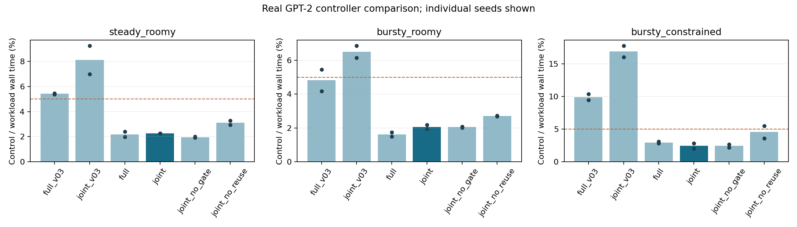
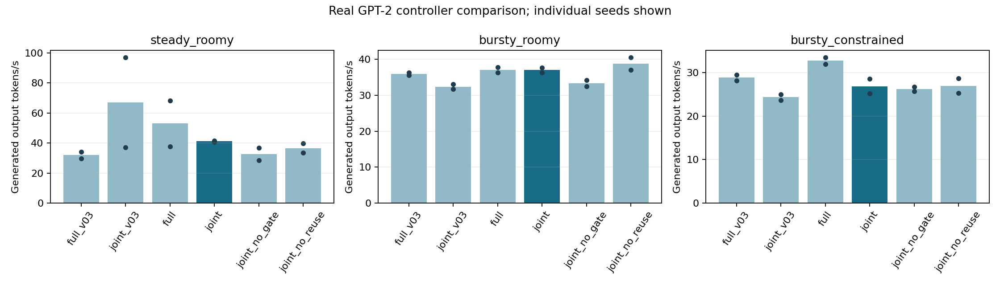

# Controller efficiency: real v0.4 comparison

All six optimized joint runs meet the exploratory <5% control-overhead target (worst 2.82%).

36 actual serving runs complete 432 requests with 0 rejections, plus 6 independent teacher-forced audits (384 targets total). 1246 reused iterations retain fresh resource checks. 106 tests and four-client real HTTP verification pass. Actual CUDA peaks exceed the declared device quota in 0 runs.

| Scenario | Old joint control % | New joint control % | Old joint token/s | New joint token/s | Change % | New full token/s |
|---|---:|---:|---:|---:|---:|---:|
| steady_roomy | 8.12 | 2.26 | 67.04 | 41.11 | -38.68 | 53.03 |
| bursty_roomy | 6.50 | 2.07 | 32.41 | 37.02 | +14.24 | 37.06 |
| bursty_constrained | 16.88 | 2.42 | 24.34 | 26.88 | +10.45 | 32.76 |

Lower overhead does not establish a general throughput or prediction-accuracy improvement. The optimized joint controller improves mean throughput over its old counterpart in 2 of 3 scenarios. The steady scenario's old joint repeats range from 37.0 to 97.0 token/s. Optimized full precision is faster than optimized joint control under the tight quota. Joint prediction MAE increases in 3 of 3 scenarios; phase isolation passes its correctness test but does not demonstrate better overall prediction in these different executed trajectories. Disabling reuse increases control cost, yet its throughput result varies by scenario. The evidence supports reducing scheduling cost, not a universal performance win.

## Complete policy results

| Scenario | Policy | Token/s | Control % | Reuse % | P95 TTFT ms | P95 TBT ms | Prediction MAE ms |
|---|---|---:|---:|---:|---:|---:|---:|
| steady_roomy | full_v03 | 31.94 | 5.43 | 0.00 | 5338.29 | 157.50 | 22.40 |
| steady_roomy | joint_v03 | 67.04 | 8.12 | 0.00 | 2510.27 | 134.86 | 10.74 |
| steady_roomy | full | 53.03 | 2.19 | 60.15 | 2610.54 | 120.38 | 14.17 |
| steady_roomy | joint | 41.11 | 2.26 | 58.25 | 4064.02 | 147.87 | 18.81 |
| steady_roomy | joint_no_gate | 32.65 | 1.96 | 57.23 | 4899.62 | 197.42 | 23.66 |
| steady_roomy | joint_no_reuse | 36.61 | 3.12 | 0.00 | 4524.32 | 158.61 | 20.28 |
| bursty_roomy | full_v03 | 35.97 | 4.81 | 0.00 | 5787.64 | 130.73 | 17.90 |
| bursty_roomy | joint_v03 | 32.41 | 6.50 | 0.00 | 6565.77 | 201.50 | 15.79 |
| bursty_roomy | full | 37.06 | 1.62 | 57.01 | 5500.40 | 144.36 | 16.19 |
| bursty_roomy | joint | 37.02 | 2.07 | 57.13 | 5674.97 | 154.09 | 18.79 |
| bursty_roomy | joint_no_gate | 33.34 | 2.05 | 60.21 | 6618.72 | 174.21 | 18.07 |
| bursty_roomy | joint_no_reuse | 38.81 | 2.70 | 0.00 | 5215.66 | 137.99 | 16.09 |
| bursty_constrained | full_v03 | 28.84 | 9.90 | 0.00 | 7906.69 | 58.93 | 21.50 |
| bursty_constrained | joint_v03 | 24.34 | 16.88 | 0.00 | 9702.29 | 129.23 | 10.65 |
| bursty_constrained | full | 32.76 | 2.95 | 70.61 | 6845.58 | 55.47 | 7.22 |
| bursty_constrained | joint | 26.88 | 2.42 | 65.02 | 8506.38 | 148.40 | 16.25 |
| bursty_constrained | joint_no_gate | 26.21 | 2.43 | 66.55 | 8719.91 | 151.61 | 15.21 |
| bursty_constrained | joint_no_reuse | 26.96 | 4.54 | 0.00 | 8382.70 | 154.92 | 14.02 |

## Separate policy quality audits

| Policy | Audit targets | Perplexity | Relative PPL % | INT4 output % | INT4 iterations |
|---|---:|---:|---:|---:|---:|
| full_v03 | 64 | 68.284 | +0.000 | 0.00 | 0 |
| joint_v03 | 64 | 68.403 | +0.174 | 21.88 | 9 |
| full | 64 | 68.284 | +0.000 | 0.00 | 0 |
| joint | 64 | 67.770 | -0.753 | 0.00 | 5 |
| joint_no_gate | 64 | 68.344 | +0.088 | 9.38 | 7 |
| joint_no_reuse | 64 | 67.730 | -0.811 | 0.00 | 3 |

The joint audit uses INT4 during 5 iterations containing prefill and emits 0.00% of outputs under INT4. Historical KV can remain affected after FP32 restoration. A small perplexity decrease is not evidence of improved model quality. Greedy serving can use different precision histories; this short audit does not certify all quantized serving outputs.

Means summarize two seeds per scenario; individual points are retained. Policy order is shuffled, but laptop thermal state, OS activity and limited repeats remain confounders. Throughput includes the entire scheduled trace and drain. Control overhead includes live telemetry, planning and admission. TTFT is engine token readiness from scheduled arrival, not streaming HTTP delivery. Quotas are enforced reservation budgets, not physical VRAM exhaustion. The small quality audit and heuristic uncertainty margins do not prove a task-quality bound or statistical confidence. Fresh v0.3 comparators run in the new study; historical results/live measurements remain separately archived.
