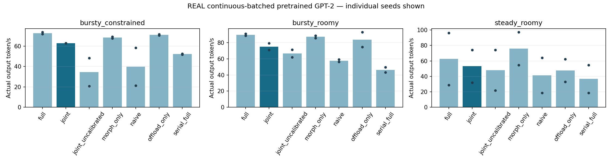
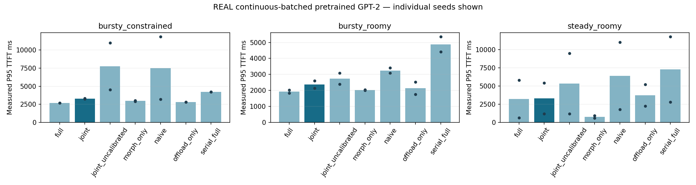

# Real continuous-batching experiments

**Actual pretrained GPT-2 tensor execution. All reported times are measured wall-clock observations.**

Same prompt/arrival/output-budget traces across policies. Dense projections batch all current tokens. Ragged attention loops per request. Quotas are enforced admission budgets, not physical OOM events.

| Scenario | Policy | P95 TTFT ms | P95 TBT ms | Output token/s | SLO failure % | Max active | INT4 output % | CPU offload output % |
|---|---|---:|---:|---:|---:|---:|---:|---:|
| bursty_constrained | full | 2680.21 | 21.36 | 72.83 | 29.17 | 2 | 0.00 | 0.00 |
| bursty_constrained | joint | 3285.92 | 51.17 | 62.83 | 37.50 | 4 | 4.69 | 34.20 |
| bursty_constrained | joint_uncalibrated | 7767.06 | 80.91 | 34.48 | 79.17 | 2 | 0.00 | 95.66 |
| bursty_constrained | morph_only | 2960.01 | 23.39 | 68.48 | 37.50 | 2 | 7.81 | 0.00 |
| bursty_constrained | naive | 7505.31 | 114.46 | 39.88 | 62.50 | 4 | 0.00 | 95.83 |
| bursty_constrained | offload_only | 2801.59 | 32.52 | 71.10 | 37.50 | 4 | 0.00 | 7.99 |
| bursty_constrained | serial_full | 4215.61 | 16.66 | 52.23 | 54.17 | 1 | 0.00 | 0.00 |
| bursty_roomy | full | 1923.06 | 47.76 | 89.98 | 8.33 | 8 | 0.00 | 0.00 |
| bursty_roomy | joint | 2369.54 | 70.03 | 75.21 | 50.00 | 8 | 27.08 | 2.08 |
| bursty_roomy | joint_uncalibrated | 2741.94 | 74.87 | 66.69 | 58.33 | 8 | 0.00 | 49.65 |
| bursty_roomy | morph_only | 2015.23 | 48.66 | 87.40 | 12.50 | 8 | 3.30 | 0.00 |
| bursty_roomy | naive | 3245.78 | 87.01 | 57.74 | 50.00 | 8 | 0.00 | 95.83 |
| bursty_roomy | offload_only | 2139.13 | 58.56 | 83.92 | 20.83 | 8 | 0.00 | 0.00 |
| bursty_roomy | serial_full | 4877.73 | 21.57 | 46.32 | 62.50 | 1 | 0.00 | 0.00 |
| steady_roomy | full | 3195.09 | 108.10 | 62.53 | 50.00 | 8 | 0.00 | 0.00 |
| steady_roomy | joint | 3297.51 | 137.42 | 53.02 | 83.33 | 8 | 24.83 | 10.59 |
| steady_roomy | joint_uncalibrated | 5336.71 | 141.55 | 48.01 | 50.00 | 8 | 0.00 | 53.99 |
| steady_roomy | morph_only | 750.54 | 115.27 | 75.90 | 29.17 | 7 | 42.53 | 0.00 |
| steady_roomy | naive | 6393.66 | 257.27 | 41.14 | 50.00 | 8 | 0.00 | 95.83 |
| steady_roomy | offload_only | 3721.24 | 179.16 | 47.58 | 83.33 | 8 | 0.00 | 4.86 |
| steady_roomy | serial_full | 7271.55 | 36.54 | 36.61 | 58.33 | 1 | 0.00 | 0.00 |

## Quality audit

A separate teacher-forced replay uses the same held-out continuations for each policy and records token NLL under the actual selected precision and historical KV. It has its own policy trajectory. See quality.json and quality_runs/; these results do not label greedy generation as teacher-forced work.

| Policy | Audit targets | Audit perplexity | Relative PPL % | INT4 output % |
|---|---:|---:|---:|---:|
| serial_full | 64 | 68.284 | -0.000 | 0.00 |
| full | 64 | 68.284 | 0.000 | 0.00 |
| morph_only | 64 | 68.785 | 0.733 | 25.00 |
| offload_only | 64 | 68.284 | 0.000 | 0.00 |
| naive | 64 | 68.284 | -0.000 | 0.00 |
| joint | 64 | 68.816 | 0.779 | 21.88 |
| joint_uncalibrated | 64 | 68.284 | -0.000 | 0.00 |

## Interpretation limits

Do not assume a controller win: inspect the full baseline, admission, overhead, transition, and failure records. The measured nearest-shape model and EWMA feedback are estimates; real elapsed timings remain authoritative. Quality uses an additive validation-KL surrogate and a small separate audit, not a guaranteed task bound.

TTFT starts at scheduled arrival, including delayed submission and queueing. All token gaps include scheduling, precision transitions and migrations. Throughput includes the complete trace and queue drain. Rejected requests count as SLO failures. Memory includes independently reported live KV, reserved budgets and CUDA peak allocations.

