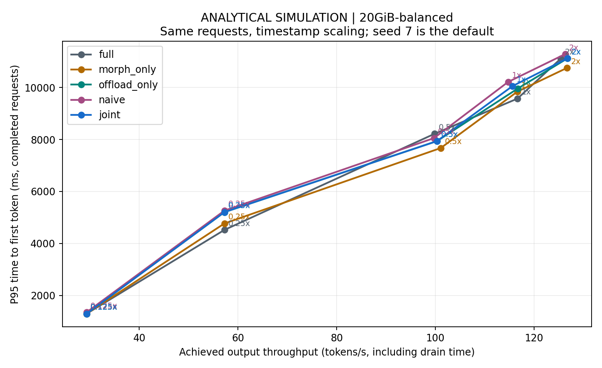
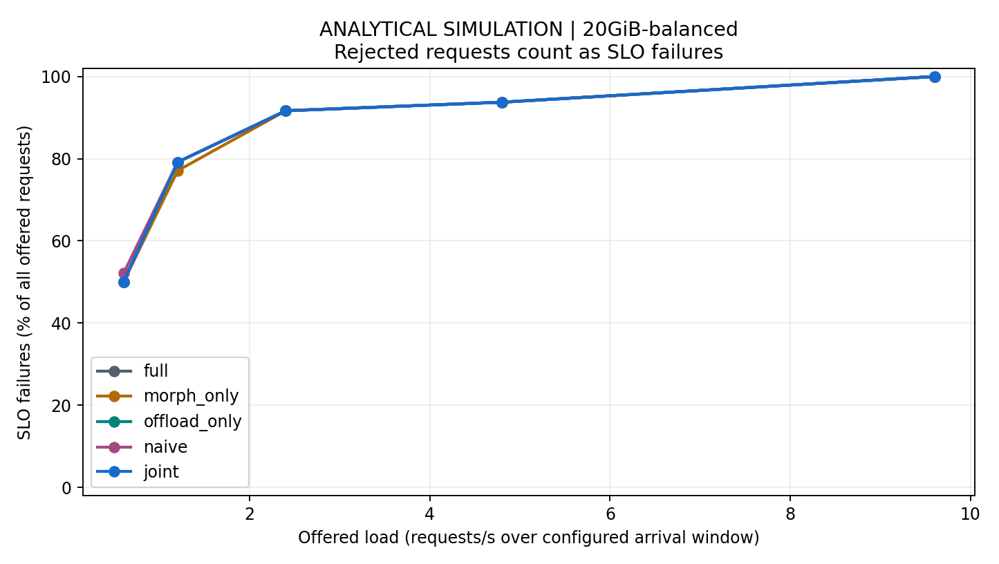

# Exploratory offered-load sweep

**ANALYTICAL SIMULATION. These are not measured LLM/GPU performance results.**

Profile: `20GiB-balanced`. One seed (7), 48 requests per run, base arrival window 10 seconds. Load factors: 0.125x, 0.25x, 0.5x, 1x, 2x.

The exact same request IDs and token lengths are replayed in all 25 runs. Multiplying offered load by f divides every arrival timestamp by f, preserving the burst structure.

| Policy | Load factor | Offered request/s | Achieved output token/s | P95 TTFT ms | SLO failure % | Rejected |
|---|---:|---:|---:|---:|---:|---:|
| full | 0.125x | 0.60 | 29.28 | 1291.17 | 50.00 | 0 |
| morph_only | 0.125x | 0.60 | 29.28 | 1291.17 | 50.00 | 0 |
| offload_only | 0.125x | 0.60 | 29.28 | 1291.17 | 50.00 | 0 |
| naive | 0.125x | 0.60 | 29.28 | 1344.51 | 52.08 | 0 |
| joint | 0.125x | 0.60 | 29.28 | 1291.17 | 50.00 | 0 |
| full | 0.25x | 1.20 | 57.26 | 4519.70 | 79.17 | 0 |
| morph_only | 0.25x | 1.20 | 57.26 | 4767.51 | 77.08 | 0 |
| offload_only | 0.25x | 1.20 | 57.26 | 5203.86 | 79.17 | 0 |
| naive | 0.25x | 1.20 | 57.26 | 5262.09 | 79.17 | 0 |
| joint | 0.25x | 1.20 | 57.26 | 5203.86 | 79.17 | 0 |
| full | 0.5x | 2.40 | 99.86 | 8219.17 | 91.67 | 0 |
| morph_only | 0.5x | 2.40 | 101.11 | 7671.20 | 91.67 | 0 |
| offload_only | 0.5x | 2.40 | 100.34 | 7938.07 | 91.67 | 0 |
| naive | 0.5x | 2.40 | 99.74 | 8053.42 | 91.67 | 0 |
| joint | 0.5x | 2.40 | 100.34 | 7938.07 | 91.67 | 0 |
| full | 1x | 4.80 | 116.67 | 9574.10 | 93.75 | 0 |
| morph_only | 1x | 4.80 | 116.63 | 9840.18 | 93.75 | 0 |
| offload_only | 1x | 4.80 | 116.70 | 9958.23 | 93.75 | 0 |
| naive | 1x | 4.80 | 114.76 | 10214.41 | 93.75 | 0 |
| joint | 1x | 4.80 | 115.65 | 10054.20 | 93.75 | 0 |
| full | 2x | 9.60 | 125.47 | 11116.88 | 100.00 | 0 |
| morph_only | 2x | 9.60 | 126.71 | 10755.94 | 100.00 | 0 |
| offload_only | 2x | 9.60 | 126.78 | 11119.56 | 100.00 | 0 |
| naive | 2x | 9.60 | 126.33 | 11285.68 | 100.00 | 0 |
| joint | 2x | 9.60 | 126.78 | 11119.56 | 100.00 | 0 |

Throughput includes the completion drain after the arrival window. TTFT covers completed requests; the failure rate includes rejected requests and completed requests exceeding either configured SLO.

This one-seed sweep is exploratory. It does not establish confidence intervals, hardware speedups, paper reproduction, an accuracy bound, or a production scheduling overhead percentage. Inspect manifest.json for all assumptions and raw runs/*.json for per-token timestamps.
