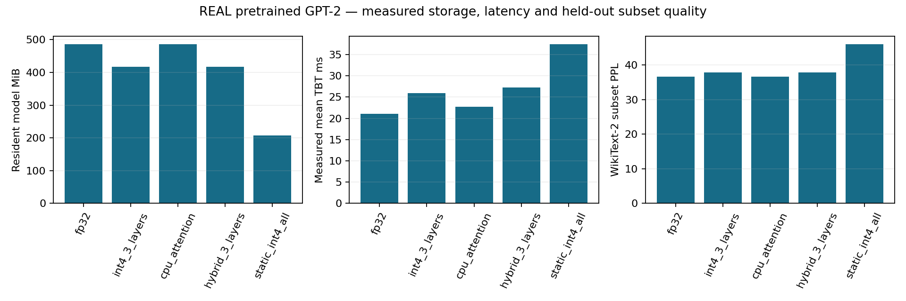

# Real pretrained GPT-2 results

All timings execute actual pretrained weights on this machine. WikiText-2 results are a fixed prefix diagnostic, not a full benchmark score.

| Device | Variant | TTFT mean ms | TBT mean ms | TBT P95 ms | Output token/s | Resident MiB |
|---|---|---:|---:|---:|---:|---:|
| cuda:0 | fp32 | 20.36 | 21.09 | 27.99 | 47.40 | 486.70 |
| cuda:0 | int4_3_layers | 25.16 | 25.95 | 36.41 | 38.53 | 417.09 |
| cuda:0 | cpu_attention | 24.73 | 22.69 | 30.59 | 43.90 | 486.70 |
| cuda:0 | hybrid_3_layers | 29.70 | 27.27 | 37.71 | 36.54 | 417.09 |
| cuda:0 | static_int4_all | 38.73 | 37.44 | 45.44 | 26.66 | 208.26 |
| cpu | fp32 | 68.59 | 49.37 | 60.60 | 20.00 | 486.70 |

| Variant | NLL | Perplexity | Relative PPL change % | Scored tokens |
|---|---:|---:|---:|---:|
| fp32 | 3.59869 | 36.550 | 0.000 | 4095 |
| int4_3_layers | 3.63289 | 37.822 | 3.480 | 4095 |
| cpu_attention | 3.59869 | 36.550 | 0.000 | 4095 |
| hybrid_3_layers | 3.63289 | 37.822 | 3.480 | 4095 |
| static_int4_all | 3.82857 | 45.997 | 25.845 | 4095 |

Original-forward correctness passed: True. Layer selection uses separate validation data. See JSON for exact inputs, hashes, numeric errors, generated text, setup costs, host backups and allocator peaks.

Memory savings do not establish a speedup. This reference backend uses floating-point matmul after INT4 unpacking and synchronized CPU attention. Serialized timings do not establish continuous-batching SLOs or large-model performance.

