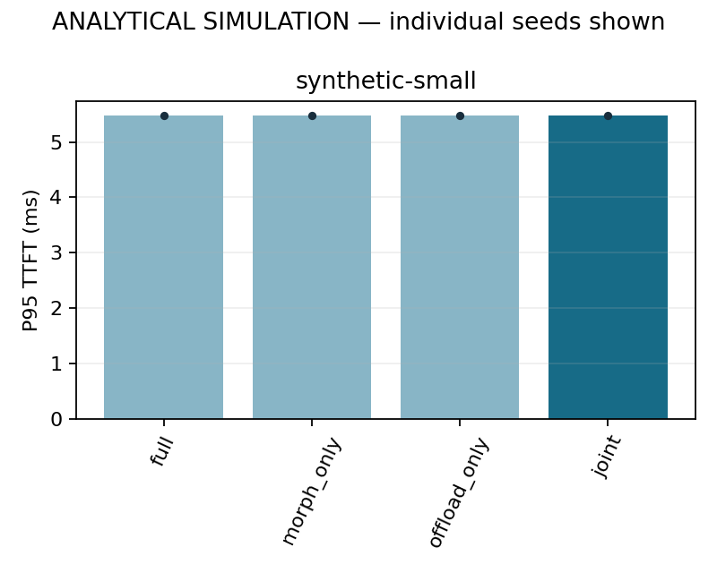
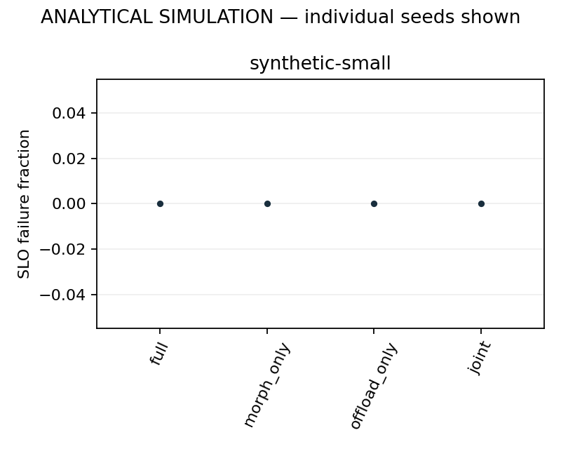
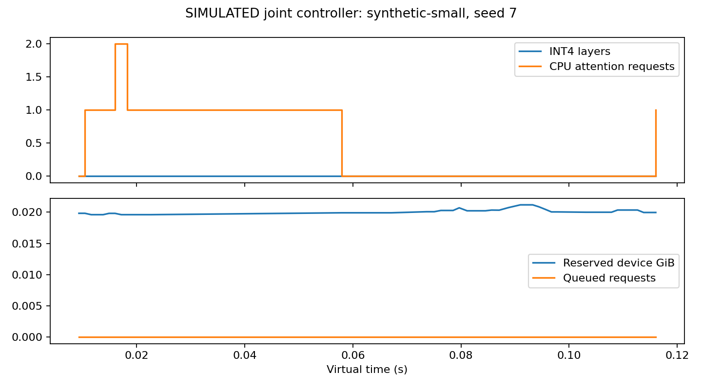

# PrismServe experiment results

**Analytical simulation. These are not measured LLM serving results.**

The rates in config.json describe hypothetical effective hardware. The same traces and seeds are replayed for every policy.

| Profile | Policy | P95 TTFT ms (mean across seeds) | P95 TBT ms | SLO failure % | Output token/s | Good request/s |
|---|---|---:|---:|---:|---:|---:|
| synthetic-small | full | 5.47 | 1.46 | 0.00 | 677.04 | 111.29 |
| synthetic-small | morph_only | 5.47 | 1.46 | 0.00 | 677.04 | 111.29 |
| synthetic-small | offload_only | 5.47 | 1.46 | 0.00 | 676.56 | 111.22 |
| synthetic-small | joint | 5.47 | 1.46 | 0.00 | 676.56 | 111.22 |

## Interpretation and evidence limits

SLO failure counts each rejected request as a failure, plus completed requests whose TTFT or worst intertoken gap exceeds the configured SLO. TTFT percentiles cover completed requests; always inspect rejection counts in summary.csv.

Full reserves full-precision weights. static_int4 is an unconstrained quality reference. morph_only and offload_only are mechanism-inspired analytical baselines, not the original MorphServe or NEO systems. naive uses a fixed combination; joint searches combinations with one common hardware interface.

The model accounts for host weight backups, packed weights with scales, full context reservations, workspace, migration, and transition peaks. Precision selection uses a synthetic additive risk proxy; this is not perplexity, accuracy, or a guaranteed quality bound.

The CPU/device pipeline overlap assumption can overestimate achieved throughput. The real backend synchronizes transfers and does not implement NEO's ISPC kernels or MorphServe's asynchronous in-place allocator.

aggregate.json includes bootstrap intervals and paired differences across seeds. Three seeds provide exploratory variability estimates only. Planner search times are measured host wall times and excluded from virtual token latency; they cannot establish a production scheduler overhead percentage.

Inspect runs/*.json for every request's token timestamps and every plan transition. Reproduce from config.json and traces/, with hashes recorded in manifest.json.

## Figures

