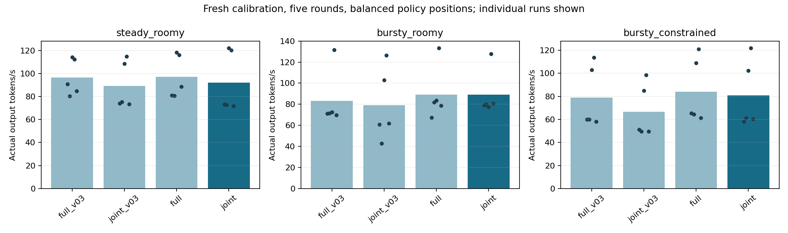
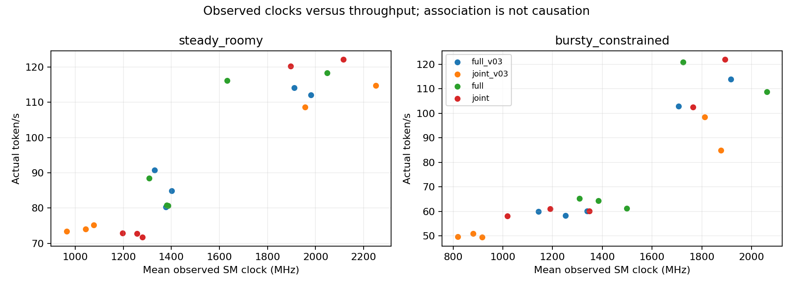
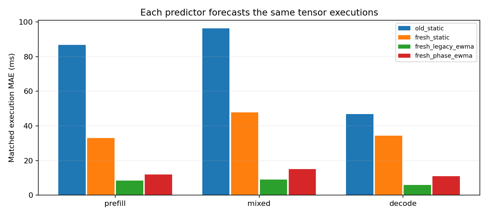

# M10: instrumented reliability and backend portability study

**Diagnostic mixed-power session. Primary accepted results: `results/validation_study_final/`. See STATUS.md.**

60 instrumented GPU runs complete 720 requests, plus 12 matched CPU/CUDA runs (48 requests). There are zero rejections. 54 prediction shapes supply 270 matched executions. Eight quality arms score 2048 held-out targets each. All 111 tests pass.

## Repeated GPU comparison

| Scenario | Old joint token/s | New joint token/s | Paired change % | Exploratory 95% interval | Old/new control % |
|---|---:|---:|---:|---|---|
| steady_roomy | 89.17 | 91.95 | +2.1 | [-2.5, +7.8] | 11.21 / 4.07 |
| bursty_roomy | 79.04 | 89.00 | +24.5 | [-8.6, +58.1] | 8.83 / 2.69 |
| bursty_constrained | 66.66 | 80.72 | +20.6 | [+17.1, +23.2] | 14.15 / 4.03 |

Optimized joint control stays below 5% of workload wall time in 14/15 runs; its worst observed fraction is 5.11%. This is a new session, not a re-labeling of M9's six-run overhead result. The fraction depends on execution speed as well as absolute controller cost. All request latency includes telemetry, planning, transitions and drain.

Optimized full precision has higher mean throughput than optimized joint control in 2/3 scenarios. Improvements over the older joint controller do not establish an advantage over optimized full precision. Decision reuse also trades admission responsiveness for lower control cost: compare TTFT as well as throughput. The final serving actions below distinguish control-overhead savings from gains due to actual quantization/offload.

| Scenario | Policy | Mean token/s | Median token/s | SD | CV % | Control % | P95 TTFT ms | P95 TBT ms |
|---|---|---:|---:|---:|---:|---:|---:|---:|
| steady_roomy | full_v03 | 96.41 | 90.72 | 15.68 | 16.3 | 7.88 | 560.0 | 41.7 |
| steady_roomy | joint_v03 | 89.17 | 75.20 | 20.66 | 23.2 | 11.21 | 854.1 | 54.7 |
| steady_roomy | full | 96.92 | 88.50 | 18.88 | 19.5 | 3.36 | 604.3 | 40.9 |
| steady_roomy | joint | 91.95 | 72.93 | 26.68 | 29.0 | 4.07 | 822.1 | 46.3 |
| bursty_roomy | full_v03 | 83.31 | 71.43 | 27.00 | 32.4 | 5.94 | 2144.8 | 57.5 |
| bursty_roomy | joint_v03 | 79.04 | 61.88 | 34.46 | 43.6 | 8.83 | 2730.6 | 104.1 |
| bursty_roomy | full | 88.98 | 81.83 | 25.63 | 28.8 | 2.24 | 1921.0 | 72.9 |
| bursty_roomy | joint | 89.00 | 80.01 | 21.74 | 24.4 | 2.69 | 1818.0 | 58.3 |
| bursty_constrained | full_v03 | 78.96 | 60.03 | 27.12 | 34.3 | 10.61 | 2620.7 | 22.6 |
| bursty_constrained | joint_v03 | 66.66 | 51.02 | 23.28 | 34.9 | 14.15 | 3064.9 | 57.6 |
| bursty_constrained | full | 84.06 | 65.25 | 28.40 | 33.8 | 3.66 | 2388.8 | 22.6 |
| bursty_constrained | joint | 80.72 | 61.10 | 29.53 | 36.6 | 4.03 | 2507.2 | 36.2 |

| Scenario | Policy | INT4 outputs % | CPU-attention outputs % | Max active | SLO failure % |
|---|---|---:|---:|---:|---:|
| steady_roomy | full_v03 | 0.00 | 0.00 | 8 | 0.00 |
| steady_roomy | joint_v03 | 0.00 | 11.39 | 8 | 20.00 |
| steady_roomy | full | 0.00 | 0.00 | 8 | 0.00 |
| steady_roomy | joint | 0.00 | 3.61 | 8 | 0.00 |
| bursty_roomy | full_v03 | 0.00 | 0.00 | 8 | 31.67 |
| bursty_roomy | joint_v03 | 14.93 | 6.39 | 8 | 48.33 |
| bursty_roomy | full | 0.00 | 0.00 | 8 | 26.67 |
| bursty_roomy | joint | 0.21 | 1.67 | 8 | 18.33 |
| bursty_constrained | full_v03 | 0.00 | 0.00 | 2 | 28.33 |
| bursty_constrained | joint_v03 | 0.76 | 45.35 | 4 | 36.67 |
| bursty_constrained | full | 0.00 | 0.00 | 2 | 28.33 |
| bursty_constrained | joint | 0.07 | 18.47 | 4 | 23.33 |

Observed SM clocks span 375–2565 MHz; GPU temperatures span 57–62 °C. AC-state observations are ['False', 'True']. Driver power/thermal reason flags are retained per sample. These observations do not prove that a particular performance change was caused by throttling; clock settings and external OS activity were not controlled.

## Prediction on identical actual executions

On identical executed batches, overall MAE is 72.16 ms with the old static table, 38.51 ms with the fresh static table, 7.48 ms with legacy feedback and 12.57 ms with phase feedback. These forecasts share actual execution durations and are made before observing each result. They therefore diagnose calibration/feedback without conflating different serving trajectories. Feedback remains dependent on probe order, action-family granularity and unobserved shapes; the best predictor here need not produce the best admission policy.

| Predictor | Phase | Executions | MAE ms | Bias ms | MAPE % |
|---|---|---:|---:|---:|---:|
| fresh_legacy_ewma | all | 270 | 7.48 | +5.27 | 40.1 |
| fresh_legacy_ewma | decode | 120 | 5.93 | +4.00 | 36.9 |
| fresh_legacy_ewma | mixed | 90 | 8.99 | +8.82 | 45.9 |
| fresh_legacy_ewma | prefill | 60 | 8.31 | +2.51 | 37.9 |
| fresh_phase_ewma | all | 270 | 12.57 | +11.76 | 67.6 |
| fresh_phase_ewma | decode | 120 | 11.02 | +9.59 | 68.9 |
| fresh_phase_ewma | mixed | 90 | 15.03 | +15.03 | 77.4 |
| fresh_phase_ewma | prefill | 60 | 12.00 | +11.19 | 50.1 |
| fresh_static | all | 270 | 38.51 | +38.51 | 222.0 |
| fresh_static | decode | 120 | 34.32 | +34.32 | 217.2 |
| fresh_static | mixed | 90 | 47.81 | +47.81 | 269.1 |
| fresh_static | prefill | 60 | 32.95 | +32.95 | 160.9 |
| old_static | all | 270 | 72.16 | +72.16 | 394.6 |
| old_static | decode | 120 | 46.75 | +46.75 | 286.2 |
| old_static | mixed | 90 | 96.29 | +96.29 | 523.6 |
| old_static | prefill | 60 | 86.77 | +86.77 | 418.1 |

## CPU/CUDA execution portability

| Backend | Policy | Mean token/s | P95 TTFT ms | P95 TBT ms | Control % | Max batch | INT4 output % |
|---|---|---:|---:|---:|---:|---:|---:|
| cpu | full | 31.86 | 465.1 | 61.1 | 1.22 | 3 | 0.00 |
| cpu | joint | 31.68 | 467.7 | 61.8 | 1.37 | 3 | 0.00 |
| cuda | full | 72.02 | 50.8 | 15.9 | 1.96 | 4 | 0.00 |
| cuda | joint | 71.06 | 53.9 | 17.8 | 2.49 | 4 | 0.00 |

All 12 matched backend runs complete. CPU/CUDA full-precision greedy outputs match in 96/96 token positions. CPU-primary execution selects no CPU-offload requests, as required by its capability contract. Both use the same controller/batching source and separate calibration. This establishes execution portability across two backends on one laptop, not physical multi-machine or GPU-vendor portability. CPU's combined host quota and CUDA's separate memory pools are not equivalent resources.

## Expanded history-aware quality audit

| Audit arm | Targets | Perplexity | Relative PPL % | INT4 output % | Quantized prefill iterations |
|---|---:|---:|---:|---:|---:|
| dynamic_full | 2048 | 36.451 | +0.000 | 0.00 | 0 |
| dynamic_joint | 2048 | 36.451 | +0.000 | 0.00 | 0 |
| dynamic_joint_no_gate | 2048 | 36.451 | +0.000 | 0.00 | 0 |
| fixed_fp32 | 2048 | 36.451 | +0.000 | 0.00 | 0 |
| fixed_static_int4 | 2048 | 37.648 | +3.284 | 100.00 | 8 |
| fixed_early_prefill_int4_restore | 2048 | 36.772 | +0.881 | 0.00 | 4 |
| fixed_decode_int4 | 2048 | 36.976 | +1.440 | 99.22 | 0 |
| fixed_cpu_attention | 2048 | 36.451 | +0.000 | 0.00 | 0 |

Each arm scores the same 2048 distinct held-out positions in 16 disjoint prompt/continuation windows; eight arms repeat those targets. Early-prefill quantization restores FP32 before output emission but retains affected KV. Controlled schedules isolate this history effect and bypass admission; their times are not serving benchmarks. Dynamic teacher forcing has its own policy trajectory. These subset perplexities are not downstream-task accuracy or proof of a quality bound. FP32 dynamic/fixed token NLL and CPU-attention comparisons pass the 0.002 tolerance; observed maxima are {'dynamic_full': 4.57763671875e-05, 'cpu_attention': 4.57763671875e-05}. All three dynamic audits remain unquantized in this session. Their equal perplexities do not certify adaptive quantized outputs; the controlled schedules supply the separate precision-history evidence.

## Evidence limits

Five rounds and a single laptop remain a limited sample. Paired-change intervals bootstrap paired percent changes, not independent machines; they are exploratory, not population confidence guarantees. Steady traces repeat unchanged; burst arrivals vary by seed. Fresh calibration and standardized warmup change conditions relative to M9, so cross-session absolute rates are not controlled speedup evidence. TTFT measures engine token readiness in a non-streaming service. Reference INT4 still unpacks to floating point, and CPU attention remains synchronous. Broader hardware/model/task validation remains open.

Protocol: [validation_study.md](../../docs/validation_study.md). Raw timing, telemetry, sources and target histories are retained alongside this report.
